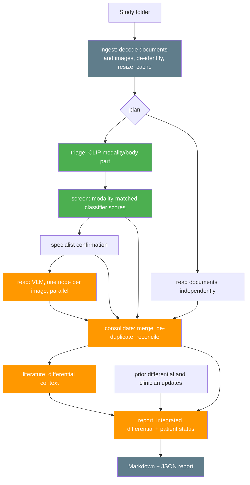

# Architecture

The [AOS implementation audit](AOS_IMPROVEMENTS.md) documents capability DNA,
performance-aware selection, bounded adaptation and longitudinal differential
memory added on `feature/aos-patient-continuity`.
Structured task contracts, bounded runtime DAG patches and direct-image series/
coverage handling are documented in [ADAPTIVE_IMAGING.md](ADAPTIVE_IMAGING.md).

## The shape of the problem

A clinician hands over a folder. Inside is whatever their PACS exported: a
DICOM series, some JPEGs, maybe a referral note. Out of it must come one
document that answers *what is going on with this patient* and *what should I
do next* — with enough provenance that a radiologist can check the reasoning.

That shapes three decisions that run through the whole system:

1. **The pipeline shape is fixed, so it is code, not a prompt.** A radiology
   read always goes triage → screen → read → consolidate → contextualise →
   report. Asking an LLM to re-derive that graph every run costs latency and
   makes the system unauditable. `agents/planner.py` builds it directly.
2. **Two model families, deliberately.** A generative VLM writes fluent prose
   about findings it may not have seen. A supervised classifier returns a
   model score over a fixed label set but cannot describe anything.
   Running both and reconciling them is what makes a disagreement *visible*.
3. **Partial failure must still produce a report.** One unreadable image cannot
   cost the other eleven. Failure is contained per node, and the report says
   exactly what did not run.

## Layers

```
main.py / pipeline.py          entry points, CLI, stage sequencing
├── ingest/                    folder → Study        (no models involved)
│   ├── study_loader.py        walk, decode, dedupe, sidecars, document dispatch
│   ├── document_loader.py     bounded PDF/text/office extraction + page provenance
│   ├── dicom_utils.py         DICOM → PIL: LUT, windowing, PHI stripping
│   └── preprocess.py          resize + re-encode + content-hash cache
├── agents/                    orchestration          (no model calls except planner)
│   ├── planner.py             deterministic DAG construction
│   ├── manager_agent.py       LLM planner for free-form jobs; plan rendering
│   ├── graph_executor.py      dependency-ready parallel execution, failure containment
│   ├── sub_agent.py           runs one node; timeout and error boundary
│   └── integrator_agent.py    executed graph → RadiologyReport
├── capabilities/              the only layer that talks to models
│   ├── registry.py            capability DNA, discovery and request/result contract
│   ├── text_catalog.py        live model profiles for task-aware selection
│   ├── hf_backend.py          local/remote routing, model cache, GPU semaphore
│   └── 13 registered capabilities (including verification)
├── reporting/report_builder.py  report → markdown + JSON
├── core/                      errors, logging, retry, cache, generic routing, evidence evaluation
└── models.py                  every type, pydantic, fully serialisable
```

The dependency rule is one-directional: `capabilities` never imports `agents`.
The executor knows nothing about radiology; the capabilities know nothing about
graphs. Adding a capability means writing one function and decorating it.

## The pipeline



Green runs locally, orange is a hosted model call, grey touches no model.

### Stage by stage

| Stage | Capability | Model class | Why it exists |
|---|---|---|---|
| Quality | `image_quality` | Deterministic pixel/series checks | Detects unusable pixels and records supplied-series coverage before model inference. |
| Triage | `modality_triage` | CLIP, ~600MB local | A VLM prompt that knows it is looking at a chest PA film reads far better than one that does not. Also catches files that are not medical images. |
| Screen | `image_classification` | ViT, ~330MB local | A checkable probability the narrative read can be tested against. |
| Confirm | `specialist_confirmation` | Modality-specific specialists | Re-checks candidates and question-driven conditions with independent models where available. |
| Read | `vision` | Medical VLM, hosted | The actual image interpretation. Image reads run in parallel. |
| Documents | `document_analysis` | Text/VLM backend | Classify and extract findings from PDF/text/office pages with source refs. |
| Consolidate | `cross_image_synthesis` | Text LLM | Images were read in isolation; the study is one patient. Merges duplicates, surfaces disagreements. |
| Verification | `document_verification`, `temporal_comparison`, `evidence_verification` | Rendered-page, temporal and provenance checks | Adds bounded source, chronology and numeric verification when requested by the running graph. |
| Literature | `web_search` | Text LLM + search | Differential and next-investigation context for the findings raised. |
| Report | `report_synthesis` | Text LLM | Impression, triage level, recommended next steps. |
| Utility | `summarization` | Text summarizer | Provides bounded text condensation when a workflow requests it. |

## Dependency-ready scheduling and recovery

`graph_utils.build_waves` validates/renders the DAG. Runtime execution uses one
bounded pool and starts each child when its own parents finish; there is no
global wave barrier. Image quality precedes triage → screen → confirmation → read.
Document branches run independently. Local server image calls serialize under
the GPU-server limit, even when several graph nodes are ready.

Capabilities can emit structured verification requirements. DNA matching selects
a compatible verifier; a detached graph patch is validated before pending
consumers are rewired. Failed checks preserve original evidence. An untried
equivalent implementation can replace exhausted failed work. Completed/running
nodes are immutable; added work is bounded and original/revised plans are retained.

## How data moves between nodes

Each node receives two things from its parents:

* **`text`** — the parents' prose outputs, labelled and concatenated, truncated
  at 30,000 characters so one verbose node cannot blow everything downstream.
* **`artifacts`** — typed structured data. Lists concatenate, dicts merge.

The artifacts channel is what makes the cross-checking work: the classifier's
per-image probabilities reach the VLM prompt as data, and the consolidation
step's `findings` list reaches the report stage as objects rather than as text
to be re-parsed.

```python
@dataclass
class CapabilityRequest:
    instruction: str          # the node description; doubles as the prompt
    text: str                 # concatenated parent outputs
    study: Study | None       # full study context
    image_ids: list[str]      # which images THIS node owns
    artifacts: dict           # merged parent artifacts
```

## Failure containment

```
node fails → status="failed", error recorded, duration recorded
           → descendants_of(node) marked "skipped"
           → independent branches continue
           → report produced, degraded=True, every failure listed
```

A node never raises into the executor. `SubAgent.perform` catches everything
including timeouts and wrong return types, and guarantees a terminal state.

## Severity cannot drift

Overall patient severity is computed from the structured findings list, never
parsed from model prose, and floored at two independent layers:

```python
severity = max_severity([model_claimed_severity, worst_finding_severity])
```

So a model that describes a pneumothorax and then summarises the study as
routine is overridden, and the override is logged.

## Model routing

`hf_backend.prefer_local(model_id, size_hint_gb)` decides per model:

```
MAOS_BACKEND=local  → always local
MAOS_BACKEND=remote → always hosted
auto (default)      → local if size_hint_gb <= 60% of VRAM
```

On the 4GB RTX 2050 this development ran on: CLIP (0.65GB) and the classifier
(0.4GB) run locally; a 4B VLM (~8GB in fp16) routes to hosted inference. The
same code on a 24GB card runs everything locally with no change.

Models load once, lazily, behind a lock, into a process-wide cache. A
`BoundedSemaphore(MAOS_MAX_GPU_WORKERS)` then caps concurrent GPU work — on a
small card that is 1, so eight parallel read nodes queue for the GPU rather
than all OOM-ing together.

## Caching

Content-addressed on SHA-256, in `.cache/`:

| Namespace | Key | Saves |
|---|---|---|
| `prepared` | image content hash + target size | decode + resize |
| `classification` | model + image hash | a GPU pass |
| `triage` | model + image hash | a GPU pass |
| `vision` | model + image hash + full prompt | a hosted VLM call |

The prompt is part of the vision key, so changing the clinical history
correctly invalidates the read rather than returning a stale one.

## Extending it

**A new capability** — one function, one decorator:

```python
@register("segmentation", "Segment and measure a region of interest.")
def run(request: CapabilityRequest) -> CapabilityResult:
    images = request.images()
    return CapabilityResult(text="...", artifacts={"measurements": [...]})
```

It is now schedulable by name and visible to the LLM planner automatically.

**A new model** — set the matching environment variable. No code change:

```bash
MAOS_CXR_CLASSIFIER=your-org/your-finetuned-checkpoint
```

**A new stage in the fixed plan** — add a `Node` in `agents/planner.py` with
its `depends_on`. The executor derives the waves.
