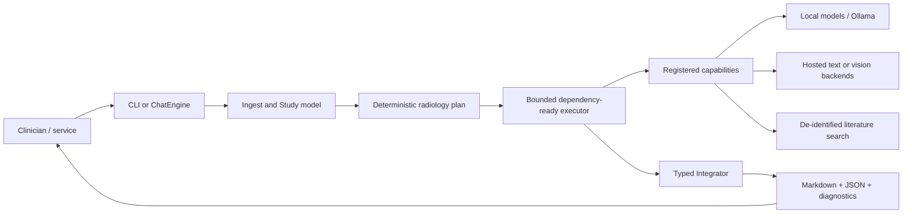
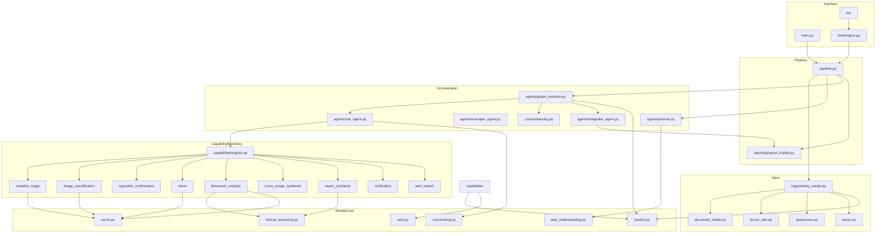
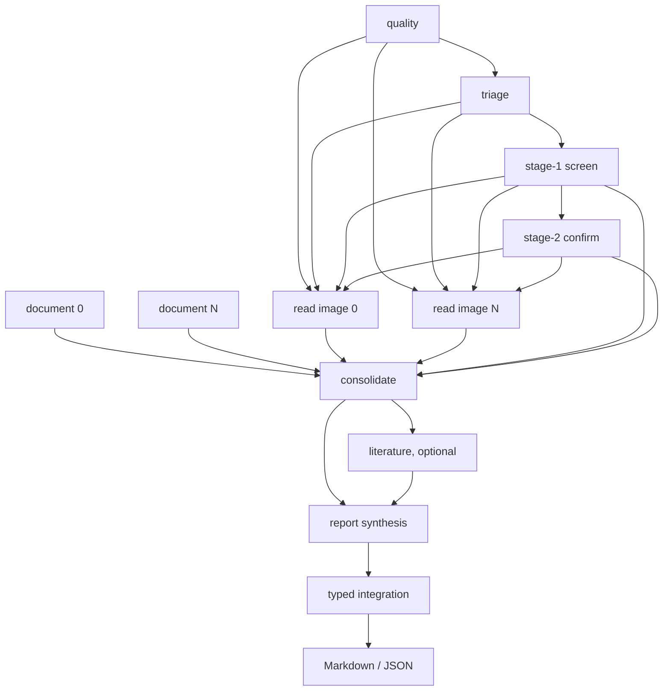
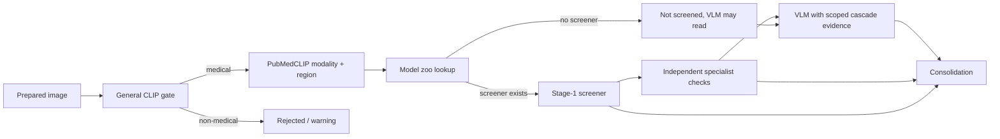

# Integrated Medical AOS architecture

## 1. Architectural summary

Medical AOS is a layered, artifact-carrying task-graph system. The fixed
radiology workflow is implemented as code, while model calls are isolated behind
registered capabilities. This separates four concerns that are often mixed in a
single prompt:

1. **Data plane:** decode, de-identify, preprocess, and retain evidence.
2. **Control plane:** plan, validate, schedule, retry, recover, and budget work.
3. **Inference plane:** route to modality-specific screeners/specialists and
   narrative/document models.
4. **Evidence/provenance plane:** bind outputs to source IDs, validate claims,
   compute status, and expose degradation.

The architecture intentionally treats a final fluent paragraph as only one
artifact among many. A report is assembled from typed findings and trace data.

## 2. System context



The system does not require a database or service bus for a single run. Disk
artifacts, content hashes, Pydantic objects, and report provenance provide the
durable boundary. A service can wrap the same callable stages and use the JSON
report as an integration contract.

## 3. Layered component architecture



`capabilities` is the model boundary. The executor does not contain disease
rules, and capability implementations do not know how the graph is scheduled.
`models.py` is the shared typed vocabulary between these layers.

## 4. Fixed radiology DAG



The image branch is intentionally broad but bounded. One image normally maps to
one VLM node; above `_MAX_VISION_NODES`, images are grouped while preserving
series boundaries where possible. Documents are assigned by document/page group
and can be processed independently.

The graph has two important non-obvious properties:

- the screening cascade is a direct input to consolidation, so a specialist
  candidate not mentioned by a VLM can become a visible discrepancy; and
- `allow_partial=True` is used for appropriate joins, so an unavailable
  screening or unrelated document does not necessarily prevent all usable
  evidence from reaching a report.

## 5. Dataflow architecture

### Text channel

The text channel is a labeled concatenation of successful parent outputs. It is
used for prompts, human-readable plan/report text, and fallback context. It is
bounded at the executor edge to limit context blow-up.

### Artifact channel

The artifact channel is the primary machine-to-machine dataflow:

```text
quality       -> image_quality, series_context
triage        -> triage, non_medical
screen        -> screening, raw classifications, candidates
confirm       -> confirmation, specialist flags
vision        -> reads, read_errors, image quality
documents     -> source reads, types, source-bound findings
consolidate   -> deduplicated/reconciled findings, discrepancies
verification  -> verification records and limited context
report        -> status, impression, assessment
```

Lists are concatenated and dictionaries are merged in dependency order. Private
selection/cost keys are not propagated as clinical evidence. The result is a
typed evidence graph rather than a sequence of unstructured prompts.

## 6. Control-plane scheduling

The executor uses a single bounded worker pool. It maintains pending nodes and
in-flight futures, submits any node whose own dependencies are terminal, and
waits for the first completed future. This provides dependency-ready scheduling
without a global barrier.

Control-plane safeguards include:

- DAG validation before model calls;
- 64-node graph ceiling;
- global worker ceiling;
- local GPU/server semaphore;
- per-capability timeout;
- transient-only exponential retry;
- maximum attempts per node;
- task elapsed/cost/memory budgets;
- compatible alternative selection; and
- persistent reliability/latency aggregates with cooldowns.

The timeout design is cooperative. A Python thread cannot forcibly kill every
native/C/network operation, so a timed-out underlying call may continue until
its own client timeout. The node nevertheless becomes terminal and downstream
work follows the graph's failure policy.

## 7. Bounded runtime adaptation

Capabilities produce structured requests rather than editing the graph directly.
The replanner:

1. validates the request schema and required skills/outputs;
2. applies remaining task budgets;
3. selects a compatible registered capability;
4. constructs a detached candidate graph;
5. validates the candidate graph;
6. inserts the verification/replacement node;
7. rewires only pending consumers; and
8. records the revision and selection trace.

Completed/running nodes are immutable, verification is one level deep, duplicate
requests are suppressed, and budget exhaustion remains visible. This is bounded
recovery policy, not unconstrained autonomous graph invention.

## 8. Inference-plane routing



This routing prevents the original cross-modality failure mode in which a binary
pneumonia model was applied to CT, MRI, ultrasound, and non-medical images. It
also makes coverage gaps explicit rather than filling them with a confident
universal classifier.

## 9. Provenance architecture

Provenance is distributed across three linked objects:

```text
Study               what was supplied and how it was normalized
Graph               what was planned, executed, retried, skipped, or revised
RadiologyReport     what was concluded and which evidence/model/node produced it
```

The report joins:

- source IDs and page/frame references;
- direct-image vs written-report evidence kinds;
- per-image screening and confirmation state;
- image/document read completion;
- series order and partial coverage;
- verification scope and issues;
- model IDs and routes;
- node status/timing/errors; and
- original/revised plan data.

This enables an evaluator to distinguish “the model reported no finding” from
“the image was not read,” “the modality had no screener,” and “the source page
was not extractable.”

## 10. Failure topology

```text
bad file -> skipped_files + warning; other files continue
bad DICOM frame -> good frames retained; series partial warning
triage failure -> conservative header/filename fallback or degraded node
screener failure -> not screened/error; VLM branch may continue
VLM failure -> image read error; report marks missing direct coverage
document page failure -> other pages continue; verification request
consolidation failure -> source observations carried forward and degraded
report failure -> fallback impression/status from structured findings
all stages fail -> indeterminate, degraded report; never normal
```

The report builder is therefore a safety and observability boundary, not just a
formatter.

## 11. Deployment topologies

### Hosted inference

```text
local ingest/cache -> local triage/screen -> hosted VLM/text -> local report
```

This suits small GPUs but sends selected patient-derived data to providers.

### Fully local

```text
local ingest/cache -> local triage/screen -> Ollama/llama.cpp VLM -> local text
```

This reduces outbound exposure but requires local model installation, memory,
and endpoint health checks.

### Hybrid service

The stages can be exposed as separate service boundaries: cache ingest, enqueue a
graph, execute capabilities under a worker policy, persist JSON provenance, and
render through a separate report service. The current code already exposes
stage-level callables for this direction.

## 12. Architectural strengths and open design issues

### Strengths

- fixed clinical graph is auditable;
- capability registry makes model/tool contracts explicit;
- artifact propagation prevents lossy text-only handoff;
- partial failure is local rather than study-global;
- direct image and written report evidence remain separate;
- runtime adaptation is bounded and auditable; and
- report status has structured safety floors.

### Open issues

- the VLM remains generative and can hallucinate;
- semantic entailment is not fully implemented;
- disease identity/ontology and temporality are incomplete;
- 3D series reasoning is not implemented;
- true provider billing/load accounting is incomplete;
- thread-based timeout cannot kill every underlying call; and
- external clinical validation is absent.
