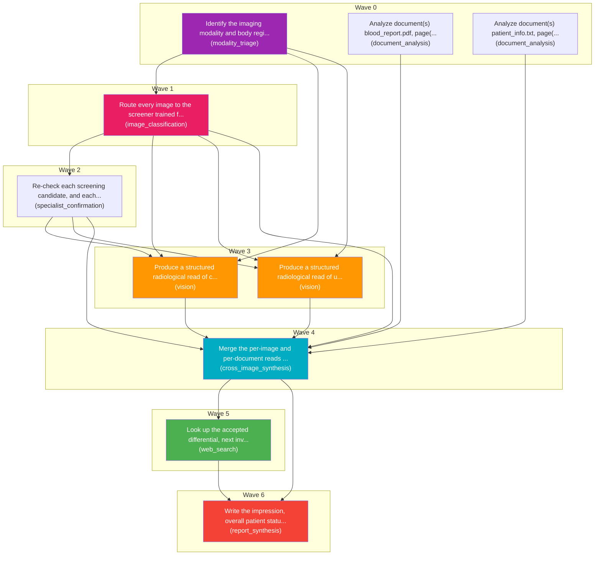

# Task Plan

**Job:** Interpret 2 image(s) and 2 document(s) (CT, Ultrasound) from study patient-002-acute-appendicitis-e43475bf and report patient status. History: abdominal pain Question: check it is ulcer or appendix

**Shape:** 10 nodes across 7 waves

| Node | Description | Capability | Depends on | Status | Time |
|---|---|---|---|---|---|
| `triage` | Identify the imaging modality and body region of every image, and flag any file that is not a medical image. | modality_triage | - | pending | - |
| `screen` | Route every image to the screener trained for its modality and region, and report candidate conditions with probabilities. | image_classification | `triage` | pending | - |
| `confirm` | Re-check each screening candidate, and each condition named in the referring question, with a disease-specific specialist model. | specialist_confirmation | `screen` | pending | - |
| `read0` | Produce a structured radiological read of ct.jpg, describing modality, image quality, observations with severity, and a short impression. | vision | `triage`, `screen`, `confirm` | pending | - |
| `read1` | Produce a structured radiological read of ultrasound.png, describing modality, image quality, observations with severity, and a short impression. | vision | `triage`, `screen`, `confirm` | pending | - |
| `document0` | Analyze document(s) blood_report.pdf, page(s) 1. Classify each document and extract clinically relevant observations and exact reported values, preserving source refs. | document_analysis | - | pending | - |
| `document1` | Analyze document(s) patient_info.txt, page(s) 1. Classify each document and extract clinically relevant observations and exact reported values, preserving source refs. | document_analysis | - | pending | - |
| `consolidate` | Merge the per-image and per-document reads into one coherent, de-duplicated findings list. Preserve exact document source references and reconcile disagreements without inventing facts. | cross_image_synthesis | `read0`, `read1`, `document0`, `document1`, `screen`, `confirm` | pending | - |
| `literature` | Look up the accepted differential, next investigation and red flags for the findings identified in this study. | web_search | `consolidate` | pending | - |
| `report` | Write the impression, overall patient status, triage level and recommended next steps for the referring clinician. | report_synthesis | `consolidate`, `literature` | pending | - |

## Execution waves

- **Wave 0** (3 in parallel): `triage`, `document0`, `document1`
- **Wave 1** (1 in parallel): `screen`
- **Wave 2** (1 in parallel): `confirm`
- **Wave 3** (2 in parallel): `read0`, `read1`
- **Wave 4** (1 in parallel): `consolidate`
- **Wave 5** (1 in parallel): `literature`
- **Wave 6** (1 in parallel): `report`

## Graph

