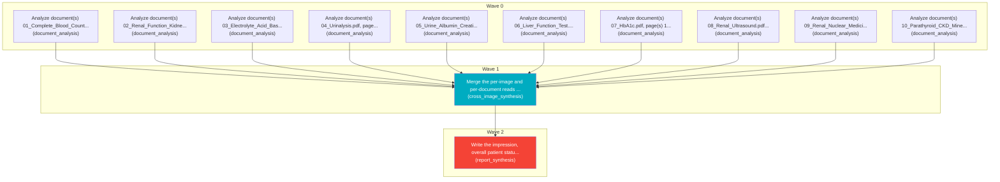

# Task Plan

**Job:** Interpret 0 image(s) and 10 document(s) (unknown modality) from study uploads-3e457a50 and report patient status. History: feeling extremely exhausted, ankles and feet are swollen, trouble catching  breath

**Shape:** 12 nodes across 3 waves

| Node | Description | Capability | Depends on | Status | Time |
|---|---|---|---|---|---|
| `document0` | Analyze document(s) 01_Complete_Blood_Count_CBC (2).pdf, page(s) 1. Classify each document and extract clinically relevant observations and exact reported values, preserving source refs. | document_analysis | - | done | 2.04s |
| `document1` | Analyze document(s) 02_Renal_Function_Kidney_Panel.pdf, page(s) 1. Classify each document and extract clinically relevant observations and exact reported values, preserving source refs. | document_analysis | - | done | 2.13s |
| `document2` | Analyze document(s) 03_Electrolyte_Acid_Base_Report.pdf, page(s) 1. Classify each document and extract clinically relevant observations and exact reported values, preserving source refs. | document_analysis | - | done | 2.20s |
| `document3` | Analyze document(s) 04_Urinalysis.pdf, page(s) 1. Classify each document and extract clinically relevant observations and exact reported values, preserving source refs. | document_analysis | - | done | 3.26s |
| `document4` | Analyze document(s) 05_Urine_Albumin_Creatinine_Ratio.pdf, page(s) 1. Classify each document and extract clinically relevant observations and exact reported values, preserving source refs. | document_analysis | - | done | 5.72s |
| `document5` | Analyze document(s) 06_Liver_Function_Test.pdf, page(s) 1. Classify each document and extract clinically relevant observations and exact reported values, preserving source refs. | document_analysis | - | done | 5.77s |
| `document6` | Analyze document(s) 07_HbA1c.pdf, page(s) 1. Classify each document and extract clinically relevant observations and exact reported values, preserving source refs. | document_analysis | - | done | 3.53s |
| `document7` | Analyze document(s) 08_Renal_Ultrasound.pdf, page(s) 1. Classify each document and extract clinically relevant observations and exact reported values, preserving source refs. | document_analysis | - | done | 2.82s |
| `document8` | Analyze document(s) 09_Renal_Nuclear_Medicine_Scan.pdf, page(s) 1. Classify each document and extract clinically relevant observations and exact reported values, preserving source refs. | document_analysis | - | done | 5.21s |
| `document9` | Analyze document(s) 10_Parathyroid_CKD_Mineral_Profile.pdf, page(s) 1. Classify each document and extract clinically relevant observations and exact reported values, preserving source refs. | document_analysis | - | done | 5.78s |
| `consolidate` | Merge the per-image and per-document reads into one coherent, de-duplicated findings list. Preserve exact document source references and reconcile disagreements without inventing facts. | cross_image_synthesis | `document0`, `document1`, `document2`, `document3`, `document4`, `document5`, `document6`, `document7`, `document8`, `document9` | done | - |
| `report` | Write the impression, overall patient status, triage level and recommended next steps for the referring clinician. | report_synthesis | `consolidate` | done | 6.50s |

## Execution waves

- **Wave 0** (10 in parallel): `document0`, `document1`, `document2`, `document3`, `document4`, `document5`, `document6`, `document7`, `document8`, `document9`
- **Wave 1** (1 in parallel): `consolidate`
- **Wave 2** (1 in parallel): `report`

## Graph



## Selection and adaptation trace

```json
{
  "document0": {
    "requirements": {
      "skills": [
        "extract_documents"
      ],
      "inputs": [
        "documents"
      ],
      "outputs": [
        "document_reads",
        "findings"
      ],
      "tools": [],
      "context_tokens": 0,
      "max_memory_gb": null,
      "max_cost": null,
      "max_latency_s": null
    },
    "candidates": [
      {
        "candidate": "cross_image_synthesis",
        "eligible": false,
        "reasons": [
          "missing skills: ['extract_documents']",
          "missing inputs: ['documents']",
          "missing outputs: ['document_reads']"
        ],
        "score": 4.1651,
        "history": {
          "attempts": 3,
          "successes": 3,
          "latency_s": 0.0016,
          "last_success": true,
          "cooldown_until": 0
        }
      },
      {
        "candidate": "vision",
        "eligible": false,
        "reasons": [
          "missing skills: ['extract_documents']",
          "missing inputs: ['documents']",
          "missing outputs: ['document_reads', 'findings']"
        ],
        "score": 2.6402,
        "history": {}
      },
      {
        "candidate": "document_analysis",
        "eligible": true,
        "reasons": [],
        "score": 5.1002,
        "history": {
          "attempts": 31,
          "successes": 31,
          "latency_s": 4.7706,
          "last_success": true,
          "cooldown_until": 0
        }
      },
      {
        "candidate": "image_classification",
        "eligible": false,
        "reasons": [
          "missing skills: ['extract_documents']",
          "missing inputs: ['documents']",
          "missing outputs: ['document_reads', 'findings']"
        ],
        "score": 2.6402,
        "history": {}
      },
      {
        "candidate": "image_quality",
        "eligible": false,
        "reasons": [
          "missing skills: ['extract_documents']",
          "missing inputs: ['documents']",
          "missing outputs: ['document_reads', 'findings']"
        ],
        "score": 3.238,
        "history": {}
      },
      {
        "candidate": "modality_triage",
        "eligible": false,
        "reasons": [
          "missing skills: ['extract_documents']",
          "missing inputs: ['documents']",
          "missing outputs: ['document_reads', 'findings']"
        ],
        "score": 2.6402,
        "history": {}
      },
      {
        "candidate": "report_synthesis",
        "eligible": false,
        "reasons": [
          "missing skills: ['extract_documents']",
          "missing inputs: ['documents']",
          "missing outputs: ['document_reads', 'findings']"
        ],
        "score": 2.206,
        "history": {
          "attempts": 3,
          "successes": 3,
          "latency_s": 6.1041,
          "last_success": true,
          "cooldown_until": 0
        }
      },
      {
        "candidate": "specialist_confirmation",
        "eligible": false,
        "reasons": [
          "missing skills: ['extract_documents']",
          "missing inputs: ['documents']",
          "missing outputs: ['document_reads', 'findings']"
        ],
        "score": 2.6402,
        "history": {}
      },
      {
        "candidate": "summarization",
        "eligible": false,
        "reasons": [
          "missing skills: ['extract_documents']",
          "missing inputs: ['documents']",
          "missing outputs: ['document_reads', 'findings']"
        ],
        "score": 2.6402,
        "history": {}
      },
      {
        "candidate": "document_verification",
        "eligible": false,
        "reasons": [
          "missing skills: ['extract_documents']",
          "missing outputs: ['document_reads', 'findings']"
        ],
        "score": 2.3218,
        "history": {
          "attempts": 2,
          "successes": 2,
          "latency_s": 4.356,
          "last_success": true,
          "cooldown_until": 0
        }
      },
      {
        "candidate": "temporal_comparison",
        "eligible": false,
        "reasons": [
          "missing skills: ['extract_documents']",
          "missing inputs: ['documents']",
          "missing outputs: ['document_reads', 'findings']"
        ],
        "score": 3.7485,
        "history": {
          "attempts": 1,
          "successes": 1,
          "latency_s": 0.0015,
          "last_success": true,
          "cooldown_until": 0
        }
      },
      {
        "candidate": "evidence_verification",
        "eligible": false,
        "reasons": [
          "missing skills: ['extract_documents']",
          "missing inputs: ['documents']",
          "missing outputs: ['document_reads', 'findings']"
        ],
        "score": 3.238,
        "history": {}
      },
      {
        "candidate": "web_search",
        "eligible": false,
        "reasons": [
          "missing skills: ['extract_documents']",
          "missing inputs: ['documents']",
          "missing outputs: ['document_reads', 'findings']"
        ],
        "score": 2.6402,
        "history": {}
      }
    ],
    "attempts": [
      {
        "capability": "document_analysis",
        "status": "accepted"
      }
    ]
  },
  "document1": {
    "requirements": {
      "skills": [
        "extract_documents"
      ],
      "inputs": [
        "documents"
      ],
      "outputs": [
        "document_reads",
        "findings"
      ],
      "tools": [],
      "context_tokens": 0,
      "max_memory_gb": null,
      "max_cost": null,
      "max_latency_s": null
    },
    "candidates": [
      {
        "candidate": "cross_image_synthesis",
        "eligible": false,
        "reasons": [
          "missing skills: ['extract_documents']",
          "missing inputs: ['documents']",
          "missing outputs: ['document_reads']"
        ],
        "score": 4.1651,
        "history": {
          "attempts": 3,
          "successes": 3,
          "latency_s": 0.0016,
          "last_success": true,
          "cooldown_until": 0
        }
      },
      {
        "candidate": "vision",
        "eligible": false,
        "reasons": [
          "missing skills: ['extract_documents']",
          "missing inputs: ['documents']",
          "missing outputs: ['document_reads', 'findings']"
        ],
        "score": 2.6402,
        "history": {}
      },
      {
        "candidate": "document_analysis",
        "eligible": true,
        "reasons": [],
        "score": 5.1002,
        "history": {
          "attempts": 31,
          "successes": 31,
          "latency_s": 4.7706,
          "last_success": true,
          "cooldown_until": 0
        }
      },
      {
        "candidate": "image_classification",
        "eligible": false,
        "reasons": [
          "missing skills: ['extract_documents']",
          "missing inputs: ['documents']",
          "missing outputs: ['document_reads', 'findings']"
        ],
        "score": 2.6402,
        "history": {}
      },
      {
        "candidate": "image_quality",
        "eligible": false,
        "reasons": [
          "missing skills: ['extract_documents']",
          "missing inputs: ['documents']",
          "missing outputs: ['document_reads', 'findings']"
        ],
        "score": 3.238,
        "history": {}
      },
      {
        "candidate": "modality_triage",
        "eligible": false,
        "reasons": [
          "missing skills: ['extract_documents']",
          "missing inputs: ['documents']",
          "missing outputs: ['document_reads', 'findings']"
        ],
        "score": 2.6402,
        "history": {}
      },
      {
        "candidate": "report_synthesis",
        "eligible": false,
        "reasons": [
          "missing skills: ['extract_documents']",
          "missing inputs: ['documents']",
          "missing outputs: ['document_reads', 'findings']"
        ],
        "score": 2.206,
        "history": {
          "attempts": 3,
          "successes": 3,
          "latency_s": 6.1041,
          "last_success": true,
          "cooldown_until": 0
        }
      },
      {
        "candidate": "specialist_confirmation",
        "eligible": false,
        "reasons": [
          "missing skills: ['extract_documents']",
          "missing inputs: ['documents']",
          "missing outputs: ['document_reads', 'findings']"
        ],
        "score": 2.6402,
        "history": {}
      },
      {
        "candidate": "summarization",
        "eligible": false,
        "reasons": [
          "missing skills: ['extract_documents']",
          "missing inputs: ['documents']",
          "missing outputs: ['document_reads', 'findings']"
        ],
        "score": 2.6402,
        "history": {}
      },
      {
        "candidate": "document_verification",
        "eligible": false,
        "reasons": [
          "missing skills: ['extract_documents']",
          "missing outputs: ['document_reads', 'findings']"
        ],
        "score": 2.3218,
        "history": {
          "attempts": 2,
          "successes": 2,
          "latency_s": 4.356,
          "last_success": true,
          "cooldown_until": 0
        }
      },
      {
        "candidate": "temporal_comparison",
        "eligible": false,
        "reasons": [
          "missing skills: ['extract_documents']",
          "missing inputs: ['documents']",
          "missing outputs: ['document_reads', 'findings']"
        ],
        "score": 3.7485,
        "history": {
          "attempts": 1,
          "successes": 1,
          "latency_s": 0.0015,
          "last_success": true,
          "cooldown_until": 0
        }
      },
      {
        "candidate": "evidence_verification",
        "eligible": false,
        "reasons": [
          "missing skills: ['extract_documents']",
          "missing inputs: ['documents']",
          "missing outputs: ['document_reads', 'findings']"
        ],
        "score": 3.238,
        "history": {}
      },
      {
        "candidate": "web_search",
        "eligible": false,
        "reasons": [
          "missing skills: ['extract_documents']",
          "missing inputs: ['documents']",
          "missing outputs: ['document_reads', 'findings']"
        ],
        "score": 2.6402,
        "history": {}
      }
    ],
    "attempts": [
      {
        "capability": "document_analysis",
        "status": "accepted"
      }
    ]
  },
  "document2": {
    "requirements": {
      "skills": [
        "extract_documents"
      ],
      "inputs": [
        "documents"
      ],
      "outputs": [
        "document_reads",
        "findings"
      ],
      "tools": [],
      "context_tokens": 0,
      "max_memory_gb": null,
      "max_cost": null,
      "max_latency_s": null
    },
    "candidates": [
      {
        "candidate": "cross_image_synthesis",
        "eligible": false,
        "reasons": [
          "missing skills: ['extract_documents']",
          "missing inputs: ['documents']",
          "missing outputs: ['document_reads']"
        ],
        "score": 4.1651,
        "history": {
          "attempts": 3,
          "successes": 3,
          "latency_s": 0.0016,
          "last_success": true,
          "cooldown_until": 0
        }
      },
      {
        "candidate": "vision",
        "eligible": false,
        "reasons": [
          "missing skills: ['extract_documents']",
          "missing inputs: ['documents']",
          "missing outputs: ['document_reads', 'findings']"
        ],
        "score": 2.6402,
        "history": {}
      },
      {
        "candidate": "document_analysis",
        "eligible": true,
        "reasons": [],
        "score": 5.1002,
        "history": {
          "attempts": 31,
          "successes": 31,
          "latency_s": 4.7706,
          "last_success": true,
          "cooldown_until": 0
        }
      },
      {
        "candidate": "image_classification",
        "eligible": false,
        "reasons": [
          "missing skills: ['extract_documents']",
          "missing inputs: ['documents']",
          "missing outputs: ['document_reads', 'findings']"
        ],
        "score": 2.6402,
        "history": {}
      },
      {
        "candidate": "image_quality",
        "eligible": false,
        "reasons": [
          "missing skills: ['extract_documents']",
          "missing inputs: ['documents']",
          "missing outputs: ['document_reads', 'findings']"
        ],
        "score": 3.238,
        "history": {}
      },
      {
        "candidate": "modality_triage",
        "eligible": false,
        "reasons": [
          "missing skills: ['extract_documents']",
          "missing inputs: ['documents']",
          "missing outputs: ['document_reads', 'findings']"
        ],
        "score": 2.6402,
        "history": {}
      },
      {
        "candidate": "report_synthesis",
        "eligible": false,
        "reasons": [
          "missing skills: ['extract_documents']",
          "missing inputs: ['documents']",
          "missing outputs: ['document_reads', 'findings']"
        ],
        "score": 2.206,
        "history": {
          "attempts": 3,
          "successes": 3,
          "latency_s": 6.1041,
          "last_success": true,
          "cooldown_until": 0
        }
      },
      {
        "candidate": "specialist_confirmation",
        "eligible": false,
        "reasons": [
          "missing skills: ['extract_documents']",
          "missing inputs: ['documents']",
          "missing outputs: ['document_reads', 'findings']"
        ],
        "score": 2.6402,
        "history": {}
      },
      {
        "candidate": "summarization",
        "eligible": false,
        "reasons": [
          "missing skills: ['extract_documents']",
          "missing inputs: ['documents']",
          "missing outputs: ['document_reads', 'findings']"
        ],
        "score": 2.6402,
        "history": {}
      },
      {
        "candidate": "document_verification",
        "eligible": false,
        "reasons": [
          "missing skills: ['extract_documents']",
          "missing outputs: ['document_reads', 'findings']"
        ],
        "score": 2.3218,
        "history": {
          "attempts": 2,
          "successes": 2,
          "latency_s": 4.356,
          "last_success": true,
          "cooldown_until": 0
        }
      },
      {
        "candidate": "temporal_comparison",
        "eligible": false,
        "reasons": [
          "missing skills: ['extract_documents']",
          "missing inputs: ['documents']",
          "missing outputs: ['document_reads', 'findings']"
        ],
        "score": 3.7485,
        "history": {
          "attempts": 1,
          "successes": 1,
          "latency_s": 0.0015,
          "last_success": true,
          "cooldown_until": 0
        }
      },
      {
        "candidate": "evidence_verification",
        "eligible": false,
        "reasons": [
          "missing skills: ['extract_documents']",
          "missing inputs: ['documents']",
          "missing outputs: ['document_reads', 'findings']"
        ],
        "score": 3.238,
        "history": {}
      },
      {
        "candidate": "web_search",
        "eligible": false,
        "reasons": [
          "missing skills: ['extract_documents']",
          "missing inputs: ['documents']",
          "missing outputs: ['document_reads', 'findings']"
        ],
        "score": 2.6402,
        "history": {}
      }
    ],
    "attempts": [
      {
        "capability": "document_analysis",
        "status": "accepted"
      }
    ]
  },
  "document3": {
    "requirements": {
      "skills": [
        "extract_documents"
      ],
      "inputs": [
        "documents"
      ],
      "outputs": [
        "document_reads",
        "findings"
      ],
      "tools": [],
      "context_tokens": 0,
      "max_memory_gb": null,
      "max_cost": null,
      "max_latency_s": null
    },
    "candidates": [
      {
        "candidate": "cross_image_synthesis",
        "eligible": false,
        "reasons": [
          "missing skills: ['extract_documents']",
          "missing inputs: ['documents']",
          "missing outputs: ['document_reads']"
        ],
        "score": 4.1651,
        "history": {
          "attempts": 3,
          "successes": 3,
          "latency_s": 0.0016,
          "last_success": true,
          "cooldown_until": 0
        }
      },
      {
        "candidate": "vision",
        "eligible": false,
        "reasons": [
          "missing skills: ['extract_documents']",
          "missing inputs: ['documents']",
          "missing outputs: ['document_reads', 'findings']"
        ],
        "score": 2.6402,
        "history": {}
      },
      {
        "candidate": "document_analysis",
        "eligible": true,
        "reasons": [],
        "score": 5.1002,
        "history": {
          "attempts": 31,
          "successes": 31,
          "latency_s": 4.7706,
          "last_success": true,
          "cooldown_until": 0
        }
      },
      {
        "candidate": "image_classification",
        "eligible": false,
        "reasons": [
          "missing skills: ['extract_documents']",
          "missing inputs: ['documents']",
          "missing outputs: ['document_reads', 'findings']"
        ],
        "score": 2.6402,
        "history": {}
      },
      {
        "candidate": "image_quality",
        "eligible": false,
        "reasons": [
          "missing skills: ['extract_documents']",
          "missing inputs: ['documents']",
          "missing outputs: ['document_reads', 'findings']"
        ],
        "score": 3.238,
        "history": {}
      },
      {
        "candidate": "modality_triage",
        "eligible": false,
        "reasons": [
          "missing skills: ['extract_documents']",
          "missing inputs: ['documents']",
          "missing outputs: ['document_reads', 'findings']"
        ],
        "score": 2.6402,
        "history": {}
      },
      {
        "candidate": "report_synthesis",
        "eligible": false,
        "reasons": [
          "missing skills: ['extract_documents']",
          "missing inputs: ['documents']",
          "missing outputs: ['document_reads', 'findings']"
        ],
        "score": 2.206,
        "history": {
          "attempts": 3,
          "successes": 3,
          "latency_s": 6.1041,
          "last_success": true,
          "cooldown_until": 0
        }
      },
      {
        "candidate": "specialist_confirmation",
        "eligible": false,
        "reasons": [
          "missing skills: ['extract_documents']",
          "missing inputs: ['documents']",
          "missing outputs: ['document_reads', 'findings']"
        ],
        "score": 2.6402,
        "history": {}
      },
      {
        "candidate": "summarization",
        "eligible": false,
        "reasons": [
          "missing skills: ['extract_documents']",
          "missing inputs: ['documents']",
          "missing outputs: ['document_reads', 'findings']"
        ],
        "score": 2.6402,
        "history": {}
      },
      {
        "candidate": "document_verification",
        "eligible": false,
        "reasons": [
          "missing skills: ['extract_documents']",
          "missing outputs: ['document_reads', 'findings']"
        ],
        "score": 2.3218,
        "history": {
          "attempts": 2,
          "successes": 2,
          "latency_s": 4.356,
          "last_success": true,
          "cooldown_until": 0
        }
      },
      {
        "candidate": "temporal_comparison",
        "eligible": false,
        "reasons": [
          "missing skills: ['extract_documents']",
          "missing inputs: ['documents']",
          "missing outputs: ['document_reads', 'findings']"
        ],
        "score": 3.7485,
        "history": {
          "attempts": 1,
          "successes": 1,
          "latency_s": 0.0015,
          "last_success": true,
          "cooldown_until": 0
        }
      },
      {
        "candidate": "evidence_verification",
        "eligible": false,
        "reasons": [
          "missing skills: ['extract_documents']",
          "missing inputs: ['documents']",
          "missing outputs: ['document_reads', 'findings']"
        ],
        "score": 3.238,
        "history": {}
      },
      {
        "candidate": "web_search",
        "eligible": false,
        "reasons": [
          "missing skills: ['extract_documents']",
          "missing inputs: ['documents']",
          "missing outputs: ['document_reads', 'findings']"
        ],
        "score": 2.6402,
        "history": {}
      }
    ],
    "attempts": [
      {
        "capability": "document_analysis",
        "status": "accepted"
      }
    ]
  },
  "document4": {
    "requirements": {
      "skills": [
        "extract_documents"
      ],
      "inputs": [
        "documents"
      ],
      "outputs": [
        "document_reads",
        "findings"
      ],
      "tools": [],
      "context_tokens": 0,
      "max_memory_gb": null,
      "max_cost": null,
      "max_latency_s": null
    },
    "candidates": [
      {
        "candidate": "cross_image_synthesis",
        "eligible": false,
        "reasons": [
          "missing skills: ['extract_documents']",
          "missing inputs: ['documents']",
          "missing outputs: ['document_reads']"
        ],
        "score": 4.1651,
        "history": {
          "attempts": 3,
          "successes": 3,
          "latency_s": 0.0016,
          "last_success": true,
          "cooldown_until": 0
        }
      },
      {
        "candidate": "vision",
        "eligible": false,
        "reasons": [
          "missing skills: ['extract_documents']",
          "missing inputs: ['documents']",
          "missing outputs: ['document_reads', 'findings']"
        ],
        "score": 2.6402,
        "history": {}
      },
      {
        "candidate": "document_analysis",
        "eligible": true,
        "reasons": [],
        "score": 5.1002,
        "history": {
          "attempts": 31,
          "successes": 31,
          "latency_s": 4.7706,
          "last_success": true,
          "cooldown_until": 0
        }
      },
      {
        "candidate": "image_classification",
        "eligible": false,
        "reasons": [
          "missing skills: ['extract_documents']",
          "missing inputs: ['documents']",
          "missing outputs: ['document_reads', 'findings']"
        ],
        "score": 2.6402,
        "history": {}
      },
      {
        "candidate": "image_quality",
        "eligible": false,
        "reasons": [
          "missing skills: ['extract_documents']",
          "missing inputs: ['documents']",
          "missing outputs: ['document_reads', 'findings']"
        ],
        "score": 3.238,
        "history": {}
      },
      {
        "candidate": "modality_triage",
        "eligible": false,
        "reasons": [
          "missing skills: ['extract_documents']",
          "missing inputs: ['documents']",
          "missing outputs: ['document_reads', 'findings']"
        ],
        "score": 2.6402,
        "history": {}
      },
      {
        "candidate": "report_synthesis",
        "eligible": false,
        "reasons": [
          "missing skills: ['extract_documents']",
          "missing inputs: ['documents']",
          "missing outputs: ['document_reads', 'findings']"
        ],
        "score": 2.206,
        "history": {
          "attempts": 3,
          "successes": 3,
          "latency_s": 6.1041,
          "last_success": true,
          "cooldown_until": 0
        }
      },
      {
        "candidate": "specialist_confirmation",
        "eligible": false,
        "reasons": [
          "missing skills: ['extract_documents']",
          "missing inputs: ['documents']",
          "missing outputs: ['document_reads', 'findings']"
        ],
        "score": 2.6402,
        "history": {}
      },
      {
        "candidate": "summarization",
        "eligible": false,
        "reasons": [
          "missing skills: ['extract_documents']",
          "missing inputs: ['documents']",
          "missing outputs: ['document_reads', 'findings']"
        ],
        "score": 2.6402,
        "history": {}
      },
      {
        "candidate": "document_verification",
        "eligible": false,
        "reasons": [
          "missing skills: ['extract_documents']",
          "missing outputs: ['document_reads', 'findings']"
        ],
        "score": 2.3218,
        "history": {
          "attempts": 2,
          "successes": 2,
          "latency_s": 4.356,
          "last_success": true,
          "cooldown_until": 0
        }
      },
      {
        "candidate": "temporal_comparison",
        "eligible": false,
        "reasons": [
          "missing skills: ['extract_documents']",
          "missing inputs: ['documents']",
          "missing outputs: ['document_reads', 'findings']"
        ],
        "score": 3.7485,
        "history": {
          "attempts": 1,
          "successes": 1,
          "latency_s": 0.0015,
          "last_success": true,
          "cooldown_until": 0
        }
      },
      {
        "candidate": "evidence_verification",
        "eligible": false,
        "reasons": [
          "missing skills: ['extract_documents']",
          "missing inputs: ['documents']",
          "missing outputs: ['document_reads', 'findings']"
        ],
        "score": 3.238,
        "history": {}
      },
      {
        "candidate": "web_search",
        "eligible": false,
        "reasons": [
          "missing skills: ['extract_documents']",
          "missing inputs: ['documents']",
          "missing outputs: ['document_reads', 'findings']"
        ],
        "score": 2.6402,
        "history": {}
      }
    ],
    "attempts": [
      {
        "capability": "document_analysis",
        "status": "accepted"
      }
    ]
  },
  "document5": {
    "requirements": {
      "skills": [
        "extract_documents"
      ],
      "inputs": [
        "documents"
      ],
      "outputs": [
        "document_reads",
        "findings"
      ],
      "tools": [],
      "context_tokens": 0,
      "max_memory_gb": null,
      "max_cost": null,
      "max_latency_s": null
    },
    "candidates": [
      {
        "candidate": "cross_image_synthesis",
        "eligible": false,
        "reasons": [
          "missing skills: ['extract_documents']",
          "missing inputs: ['documents']",
          "missing outputs: ['document_reads']"
        ],
        "score": 4.1651,
        "history": {
          "attempts": 3,
          "successes": 3,
          "latency_s": 0.0016,
          "last_success": true,
          "cooldown_until": 0
        }
      },
      {
        "candidate": "vision",
        "eligible": false,
        "reasons": [
          "missing skills: ['extract_documents']",
          "missing inputs: ['documents']",
          "missing outputs: ['document_reads', 'findings']"
        ],
        "score": 2.6402,
        "history": {}
      },
      {
        "candidate": "document_analysis",
        "eligible": true,
        "reasons": [],
        "score": 5.1002,
        "history": {
          "attempts": 31,
          "successes": 31,
          "latency_s": 4.7706,
          "last_success": true,
          "cooldown_until": 0
        }
      },
      {
        "candidate": "image_classification",
        "eligible": false,
        "reasons": [
          "missing skills: ['extract_documents']",
          "missing inputs: ['documents']",
          "missing outputs: ['document_reads', 'findings']"
        ],
        "score": 2.6402,
        "history": {}
      },
      {
        "candidate": "image_quality",
        "eligible": false,
        "reasons": [
          "missing skills: ['extract_documents']",
          "missing inputs: ['documents']",
          "missing outputs: ['document_reads', 'findings']"
        ],
        "score": 3.238,
        "history": {}
      },
      {
        "candidate": "modality_triage",
        "eligible": false,
        "reasons": [
          "missing skills: ['extract_documents']",
          "missing inputs: ['documents']",
          "missing outputs: ['document_reads', 'findings']"
        ],
        "score": 2.6402,
        "history": {}
      },
      {
        "candidate": "report_synthesis",
        "eligible": false,
        "reasons": [
          "missing skills: ['extract_documents']",
          "missing inputs: ['documents']",
          "missing outputs: ['document_reads', 'findings']"
        ],
        "score": 2.206,
        "history": {
          "attempts": 3,
          "successes": 3,
          "latency_s": 6.1041,
          "last_success": true,
          "cooldown_until": 0
        }
      },
      {
        "candidate": "specialist_confirmation",
        "eligible": false,
        "reasons": [
          "missing skills: ['extract_documents']",
          "missing inputs: ['documents']",
          "missing outputs: ['document_reads', 'findings']"
        ],
        "score": 2.6402,
        "history": {}
      },
      {
        "candidate": "summarization",
        "eligible": false,
        "reasons": [
          "missing skills: ['extract_documents']",
          "missing inputs: ['documents']",
          "missing outputs: ['document_reads', 'findings']"
        ],
        "score": 2.6402,
        "history": {}
      },
      {
        "candidate": "document_verification",
        "eligible": false,
        "reasons": [
          "missing skills: ['extract_documents']",
          "missing outputs: ['document_reads', 'findings']"
        ],
        "score": 2.3218,
        "history": {
          "attempts": 2,
          "successes": 2,
          "latency_s": 4.356,
          "last_success": true,
          "cooldown_until": 0
        }
      },
      {
        "candidate": "temporal_comparison",
        "eligible": false,
        "reasons": [
          "missing skills: ['extract_documents']",
          "missing inputs: ['documents']",
          "missing outputs: ['document_reads', 'findings']"
        ],
        "score": 3.7485,
        "history": {
          "attempts": 1,
          "successes": 1,
          "latency_s": 0.0015,
          "last_success": true,
          "cooldown_until": 0
        }
      },
      {
        "candidate": "evidence_verification",
        "eligible": false,
        "reasons": [
          "missing skills: ['extract_documents']",
          "missing inputs: ['documents']",
          "missing outputs: ['document_reads', 'findings']"
        ],
        "score": 3.238,
        "history": {}
      },
      {
        "candidate": "web_search",
        "eligible": false,
        "reasons": [
          "missing skills: ['extract_documents']",
          "missing inputs: ['documents']",
          "missing outputs: ['document_reads', 'findings']"
        ],
        "score": 2.6402,
        "history": {}
      }
    ],
    "attempts": [
      {
        "capability": "document_analysis",
        "status": "accepted"
      }
    ]
  },
  "document6": {
    "requirements": {
      "skills": [
        "extract_documents"
      ],
      "inputs": [
        "documents"
      ],
      "outputs": [
        "document_reads",
        "findings"
      ],
      "tools": [],
      "context_tokens": 0,
      "max_memory_gb": null,
      "max_cost": null,
      "max_latency_s": null
    },
    "candidates": [
      {
        "candidate": "cross_image_synthesis",
        "eligible": false,
        "reasons": [
          "missing skills: ['extract_documents']",
          "missing inputs: ['documents']",
          "missing outputs: ['document_reads']"
        ],
        "score": 4.1651,
        "history": {
          "attempts": 3,
          "successes": 3,
          "latency_s": 0.0016,
          "last_success": true,
          "cooldown_until": 0
        }
      },
      {
        "candidate": "vision",
        "eligible": false,
        "reasons": [
          "missing skills: ['extract_documents']",
          "missing inputs: ['documents']",
          "missing outputs: ['document_reads', 'findings']"
        ],
        "score": 2.6402,
        "history": {}
      },
      {
        "candidate": "document_analysis",
        "eligible": true,
        "reasons": [],
        "score": 5.1002,
        "history": {
          "attempts": 31,
          "successes": 31,
          "latency_s": 4.7706,
          "last_success": true,
          "cooldown_until": 0
        }
      },
      {
        "candidate": "image_classification",
        "eligible": false,
        "reasons": [
          "missing skills: ['extract_documents']",
          "missing inputs: ['documents']",
          "missing outputs: ['document_reads', 'findings']"
        ],
        "score": 2.6402,
        "history": {}
      },
      {
        "candidate": "image_quality",
        "eligible": false,
        "reasons": [
          "missing skills: ['extract_documents']",
          "missing inputs: ['documents']",
          "missing outputs: ['document_reads', 'findings']"
        ],
        "score": 3.238,
        "history": {}
      },
      {
        "candidate": "modality_triage",
        "eligible": false,
        "reasons": [
          "missing skills: ['extract_documents']",
          "missing inputs: ['documents']",
          "missing outputs: ['document_reads', 'findings']"
        ],
        "score": 2.6402,
        "history": {}
      },
      {
        "candidate": "report_synthesis",
        "eligible": false,
        "reasons": [
          "missing skills: ['extract_documents']",
          "missing inputs: ['documents']",
          "missing outputs: ['document_reads', 'findings']"
        ],
        "score": 2.206,
        "history": {
          "attempts": 3,
          "successes": 3,
          "latency_s": 6.1041,
          "last_success": true,
          "cooldown_until": 0
        }
      },
      {
        "candidate": "specialist_confirmation",
        "eligible": false,
        "reasons": [
          "missing skills: ['extract_documents']",
          "missing inputs: ['documents']",
          "missing outputs: ['document_reads', 'findings']"
        ],
        "score": 2.6402,
        "history": {}
      },
      {
        "candidate": "summarization",
        "eligible": false,
        "reasons": [
          "missing skills: ['extract_documents']",
          "missing inputs: ['documents']",
          "missing outputs: ['document_reads', 'findings']"
        ],
        "score": 2.6402,
        "history": {}
      },
      {
        "candidate": "document_verification",
        "eligible": false,
        "reasons": [
          "missing skills: ['extract_documents']",
          "missing outputs: ['document_reads', 'findings']"
        ],
        "score": 2.3218,
        "history": {
          "attempts": 2,
          "successes": 2,
          "latency_s": 4.356,
          "last_success": true,
          "cooldown_until": 0
        }
      },
      {
        "candidate": "temporal_comparison",
        "eligible": false,
        "reasons": [
          "missing skills: ['extract_documents']",
          "missing inputs: ['documents']",
          "missing outputs: ['document_reads', 'findings']"
        ],
        "score": 3.7485,
        "history": {
          "attempts": 1,
          "successes": 1,
          "latency_s": 0.0015,
          "last_success": true,
          "cooldown_until": 0
        }
      },
      {
        "candidate": "evidence_verification",
        "eligible": false,
        "reasons": [
          "missing skills: ['extract_documents']",
          "missing inputs: ['documents']",
          "missing outputs: ['document_reads', 'findings']"
        ],
        "score": 3.238,
        "history": {}
      },
      {
        "candidate": "web_search",
        "eligible": false,
        "reasons": [
          "missing skills: ['extract_documents']",
          "missing inputs: ['documents']",
          "missing outputs: ['document_reads', 'findings']"
        ],
        "score": 2.6402,
        "history": {}
      }
    ],
    "attempts": [
      {
        "capability": "document_analysis",
        "status": "accepted"
      }
    ]
  },
  "document7": {
    "requirements": {
      "skills": [
        "extract_documents"
      ],
      "inputs": [
        "documents"
      ],
      "outputs": [
        "document_reads",
        "findings"
      ],
      "tools": [],
      "context_tokens": 0,
      "max_memory_gb": null,
      "max_cost": null,
      "max_latency_s": null
    },
    "candidates": [
      {
        "candidate": "cross_image_synthesis",
        "eligible": false,
        "reasons": [
          "missing skills: ['extract_documents']",
          "missing inputs: ['documents']",
          "missing outputs: ['document_reads']"
        ],
        "score": 4.1651,
        "history": {
          "attempts": 3,
          "successes": 3,
          "latency_s": 0.0016,
          "last_success": true,
          "cooldown_until": 0
        }
      },
      {
        "candidate": "vision",
        "eligible": false,
        "reasons": [
          "missing skills: ['extract_documents']",
          "missing inputs: ['documents']",
          "missing outputs: ['document_reads', 'findings']"
        ],
        "score": 2.6402,
        "history": {}
      },
      {
        "candidate": "document_analysis",
        "eligible": true,
        "reasons": [],
        "score": 5.1002,
        "history": {
          "attempts": 31,
          "successes": 31,
          "latency_s": 4.7706,
          "last_success": true,
          "cooldown_until": 0
        }
      },
      {
        "candidate": "image_classification",
        "eligible": false,
        "reasons": [
          "missing skills: ['extract_documents']",
          "missing inputs: ['documents']",
          "missing outputs: ['document_reads', 'findings']"
        ],
        "score": 2.6402,
        "history": {}
      },
      {
        "candidate": "image_quality",
        "eligible": false,
        "reasons": [
          "missing skills: ['extract_documents']",
          "missing inputs: ['documents']",
          "missing outputs: ['document_reads', 'findings']"
        ],
        "score": 3.238,
        "history": {}
      },
      {
        "candidate": "modality_triage",
        "eligible": false,
        "reasons": [
          "missing skills: ['extract_documents']",
          "missing inputs: ['documents']",
          "missing outputs: ['document_reads', 'findings']"
        ],
        "score": 2.6402,
        "history": {}
      },
      {
        "candidate": "report_synthesis",
        "eligible": false,
        "reasons": [
          "missing skills: ['extract_documents']",
          "missing inputs: ['documents']",
          "missing outputs: ['document_reads', 'findings']"
        ],
        "score": 2.206,
        "history": {
          "attempts": 3,
          "successes": 3,
          "latency_s": 6.1041,
          "last_success": true,
          "cooldown_until": 0
        }
      },
      {
        "candidate": "specialist_confirmation",
        "eligible": false,
        "reasons": [
          "missing skills: ['extract_documents']",
          "missing inputs: ['documents']",
          "missing outputs: ['document_reads', 'findings']"
        ],
        "score": 2.6402,
        "history": {}
      },
      {
        "candidate": "summarization",
        "eligible": false,
        "reasons": [
          "missing skills: ['extract_documents']",
          "missing inputs: ['documents']",
          "missing outputs: ['document_reads', 'findings']"
        ],
        "score": 2.6402,
        "history": {}
      },
      {
        "candidate": "document_verification",
        "eligible": false,
        "reasons": [
          "missing skills: ['extract_documents']",
          "missing outputs: ['document_reads', 'findings']"
        ],
        "score": 2.3218,
        "history": {
          "attempts": 2,
          "successes": 2,
          "latency_s": 4.356,
          "last_success": true,
          "cooldown_until": 0
        }
      },
      {
        "candidate": "temporal_comparison",
        "eligible": false,
        "reasons": [
          "missing skills: ['extract_documents']",
          "missing inputs: ['documents']",
          "missing outputs: ['document_reads', 'findings']"
        ],
        "score": 3.7485,
        "history": {
          "attempts": 1,
          "successes": 1,
          "latency_s": 0.0015,
          "last_success": true,
          "cooldown_until": 0
        }
      },
      {
        "candidate": "evidence_verification",
        "eligible": false,
        "reasons": [
          "missing skills: ['extract_documents']",
          "missing inputs: ['documents']",
          "missing outputs: ['document_reads', 'findings']"
        ],
        "score": 3.238,
        "history": {}
      },
      {
        "candidate": "web_search",
        "eligible": false,
        "reasons": [
          "missing skills: ['extract_documents']",
          "missing inputs: ['documents']",
          "missing outputs: ['document_reads', 'findings']"
        ],
        "score": 2.6402,
        "history": {}
      }
    ],
    "attempts": [
      {
        "capability": "document_analysis",
        "status": "accepted"
      }
    ]
  },
  "document8": {
    "requirements": {
      "skills": [
        "extract_documents"
      ],
      "inputs": [
        "documents"
      ],
      "outputs": [
        "document_reads",
        "findings"
      ],
      "tools": [],
      "context_tokens": 0,
      "max_memory_gb": null,
      "max_cost": null,
      "max_latency_s": null
    },
    "candidates": [
      {
        "candidate": "cross_image_synthesis",
        "eligible": false,
        "reasons": [
          "missing skills: ['extract_documents']",
          "missing inputs: ['documents']",
          "missing outputs: ['document_reads']"
        ],
        "score": 4.1651,
        "history": {
          "attempts": 3,
          "successes": 3,
          "latency_s": 0.0016,
          "last_success": true,
          "cooldown_until": 0
        }
      },
      {
        "candidate": "vision",
        "eligible": false,
        "reasons": [
          "missing skills: ['extract_documents']",
          "missing inputs: ['documents']",
          "missing outputs: ['document_reads', 'findings']"
        ],
        "score": 2.6402,
        "history": {}
      },
      {
        "candidate": "document_analysis",
        "eligible": true,
        "reasons": [],
        "score": 5.2302,
        "history": {
          "attempts": 32,
          "successes": 32,
          "latency_s": 4.0885,
          "last_success": true,
          "cooldown_until": 0
        }
      },
      {
        "candidate": "image_classification",
        "eligible": false,
        "reasons": [
          "missing skills: ['extract_documents']",
          "missing inputs: ['documents']",
          "missing outputs: ['document_reads', 'findings']"
        ],
        "score": 2.6402,
        "history": {}
      },
      {
        "candidate": "image_quality",
        "eligible": false,
        "reasons": [
          "missing skills: ['extract_documents']",
          "missing inputs: ['documents']",
          "missing outputs: ['document_reads', 'findings']"
        ],
        "score": 3.238,
        "history": {}
      },
      {
        "candidate": "modality_triage",
        "eligible": false,
        "reasons": [
          "missing skills: ['extract_documents']",
          "missing inputs: ['documents']",
          "missing outputs: ['document_reads', 'findings']"
        ],
        "score": 2.6402,
        "history": {}
      },
      {
        "candidate": "report_synthesis",
        "eligible": false,
        "reasons": [
          "missing skills: ['extract_documents']",
          "missing inputs: ['documents']",
          "missing outputs: ['document_reads', 'findings']"
        ],
        "score": 2.206,
        "history": {
          "attempts": 3,
          "successes": 3,
          "latency_s": 6.1041,
          "last_success": true,
          "cooldown_until": 0
        }
      },
      {
        "candidate": "specialist_confirmation",
        "eligible": false,
        "reasons": [
          "missing skills: ['extract_documents']",
          "missing inputs: ['documents']",
          "missing outputs: ['document_reads', 'findings']"
        ],
        "score": 2.6402,
        "history": {}
      },
      {
        "candidate": "summarization",
        "eligible": false,
        "reasons": [
          "missing skills: ['extract_documents']",
          "missing inputs: ['documents']",
          "missing outputs: ['document_reads', 'findings']"
        ],
        "score": 2.6402,
        "history": {}
      },
      {
        "candidate": "document_verification",
        "eligible": false,
        "reasons": [
          "missing skills: ['extract_documents']",
          "missing outputs: ['document_reads', 'findings']"
        ],
        "score": 2.3218,
        "history": {
          "attempts": 2,
          "successes": 2,
          "latency_s": 4.356,
          "last_success": true,
          "cooldown_until": 0
        }
      },
      {
        "candidate": "temporal_comparison",
        "eligible": false,
        "reasons": [
          "missing skills: ['extract_documents']",
          "missing inputs: ['documents']",
          "missing outputs: ['document_reads', 'findings']"
        ],
        "score": 3.7485,
        "history": {
          "attempts": 1,
          "successes": 1,
          "latency_s": 0.0015,
          "last_success": true,
          "cooldown_until": 0
        }
      },
      {
        "candidate": "evidence_verification",
        "eligible": false,
        "reasons": [
          "missing skills: ['extract_documents']",
          "missing inputs: ['documents']",
          "missing outputs: ['document_reads', 'findings']"
        ],
        "score": 3.238,
        "history": {}
      },
      {
        "candidate": "web_search",
        "eligible": false,
        "reasons": [
          "missing skills: ['extract_documents']",
          "missing inputs: ['documents']",
          "missing outputs: ['document_reads', 'findings']"
        ],
        "score": 2.6402,
        "history": {}
      }
    ],
    "attempts": [
      {
        "capability": "document_analysis",
        "status": "accepted"
      }
    ]
  },
  "document9": {
    "requirements": {
      "skills": [
        "extract_documents"
      ],
      "inputs": [
        "documents"
      ],
      "outputs": [
        "document_reads",
        "findings"
      ],
      "tools": [],
      "context_tokens": 0,
      "max_memory_gb": null,
      "max_cost": null,
      "max_latency_s": null
    },
    "candidates": [
      {
        "candidate": "cross_image_synthesis",
        "eligible": false,
        "reasons": [
          "missing skills: ['extract_documents']",
          "missing inputs: ['documents']",
          "missing outputs: ['document_reads']"
        ],
        "score": 4.1651,
        "history": {
          "attempts": 3,
          "successes": 3,
          "latency_s": 0.0016,
          "last_success": true,
          "cooldown_until": 0
        }
      },
      {
        "candidate": "vision",
        "eligible": false,
        "reasons": [
          "missing skills: ['extract_documents']",
          "missing inputs: ['documents']",
          "missing outputs: ['document_reads', 'findings']"
        ],
        "score": 2.6402,
        "history": {}
      },
      {
        "candidate": "document_analysis",
        "eligible": true,
        "reasons": [],
        "score": 5.3351,
        "history": {
          "attempts": 33,
          "successes": 33,
          "latency_s": 3.5997,
          "last_success": true,
          "cooldown_until": 0
        }
      },
      {
        "candidate": "image_classification",
        "eligible": false,
        "reasons": [
          "missing skills: ['extract_documents']",
          "missing inputs: ['documents']",
          "missing outputs: ['document_reads', 'findings']"
        ],
        "score": 2.6402,
        "history": {}
      },
      {
        "candidate": "image_quality",
        "eligible": false,
        "reasons": [
          "missing skills: ['extract_documents']",
          "missing inputs: ['documents']",
          "missing outputs: ['document_reads', 'findings']"
        ],
        "score": 3.238,
        "history": {}
      },
      {
        "candidate": "modality_triage",
        "eligible": false,
        "reasons": [
          "missing skills: ['extract_documents']",
          "missing inputs: ['documents']",
          "missing outputs: ['document_reads', 'findings']"
        ],
        "score": 2.6402,
        "history": {}
      },
      {
        "candidate": "report_synthesis",
        "eligible": false,
        "reasons": [
          "missing skills: ['extract_documents']",
          "missing inputs: ['documents']",
          "missing outputs: ['document_reads', 'findings']"
        ],
        "score": 2.206,
        "history": {
          "attempts": 3,
          "successes": 3,
          "latency_s": 6.1041,
          "last_success": true,
          "cooldown_until": 0
        }
      },
      {
        "candidate": "specialist_confirmation",
        "eligible": false,
        "reasons": [
          "missing skills: ['extract_documents']",
          "missing inputs: ['documents']",
          "missing outputs: ['document_reads', 'findings']"
        ],
        "score": 2.6402,
        "history": {}
      },
      {
        "candidate": "summarization",
        "eligible": false,
        "reasons": [
          "missing skills: ['extract_documents']",
          "missing inputs: ['documents']",
          "missing outputs: ['document_reads', 'findings']"
        ],
        "score": 2.6402,
        "history": {}
      },
      {
        "candidate": "document_verification",
        "eligible": false,
        "reasons": [
          "missing skills: ['extract_documents']",
          "missing outputs: ['document_reads', 'findings']"
        ],
        "score": 2.3218,
        "history": {
          "attempts": 2,
          "successes": 2,
          "latency_s": 4.356,
          "last_success": true,
          "cooldown_until": 0
        }
      },
      {
        "candidate": "temporal_comparison",
        "eligible": false,
        "reasons": [
          "missing skills: ['extract_documents']",
          "missing inputs: ['documents']",
          "missing outputs: ['document_reads', 'findings']"
        ],
        "score": 3.7485,
        "history": {
          "attempts": 1,
          "successes": 1,
          "latency_s": 0.0015,
          "last_success": true,
          "cooldown_until": 0
        }
      },
      {
        "candidate": "evidence_verification",
        "eligible": false,
        "reasons": [
          "missing skills: ['extract_documents']",
          "missing inputs: ['documents']",
          "missing outputs: ['document_reads', 'findings']"
        ],
        "score": 3.238,
        "history": {}
      },
      {
        "candidate": "web_search",
        "eligible": false,
        "reasons": [
          "missing skills: ['extract_documents']",
          "missing inputs: ['documents']",
          "missing outputs: ['document_reads', 'findings']"
        ],
        "score": 2.6402,
        "history": {}
      }
    ],
    "attempts": [
      {
        "capability": "document_analysis",
        "status": "accepted"
      }
    ]
  },
  "consolidate": {
    "requirements": {
      "skills": [
        "reconcile_observations"
      ],
      "inputs": [
        "text"
      ],
      "outputs": [
        "findings"
      ],
      "tools": [],
      "context_tokens": 0,
      "max_memory_gb": null,
      "max_cost": null,
      "max_latency_s": null
    },
    "candidates": [
      {
        "candidate": "cross_image_synthesis",
        "eligible": true,
        "reasons": [],
        "score": 6.1651,
        "history": {
          "attempts": 3,
          "successes": 3,
          "latency_s": 0.0016,
          "last_success": true,
          "cooldown_until": 0
        }
      },
      {
        "candidate": "vision",
        "eligible": false,
        "reasons": [
          "missing skills: ['reconcile_observations']",
          "missing inputs: ['text']",
          "missing outputs: ['findings']"
        ],
        "score": 2.6402,
        "history": {}
      },
      {
        "candidate": "document_analysis",
        "eligible": false,
        "reasons": [
          "missing skills: ['reconcile_observations']",
          "missing inputs: ['text']"
        ],
        "score": 3.117,
        "history": {
          "attempts": 41,
          "successes": 41,
          "latency_s": 4.8674,
          "last_success": true,
          "cooldown_until": 0
        }
      },
      {
        "candidate": "image_classification",
        "eligible": false,
        "reasons": [
          "missing skills: ['reconcile_observations']",
          "missing inputs: ['text']",
          "missing outputs: ['findings']"
        ],
        "score": 2.6402,
        "history": {}
      },
      {
        "candidate": "image_quality",
        "eligible": false,
        "reasons": [
          "missing skills: ['reconcile_observations']",
          "missing inputs: ['text']",
          "missing outputs: ['findings']"
        ],
        "score": 3.238,
        "history": {}
      },
      {
        "candidate": "modality_triage",
        "eligible": false,
        "reasons": [
          "missing skills: ['reconcile_observations']",
          "missing inputs: ['text']",
          "missing outputs: ['findings']"
        ],
        "score": 2.6402,
        "history": {}
      },
      {
        "candidate": "report_synthesis",
        "eligible": false,
        "reasons": [
          "missing skills: ['reconcile_observations']",
          "missing outputs: ['findings']"
        ],
        "score": 2.206,
        "history": {
          "attempts": 3,
          "successes": 3,
          "latency_s": 6.1041,
          "last_success": true,
          "cooldown_until": 0
        }
      },
      {
        "candidate": "specialist_confirmation",
        "eligible": false,
        "reasons": [
          "missing skills: ['reconcile_observations']",
          "missing inputs: ['text']",
          "missing outputs: ['findings']"
        ],
        "score": 2.6402,
        "history": {}
      },
      {
        "candidate": "summarization",
        "eligible": false,
        "reasons": [
          "missing skills: ['reconcile_observations']",
          "missing outputs: ['findings']"
        ],
        "score": 2.6402,
        "history": {}
      },
      {
        "candidate": "document_verification",
        "eligible": false,
        "reasons": [
          "missing skills: ['reconcile_observations']",
          "missing outputs: ['findings']"
        ],
        "score": 2.3218,
        "history": {
          "attempts": 2,
          "successes": 2,
          "latency_s": 4.356,
          "last_success": true,
          "cooldown_until": 0
        }
      },
      {
        "candidate": "temporal_comparison",
        "eligible": false,
        "reasons": [
          "missing skills: ['reconcile_observations']",
          "missing outputs: ['findings']"
        ],
        "score": 3.7485,
        "history": {
          "attempts": 1,
          "successes": 1,
          "latency_s": 0.0015,
          "last_success": true,
          "cooldown_until": 0
        }
      },
      {
        "candidate": "evidence_verification",
        "eligible": false,
        "reasons": [
          "missing skills: ['reconcile_observations']",
          "missing outputs: ['findings']"
        ],
        "score": 3.238,
        "history": {}
      },
      {
        "candidate": "web_search",
        "eligible": false,
        "reasons": [
          "missing skills: ['reconcile_observations']",
          "missing outputs: ['findings']"
        ],
        "score": 2.6402,
        "history": {}
      }
    ],
    "attempts": [
      {
        "capability": "cross_image_synthesis",
        "status": "accepted"
      }
    ]
  },
  "report": {
    "requirements": {
      "skills": [
        "clinical_reasoning"
      ],
      "inputs": [
        "text",
        "findings"
      ],
      "outputs": [
        "clinical_assessment",
        "status"
      ],
      "tools": [],
      "context_tokens": 0,
      "max_memory_gb": null,
      "max_cost": null,
      "max_latency_s": null
    },
    "candidates": [
      {
        "candidate": "cross_image_synthesis",
        "eligible": false,
        "reasons": [
          "missing skills: ['clinical_reasoning']",
          "missing inputs: ['findings']",
          "missing outputs: ['clinical_assessment', 'status']"
        ],
        "score": 4.2843,
        "history": {
          "attempts": 4,
          "successes": 4,
          "latency_s": 0.0014,
          "last_success": true,
          "cooldown_until": 0
        }
      },
      {
        "candidate": "vision",
        "eligible": false,
        "reasons": [
          "missing skills: ['clinical_reasoning']",
          "missing inputs: ['findings', 'text']",
          "missing outputs: ['clinical_assessment', 'status']"
        ],
        "score": 2.6402,
        "history": {}
      },
      {
        "candidate": "document_analysis",
        "eligible": false,
        "reasons": [
          "missing skills: ['clinical_reasoning']",
          "missing inputs: ['findings', 'text']",
          "missing outputs: ['clinical_assessment', 'status']"
        ],
        "score": 3.117,
        "history": {
          "attempts": 41,
          "successes": 41,
          "latency_s": 4.8674,
          "last_success": true,
          "cooldown_until": 0
        }
      },
      {
        "candidate": "image_classification",
        "eligible": false,
        "reasons": [
          "missing skills: ['clinical_reasoning']",
          "missing inputs: ['findings', 'text']",
          "missing outputs: ['clinical_assessment', 'status']"
        ],
        "score": 2.6402,
        "history": {}
      },
      {
        "candidate": "image_quality",
        "eligible": false,
        "reasons": [
          "missing skills: ['clinical_reasoning']",
          "missing inputs: ['findings', 'text']",
          "missing outputs: ['clinical_assessment', 'status']"
        ],
        "score": 3.238,
        "history": {}
      },
      {
        "candidate": "modality_triage",
        "eligible": false,
        "reasons": [
          "missing skills: ['clinical_reasoning']",
          "missing inputs: ['findings', 'text']",
          "missing outputs: ['clinical_assessment', 'status']"
        ],
        "score": 2.6402,
        "history": {}
      },
      {
        "candidate": "report_synthesis",
        "eligible": true,
        "reasons": [],
        "score": 4.206,
        "history": {
          "attempts": 3,
          "successes": 3,
          "latency_s": 6.1041,
          "last_success": true,
          "cooldown_until": 0
        }
      },
      {
        "candidate": "specialist_confirmation",
        "eligible": false,
        "reasons": [
          "missing skills: ['clinical_reasoning']",
          "missing inputs: ['findings', 'text']",
          "missing outputs: ['clinical_assessment', 'status']"
        ],
        "score": 2.6402,
        "history": {}
      },
      {
        "candidate": "summarization",
        "eligible": false,
        "reasons": [
          "missing skills: ['clinical_reasoning']",
          "missing inputs: ['findings']",
          "missing outputs: ['clinical_assessment', 'status']"
        ],
        "score": 2.6402,
        "history": {}
      },
      {
        "candidate": "document_verification",
        "eligible": false,
        "reasons": [
          "missing skills: ['clinical_reasoning']",
          "missing inputs: ['findings']",
          "missing outputs: ['clinical_assessment', 'status']"
        ],
        "score": 2.3218,
        "history": {
          "attempts": 2,
          "successes": 2,
          "latency_s": 4.356,
          "last_success": true,
          "cooldown_until": 0
        }
      },
      {
        "candidate": "temporal_comparison",
        "eligible": false,
        "reasons": [
          "missing skills: ['clinical_reasoning']",
          "missing outputs: ['clinical_assessment', 'status']"
        ],
        "score": 3.7485,
        "history": {
          "attempts": 1,
          "successes": 1,
          "latency_s": 0.0015,
          "last_success": true,
          "cooldown_until": 0
        }
      },
      {
        "candidate": "evidence_verification",
        "eligible": false,
        "reasons": [
          "missing skills: ['clinical_reasoning']",
          "missing outputs: ['clinical_assessment', 'status']"
        ],
        "score": 3.238,
        "history": {}
      },
      {
        "candidate": "web_search",
        "eligible": false,
        "reasons": [
          "missing skills: ['clinical_reasoning']",
          "missing inputs: ['findings']",
          "missing outputs: ['clinical_assessment', 'status']"
        ],
        "score": 2.6402,
        "history": {}
      }
    ],
    "attempts": [
      {
        "capability": "report_synthesis",
        "status": "accepted"
      }
    ]
  }
}
```

## Task understanding

```json
{
  "intent": "Interpret 0 image(s) and 10 document(s) (unknown modality) from study uploads-3e457a50 and report patient status. History: feeling extremely exhausted, ankles and feet are swollen, trouble catching breath",
  "evidence": [
    {
      "source_id": "01_Complete_Blood_Count_CBC (2).pdf#page=1",
      "kind": "document_page",
      "available": true,
      "limitations": []
    },
    {
      "source_id": "02_Renal_Function_Kidney_Panel.pdf#page=1",
      "kind": "document_page",
      "available": true,
      "limitations": []
    },
    {
      "source_id": "03_Electrolyte_Acid_Base_Report.pdf#page=1",
      "kind": "document_page",
      "available": true,
      "limitations": []
    },
    {
      "source_id": "04_Urinalysis.pdf#page=1",
      "kind": "document_page",
      "available": true,
      "limitations": []
    },
    {
      "source_id": "05_Urine_Albumin_Creatinine_Ratio.pdf#page=1",
      "kind": "document_page",
      "available": true,
      "limitations": []
    },
    {
      "source_id": "06_Liver_Function_Test.pdf#page=1",
      "kind": "document_page",
      "available": true,
      "limitations": []
    },
    {
      "source_id": "07_HbA1c.pdf#page=1",
      "kind": "document_page",
      "available": true,
      "limitations": []
    },
    {
      "source_id": "08_Renal_Ultrasound.pdf#page=1",
      "kind": "document_page",
      "available": true,
      "limitations": []
    },
    {
      "source_id": "09_Renal_Nuclear_Medicine_Scan.pdf#page=1",
      "kind": "document_page",
      "available": true,
      "limitations": []
    },
    {
      "source_id": "10_Parathyroid_CKD_Mineral_Profile.pdf#page=1",
      "kind": "document_page",
      "available": true,
      "limitations": []
    }
  ],
  "missing_evidence": [],
  "required_skills": [
    "clinical_reasoning",
    "extract_documents",
    "reconcile_observations"
  ],
  "acceptance_criteria": [
    {
      "id": "source_coverage",
      "requirement": "Read every assigned image and document page",
      "output_keys": [],
      "source_ids": [
        "01_Complete_Blood_Count_CBC (2).pdf#page=1",
        "02_Renal_Function_Kidney_Panel.pdf#page=1",
        "03_Electrolyte_Acid_Base_Report.pdf#page=1",
        "04_Urinalysis.pdf#page=1",
        "05_Urine_Albumin_Creatinine_Ratio.pdf#page=1",
        "06_Liver_Function_Test.pdf#page=1",
        "07_HbA1c.pdf#page=1",
        "08_Renal_Ultrasound.pdf#page=1",
        "09_Renal_Nuclear_Medicine_Scan.pdf#page=1",
        "10_Parathyroid_CKD_Mineral_Profile.pdf#page=1"
      ],
      "coverage_keys": [
        "reads",
        "document_reads"
      ]
    },
    {
      "id": "assessment",
      "requirement": "Produce a structured source-linked clinical assessment",
      "output_keys": [
        "clinical_assessment",
        "status"
      ],
      "source_ids": [],
      "coverage_keys": []
    }
  ],
  "budget": {
    "max_replans": 4,
    "max_added_nodes": 8,
    "max_attempts_per_node": 2,
    "max_elapsed_s": null,
    "max_cost": null,
    "max_memory_gb": null
  }
}
```
