# Task Plan

**Job:** Interpret 0 image(s) and 13 document(s) (unknown modality) from study uploads-c9f1dde0 and report patient status. History: sudden confusing physical changes in plain

**Shape:** 16 nodes across 4 waves

| Node | Description | Capability | Depends on | Status | Time |
|---|---|---|---|---|---|
| `document0` | Analyze document(s) 01_CBC (3).pdf, page(s) 1. Classify each document and extract clinically relevant observations and exact reported values, preserving source refs. | document_analysis | - | done | 2.53s |
| `document1` | Analyze document(s) 02_Random_Blood_Glucose.pdf, page(s) 1. Classify each document and extract clinically relevant observations and exact reported values, preserving source refs. | document_analysis | - | done | 2.72s |
| `document2` | Analyze document(s) 03_HbA1c.pdf, page(s) 1. Classify each document and extract clinically relevant observations and exact reported values, preserving source refs. | document_analysis | - | done | 1.26s |
| `document3` | Analyze document(s) 04_Renal_Function_Electrolytes.pdf, page(s) 1. Classify each document and extract clinically relevant observations and exact reported values, preserving source refs. | document_analysis | - | done | 1.87s |
| `document4` | Analyze document(s) 05_Coagulation_Profile.pdf, page(s) 1. Classify each document and extract clinically relevant observations and exact reported values, preserving source refs. | document_analysis | - | done | 4.36s |
| `document5` | Analyze document(s) 06_Lipid_Profile.pdf, page(s) 1. Classify each document and extract clinically relevant observations and exact reported values, preserving source refs. | document_analysis | - | done | 2.23s |
| `document6` | Analyze document(s) 07_CT_Brain_Without_Contrast.pdf, page(s) 1. Classify each document and extract clinically relevant observations and exact reported values, preserving source refs. | document_analysis | - | done | 3.32s |
| `document7` | Analyze document(s) 08_MRI_Brain_DWI_ADC.pdf, page(s) 1. Classify each document and extract clinically relevant observations and exact reported values, preserving source refs. | document_analysis | - | done | 2.77s |
| `document8` | Analyze document(s) 09_CT_Angiography_Head_Neck.pdf, page(s) 1. Classify each document and extract clinically relevant observations and exact reported values, preserving source refs. | document_analysis | - | done | 4.11s |
| `document9` | Analyze document(s) 10_Carotid_Doppler.pdf, page(s) 1. Classify each document and extract clinically relevant observations and exact reported values, preserving source refs. | document_analysis | - | done | 4.91s |
| `document10` | Analyze document(s) 11_ECG.pdf, page(s) 1. Classify each document and extract clinically relevant observations and exact reported values, preserving source refs. | document_analysis | - | done | 5.14s |
| `document11` | Analyze document(s) 12_Echocardiogram.pdf, page(s) 1. Classify each document and extract clinically relevant observations and exact reported values, preserving source refs. | document_analysis | - | done | 6.50s |
| `document12` | Analyze document(s) 13_Troponin_I.pdf, page(s) 1. Classify each document and extract clinically relevant observations and exact reported values, preserving source refs. | document_analysis | - | done | 4.71s |
| `consolidate` | Merge the per-image and per-document reads into one coherent, de-duplicated findings list. Preserve exact document source references and reconcile disagreements without inventing facts. | cross_image_synthesis | `document0`, `document1`, `document2`, `document3`, `document4`, `document5`, `document6`, `document7`, `document8`, `document9`, `document10`, `document11`, `document12` | done | - |
| `report` | Write the impression, overall patient status, triage level and recommended next steps for the referring clinician. | report_synthesis | `consolidate` | done | 8.00s |
| `adapt1` | Assessment contains unsupported or invalid evidence arguments; perform a source audit | evidence_verification | `report` | done | - |

## Execution waves

- **Wave 0** (13 in parallel): `document0`, `document1`, `document2`, `document3`, `document4`, `document5`, `document6`, `document7`, `document8`, `document9`, `document10`, `document11`, `document12`
- **Wave 1** (1 in parallel): `consolidate`
- **Wave 2** (1 in parallel): `report`
- **Wave 3** (1 in parallel): `adapt1`

## Graph

```mermaid
flowchart TD
    subgraph W0["Wave 0"]
        document0["Analyze document(s) 01_CBC (3).pdf, page(s)...<br/>(document_analysis)"]
        document1["Analyze document(s) 02_Random_Blood_Glucose...<br/>(document_analysis)"]
        document2["Analyze document(s) 03_HbA1c.pdf, page(s) 1...<br/>(document_analysis)"]
        document3["Analyze document(s) 04_Renal_Function_Elect...<br/>(document_analysis)"]
        document4["Analyze document(s) 05_Coagulation_Profile....<br/>(document_analysis)"]
        document5["Analyze document(s) 06_Lipid_Profile.pdf, p...<br/>(document_analysis)"]
        document6["Analyze document(s) 07_CT_Brain_Without_Con...<br/>(document_analysis)"]
        document7["Analyze document(s) 08_MRI_Brain_DWI_ADC.pd...<br/>(document_analysis)"]
        document8["Analyze document(s) 09_CT_Angiography_Head_...<br/>(document_analysis)"]
        document9["Analyze document(s) 10_Carotid_Doppler.pdf,...<br/>(document_analysis)"]
        document10["Analyze document(s) 11_ECG.pdf, page(s) 1. ...<br/>(document_analysis)"]
        document11["Analyze document(s) 12_Echocardiogram.pdf, ...<br/>(document_analysis)"]
        document12["Analyze document(s) 13_Troponin_I.pdf, page...<br/>(document_analysis)"]
    end
    subgraph W1["Wave 1"]
        consolidate["Merge the per-image and per-document reads ...<br/>(cross_image_synthesis)"]
    end
    subgraph W2["Wave 2"]
        report["Write the impression, overall patient statu...<br/>(report_synthesis)"]
    end
    subgraph W3["Wave 3"]
        adapt1["Assessment contains unsupported or invalid ...<br/>(evidence_verification)"]
    end
    document0 --> consolidate
    document1 --> consolidate
    document2 --> consolidate
    document3 --> consolidate
    document4 --> consolidate
    document5 --> consolidate
    document6 --> consolidate
    document7 --> consolidate
    document8 --> consolidate
    document9 --> consolidate
    document10 --> consolidate
    document11 --> consolidate
    document12 --> consolidate
    consolidate --> report
    report --> adapt1

    classDef cross_image_synthesisStyle fill:#00ACC1,color:#fff
    classDef report_synthesisStyle fill:#F44336,color:#fff
    class consolidate cross_image_synthesisStyle
    class report report_synthesisStyle
```



## Selection and adaptation trace

```json
{
  "document0": {
    "requirements": {
      "skills": [
        "extract_documents"
      ],
      "inputs": [
        "documents"
      ],
      "outputs": [
        "document_reads",
        "findings"
      ],
      "tools": [],
      "context_tokens": 0,
      "max_memory_gb": null,
      "max_cost": null,
      "max_latency_s": null
    },
    "candidates": [
      {
        "candidate": "cross_image_synthesis",
        "eligible": false,
        "reasons": [
          "missing skills: ['extract_documents']",
          "missing inputs: ['documents']",
          "missing outputs: ['document_reads']"
        ],
        "score": 4.2261,
        "history": {
          "attempts": 11,
          "successes": 11,
          "latency_s": 0.5171,
          "last_success": true,
          "cooldown_until": 0
        }
      },
      {
        "candidate": "vision",
        "eligible": false,
        "reasons": [
          "missing skills: ['extract_documents']",
          "missing inputs: ['documents']",
          "missing outputs: ['document_reads', 'findings']"
        ],
        "score": 0.8352,
        "history": {
          "attempts": 2,
          "successes": 2,
          "latency_s": 22.6837,
          "last_success": true,
          "cooldown_until": 0
        }
      },
      {
        "candidate": "document_analysis",
        "eligible": true,
        "reasons": [],
        "score": 6.9544,
        "history": {
          "attempts": 120,
          "successes": 120,
          "latency_s": 0.005,
          "last_success": true,
          "cooldown_until": 0
        }
      },
      {
        "candidate": "image_classification",
        "eligible": false,
        "reasons": [
          "missing skills: ['extract_documents']",
          "missing inputs: ['documents']",
          "missing outputs: ['document_reads', 'findings']"
        ],
        "score": 3.9998,
        "history": {
          "attempts": 2,
          "successes": 2,
          "latency_s": 0.0002,
          "last_success": true,
          "cooldown_until": 0
        }
      },
      {
        "candidate": "image_quality",
        "eligible": false,
        "reasons": [
          "missing skills: ['extract_documents']",
          "missing inputs: ['documents']",
          "missing outputs: ['document_reads', 'findings']"
        ],
        "score": 3.9973,
        "history": {
          "attempts": 2,
          "successes": 2,
          "latency_s": 0.0027,
          "last_success": true,
          "cooldown_until": 0
        }
      },
      {
        "candidate": "modality_triage",
        "eligible": false,
        "reasons": [
          "missing skills: ['extract_documents']",
          "missing inputs: ['documents']",
          "missing outputs: ['document_reads', 'findings']"
        ],
        "score": 3.4983,
        "history": {
          "attempts": 2,
          "successes": 2,
          "latency_s": 0.6516,
          "last_success": true,
          "cooldown_until": 0
        }
      },
      {
        "candidate": "report_synthesis",
        "eligible": false,
        "reasons": [
          "missing skills: ['extract_documents']",
          "missing inputs: ['documents']",
          "missing outputs: ['document_reads', 'findings']"
        ],
        "score": 2.8857,
        "history": {
          "attempts": 11,
          "successes": 11,
          "latency_s": 4.7958,
          "last_success": true,
          "cooldown_until": 0
        }
      },
      {
        "candidate": "specialist_confirmation",
        "eligible": false,
        "reasons": [
          "missing skills: ['extract_documents']",
          "missing inputs: ['documents']",
          "missing outputs: ['document_reads', 'findings']"
        ],
        "score": 3.9999,
        "history": {
          "attempts": 2,
          "successes": 2,
          "latency_s": 0.0001,
          "last_success": true,
          "cooldown_until": 0
        }
      },
      {
        "candidate": "summarization",
        "eligible": false,
        "reasons": [
          "missing skills: ['extract_documents']",
          "missing inputs: ['documents']",
          "missing outputs: ['document_reads', 'findings']"
        ],
        "score": 2.6402,
        "history": {}
      },
      {
        "candidate": "document_verification",
        "eligible": false,
        "reasons": [
          "missing skills: ['extract_documents']",
          "missing outputs: ['document_reads', 'findings']"
        ],
        "score": 1.8983,
        "history": {
          "attempts": 13,
          "successes": 13,
          "latency_s": 15.2674,
          "last_success": true,
          "cooldown_until": 0
        }
      },
      {
        "candidate": "temporal_comparison",
        "eligible": false,
        "reasons": [
          "missing skills: ['extract_documents']",
          "missing inputs: ['documents']",
          "missing outputs: ['document_reads', 'findings']"
        ],
        "score": 3.7485,
        "history": {
          "attempts": 1,
          "successes": 1,
          "latency_s": 0.0015,
          "last_success": true,
          "cooldown_until": 0
        }
      },
      {
        "candidate": "evidence_verification",
        "eligible": false,
        "reasons": [
          "missing skills: ['extract_documents']",
          "missing inputs: ['documents']",
          "missing outputs: ['document_reads', 'findings']"
        ],
        "score": 4.1647,
        "history": {
          "attempts": 3,
          "successes": 3,
          "latency_s": 0.002,
          "last_success": true,
          "cooldown_until": 0
        }
      },
      {
        "candidate": "web_search",
        "eligible": false,
        "reasons": [
          "missing skills: ['extract_documents']",
          "missing inputs: ['documents']",
          "missing outputs: ['document_reads', 'findings']"
        ],
        "score": 2.6402,
        "history": {}
      }
    ],
    "attempts": [
      {
        "capability": "document_analysis",
        "status": "accepted"
      }
    ]
  },
  "document1": {
    "requirements": {
      "skills": [
        "extract_documents"
      ],
      "inputs": [
        "documents"
      ],
      "outputs": [
        "document_reads",
        "findings"
      ],
      "tools": [],
      "context_tokens": 0,
      "max_memory_gb": null,
      "max_cost": null,
      "max_latency_s": null
    },
    "candidates": [
      {
        "candidate": "cross_image_synthesis",
        "eligible": false,
        "reasons": [
          "missing skills: ['extract_documents']",
          "missing inputs: ['documents']",
          "missing outputs: ['document_reads']"
        ],
        "score": 4.2261,
        "history": {
          "attempts": 11,
          "successes": 11,
          "latency_s": 0.5171,
          "last_success": true,
          "cooldown_until": 0
        }
      },
      {
        "candidate": "vision",
        "eligible": false,
        "reasons": [
          "missing skills: ['extract_documents']",
          "missing inputs: ['documents']",
          "missing outputs: ['document_reads', 'findings']"
        ],
        "score": 0.8352,
        "history": {
          "attempts": 2,
          "successes": 2,
          "latency_s": 22.6837,
          "last_success": true,
          "cooldown_until": 0
        }
      },
      {
        "candidate": "document_analysis",
        "eligible": true,
        "reasons": [],
        "score": 6.9544,
        "history": {
          "attempts": 120,
          "successes": 120,
          "latency_s": 0.005,
          "last_success": true,
          "cooldown_until": 0
        }
      },
      {
        "candidate": "image_classification",
        "eligible": false,
        "reasons": [
          "missing skills: ['extract_documents']",
          "missing inputs: ['documents']",
          "missing outputs: ['document_reads', 'findings']"
        ],
        "score": 3.9998,
        "history": {
          "attempts": 2,
          "successes": 2,
          "latency_s": 0.0002,
          "last_success": true,
          "cooldown_until": 0
        }
      },
      {
        "candidate": "image_quality",
        "eligible": false,
        "reasons": [
          "missing skills: ['extract_documents']",
          "missing inputs: ['documents']",
          "missing outputs: ['document_reads', 'findings']"
        ],
        "score": 3.9973,
        "history": {
          "attempts": 2,
          "successes": 2,
          "latency_s": 0.0027,
          "last_success": true,
          "cooldown_until": 0
        }
      },
      {
        "candidate": "modality_triage",
        "eligible": false,
        "reasons": [
          "missing skills: ['extract_documents']",
          "missing inputs: ['documents']",
          "missing outputs: ['document_reads', 'findings']"
        ],
        "score": 3.4983,
        "history": {
          "attempts": 2,
          "successes": 2,
          "latency_s": 0.6516,
          "last_success": true,
          "cooldown_until": 0
        }
      },
      {
        "candidate": "report_synthesis",
        "eligible": false,
        "reasons": [
          "missing skills: ['extract_documents']",
          "missing inputs: ['documents']",
          "missing outputs: ['document_reads', 'findings']"
        ],
        "score": 2.8857,
        "history": {
          "attempts": 11,
          "successes": 11,
          "latency_s": 4.7958,
          "last_success": true,
          "cooldown_until": 0
        }
      },
      {
        "candidate": "specialist_confirmation",
        "eligible": false,
        "reasons": [
          "missing skills: ['extract_documents']",
          "missing inputs: ['documents']",
          "missing outputs: ['document_reads', 'findings']"
        ],
        "score": 3.9999,
        "history": {
          "attempts": 2,
          "successes": 2,
          "latency_s": 0.0001,
          "last_success": true,
          "cooldown_until": 0
        }
      },
      {
        "candidate": "summarization",
        "eligible": false,
        "reasons": [
          "missing skills: ['extract_documents']",
          "missing inputs: ['documents']",
          "missing outputs: ['document_reads', 'findings']"
        ],
        "score": 2.6402,
        "history": {}
      },
      {
        "candidate": "document_verification",
        "eligible": false,
        "reasons": [
          "missing skills: ['extract_documents']",
          "missing outputs: ['document_reads', 'findings']"
        ],
        "score": 1.8983,
        "history": {
          "attempts": 13,
          "successes": 13,
          "latency_s": 15.2674,
          "last_success": true,
          "cooldown_until": 0
        }
      },
      {
        "candidate": "temporal_comparison",
        "eligible": false,
        "reasons": [
          "missing skills: ['extract_documents']",
          "missing inputs: ['documents']",
          "missing outputs: ['document_reads', 'findings']"
        ],
        "score": 3.7485,
        "history": {
          "attempts": 1,
          "successes": 1,
          "latency_s": 0.0015,
          "last_success": true,
          "cooldown_until": 0
        }
      },
      {
        "candidate": "evidence_verification",
        "eligible": false,
        "reasons": [
          "missing skills: ['extract_documents']",
          "missing inputs: ['documents']",
          "missing outputs: ['document_reads', 'findings']"
        ],
        "score": 4.1647,
        "history": {
          "attempts": 3,
          "successes": 3,
          "latency_s": 0.002,
          "last_success": true,
          "cooldown_until": 0
        }
      },
      {
        "candidate": "web_search",
        "eligible": false,
        "reasons": [
          "missing skills: ['extract_documents']",
          "missing inputs: ['documents']",
          "missing outputs: ['document_reads', 'findings']"
        ],
        "score": 2.6402,
        "history": {}
      }
    ],
    "attempts": [
      {
        "capability": "document_analysis",
        "status": "accepted"
      }
    ]
  },
  "document2": {
    "requirements": {
      "skills": [
        "extract_documents"
      ],
      "inputs": [
        "documents"
      ],
      "outputs": [
        "document_reads",
        "findings"
      ],
      "tools": [],
      "context_tokens": 0,
      "max_memory_gb": null,
      "max_cost": null,
      "max_latency_s": null
    },
    "candidates": [
      {
        "candidate": "cross_image_synthesis",
        "eligible": false,
        "reasons": [
          "missing skills: ['extract_documents']",
          "missing inputs: ['documents']",
          "missing outputs: ['document_reads']"
        ],
        "score": 4.2261,
        "history": {
          "attempts": 11,
          "successes": 11,
          "latency_s": 0.5171,
          "last_success": true,
          "cooldown_until": 0
        }
      },
      {
        "candidate": "vision",
        "eligible": false,
        "reasons": [
          "missing skills: ['extract_documents']",
          "missing inputs: ['documents']",
          "missing outputs: ['document_reads', 'findings']"
        ],
        "score": 0.8352,
        "history": {
          "attempts": 2,
          "successes": 2,
          "latency_s": 22.6837,
          "last_success": true,
          "cooldown_until": 0
        }
      },
      {
        "candidate": "document_analysis",
        "eligible": true,
        "reasons": [],
        "score": 6.9544,
        "history": {
          "attempts": 120,
          "successes": 120,
          "latency_s": 0.005,
          "last_success": true,
          "cooldown_until": 0
        }
      },
      {
        "candidate": "image_classification",
        "eligible": false,
        "reasons": [
          "missing skills: ['extract_documents']",
          "missing inputs: ['documents']",
          "missing outputs: ['document_reads', 'findings']"
        ],
        "score": 3.9998,
        "history": {
          "attempts": 2,
          "successes": 2,
          "latency_s": 0.0002,
          "last_success": true,
          "cooldown_until": 0
        }
      },
      {
        "candidate": "image_quality",
        "eligible": false,
        "reasons": [
          "missing skills: ['extract_documents']",
          "missing inputs: ['documents']",
          "missing outputs: ['document_reads', 'findings']"
        ],
        "score": 3.9973,
        "history": {
          "attempts": 2,
          "successes": 2,
          "latency_s": 0.0027,
          "last_success": true,
          "cooldown_until": 0
        }
      },
      {
        "candidate": "modality_triage",
        "eligible": false,
        "reasons": [
          "missing skills: ['extract_documents']",
          "missing inputs: ['documents']",
          "missing outputs: ['document_reads', 'findings']"
        ],
        "score": 3.4983,
        "history": {
          "attempts": 2,
          "successes": 2,
          "latency_s": 0.6516,
          "last_success": true,
          "cooldown_until": 0
        }
      },
      {
        "candidate": "report_synthesis",
        "eligible": false,
        "reasons": [
          "missing skills: ['extract_documents']",
          "missing inputs: ['documents']",
          "missing outputs: ['document_reads', 'findings']"
        ],
        "score": 2.8857,
        "history": {
          "attempts": 11,
          "successes": 11,
          "latency_s": 4.7958,
          "last_success": true,
          "cooldown_until": 0
        }
      },
      {
        "candidate": "specialist_confirmation",
        "eligible": false,
        "reasons": [
          "missing skills: ['extract_documents']",
          "missing inputs: ['documents']",
          "missing outputs: ['document_reads', 'findings']"
        ],
        "score": 3.9999,
        "history": {
          "attempts": 2,
          "successes": 2,
          "latency_s": 0.0001,
          "last_success": true,
          "cooldown_until": 0
        }
      },
      {
        "candidate": "summarization",
        "eligible": false,
        "reasons": [
          "missing skills: ['extract_documents']",
          "missing inputs: ['documents']",
          "missing outputs: ['document_reads', 'findings']"
        ],
        "score": 2.6402,
        "history": {}
      },
      {
        "candidate": "document_verification",
        "eligible": false,
        "reasons": [
          "missing skills: ['extract_documents']",
          "missing outputs: ['document_reads', 'findings']"
        ],
        "score": 1.8983,
        "history": {
          "attempts": 13,
          "successes": 13,
          "latency_s": 15.2674,
          "last_success": true,
          "cooldown_until": 0
        }
      },
      {
        "candidate": "temporal_comparison",
        "eligible": false,
        "reasons": [
          "missing skills: ['extract_documents']",
          "missing inputs: ['documents']",
          "missing outputs: ['document_reads', 'findings']"
        ],
        "score": 3.7485,
        "history": {
          "attempts": 1,
          "successes": 1,
          "latency_s": 0.0015,
          "last_success": true,
          "cooldown_until": 0
        }
      },
      {
        "candidate": "evidence_verification",
        "eligible": false,
        "reasons": [
          "missing skills: ['extract_documents']",
          "missing inputs: ['documents']",
          "missing outputs: ['document_reads', 'findings']"
        ],
        "score": 4.1647,
        "history": {
          "attempts": 3,
          "successes": 3,
          "latency_s": 0.002,
          "last_success": true,
          "cooldown_until": 0
        }
      },
      {
        "candidate": "web_search",
        "eligible": false,
        "reasons": [
          "missing skills: ['extract_documents']",
          "missing inputs: ['documents']",
          "missing outputs: ['document_reads', 'findings']"
        ],
        "score": 2.6402,
        "history": {}
      }
    ],
    "attempts": [
      {
        "capability": "document_analysis",
        "status": "accepted"
      }
    ]
  },
  "document3": {
    "requirements": {
      "skills": [
        "extract_documents"
      ],
      "inputs": [
        "documents"
      ],
      "outputs": [
        "document_reads",
        "findings"
      ],
      "tools": [],
      "context_tokens": 0,
      "max_memory_gb": null,
      "max_cost": null,
      "max_latency_s": null
    },
    "candidates": [
      {
        "candidate": "cross_image_synthesis",
        "eligible": false,
        "reasons": [
          "missing skills: ['extract_documents']",
          "missing inputs: ['documents']",
          "missing outputs: ['document_reads']"
        ],
        "score": 4.2261,
        "history": {
          "attempts": 11,
          "successes": 11,
          "latency_s": 0.5171,
          "last_success": true,
          "cooldown_until": 0
        }
      },
      {
        "candidate": "vision",
        "eligible": false,
        "reasons": [
          "missing skills: ['extract_documents']",
          "missing inputs: ['documents']",
          "missing outputs: ['document_reads', 'findings']"
        ],
        "score": 0.8352,
        "history": {
          "attempts": 2,
          "successes": 2,
          "latency_s": 22.6837,
          "last_success": true,
          "cooldown_until": 0
        }
      },
      {
        "candidate": "document_analysis",
        "eligible": true,
        "reasons": [],
        "score": 6.9544,
        "history": {
          "attempts": 120,
          "successes": 120,
          "latency_s": 0.005,
          "last_success": true,
          "cooldown_until": 0
        }
      },
      {
        "candidate": "image_classification",
        "eligible": false,
        "reasons": [
          "missing skills: ['extract_documents']",
          "missing inputs: ['documents']",
          "missing outputs: ['document_reads', 'findings']"
        ],
        "score": 3.9998,
        "history": {
          "attempts": 2,
          "successes": 2,
          "latency_s": 0.0002,
          "last_success": true,
          "cooldown_until": 0
        }
      },
      {
        "candidate": "image_quality",
        "eligible": false,
        "reasons": [
          "missing skills: ['extract_documents']",
          "missing inputs: ['documents']",
          "missing outputs: ['document_reads', 'findings']"
        ],
        "score": 3.9973,
        "history": {
          "attempts": 2,
          "successes": 2,
          "latency_s": 0.0027,
          "last_success": true,
          "cooldown_until": 0
        }
      },
      {
        "candidate": "modality_triage",
        "eligible": false,
        "reasons": [
          "missing skills: ['extract_documents']",
          "missing inputs: ['documents']",
          "missing outputs: ['document_reads', 'findings']"
        ],
        "score": 3.4983,
        "history": {
          "attempts": 2,
          "successes": 2,
          "latency_s": 0.6516,
          "last_success": true,
          "cooldown_until": 0
        }
      },
      {
        "candidate": "report_synthesis",
        "eligible": false,
        "reasons": [
          "missing skills: ['extract_documents']",
          "missing inputs: ['documents']",
          "missing outputs: ['document_reads', 'findings']"
        ],
        "score": 2.8857,
        "history": {
          "attempts": 11,
          "successes": 11,
          "latency_s": 4.7958,
          "last_success": true,
          "cooldown_until": 0
        }
      },
      {
        "candidate": "specialist_confirmation",
        "eligible": false,
        "reasons": [
          "missing skills: ['extract_documents']",
          "missing inputs: ['documents']",
          "missing outputs: ['document_reads', 'findings']"
        ],
        "score": 3.9999,
        "history": {
          "attempts": 2,
          "successes": 2,
          "latency_s": 0.0001,
          "last_success": true,
          "cooldown_until": 0
        }
      },
      {
        "candidate": "summarization",
        "eligible": false,
        "reasons": [
          "missing skills: ['extract_documents']",
          "missing inputs: ['documents']",
          "missing outputs: ['document_reads', 'findings']"
        ],
        "score": 2.6402,
        "history": {}
      },
      {
        "candidate": "document_verification",
        "eligible": false,
        "reasons": [
          "missing skills: ['extract_documents']",
          "missing outputs: ['document_reads', 'findings']"
        ],
        "score": 1.8983,
        "history": {
          "attempts": 13,
          "successes": 13,
          "latency_s": 15.2674,
          "last_success": true,
          "cooldown_until": 0
        }
      },
      {
        "candidate": "temporal_comparison",
        "eligible": false,
        "reasons": [
          "missing skills: ['extract_documents']",
          "missing inputs: ['documents']",
          "missing outputs: ['document_reads', 'findings']"
        ],
        "score": 3.7485,
        "history": {
          "attempts": 1,
          "successes": 1,
          "latency_s": 0.0015,
          "last_success": true,
          "cooldown_until": 0
        }
      },
      {
        "candidate": "evidence_verification",
        "eligible": false,
        "reasons": [
          "missing skills: ['extract_documents']",
          "missing inputs: ['documents']",
          "missing outputs: ['document_reads', 'findings']"
        ],
        "score": 4.1647,
        "history": {
          "attempts": 3,
          "successes": 3,
          "latency_s": 0.002,
          "last_success": true,
          "cooldown_until": 0
        }
      },
      {
        "candidate": "web_search",
        "eligible": false,
        "reasons": [
          "missing skills: ['extract_documents']",
          "missing inputs: ['documents']",
          "missing outputs: ['document_reads', 'findings']"
        ],
        "score": 2.6402,
        "history": {}
      }
    ],
    "attempts": [
      {
        "capability": "document_analysis",
        "status": "accepted"
      }
    ]
  },
  "document4": {
    "requirements": {
      "skills": [
        "extract_documents"
      ],
      "inputs": [
        "documents"
      ],
      "outputs": [
        "document_reads",
        "findings"
      ],
      "tools": [],
      "context_tokens": 0,
      "max_memory_gb": null,
      "max_cost": null,
      "max_latency_s": null
    },
    "candidates": [
      {
        "candidate": "cross_image_synthesis",
        "eligible": false,
        "reasons": [
          "missing skills: ['extract_documents']",
          "missing inputs: ['documents']",
          "missing outputs: ['document_reads']"
        ],
        "score": 4.2261,
        "history": {
          "attempts": 11,
          "successes": 11,
          "latency_s": 0.5171,
          "last_success": true,
          "cooldown_until": 0
        }
      },
      {
        "candidate": "vision",
        "eligible": false,
        "reasons": [
          "missing skills: ['extract_documents']",
          "missing inputs: ['documents']",
          "missing outputs: ['document_reads', 'findings']"
        ],
        "score": 0.8352,
        "history": {
          "attempts": 2,
          "successes": 2,
          "latency_s": 22.6837,
          "last_success": true,
          "cooldown_until": 0
        }
      },
      {
        "candidate": "document_analysis",
        "eligible": true,
        "reasons": [],
        "score": 6.9544,
        "history": {
          "attempts": 120,
          "successes": 120,
          "latency_s": 0.005,
          "last_success": true,
          "cooldown_until": 0
        }
      },
      {
        "candidate": "image_classification",
        "eligible": false,
        "reasons": [
          "missing skills: ['extract_documents']",
          "missing inputs: ['documents']",
          "missing outputs: ['document_reads', 'findings']"
        ],
        "score": 3.9998,
        "history": {
          "attempts": 2,
          "successes": 2,
          "latency_s": 0.0002,
          "last_success": true,
          "cooldown_until": 0
        }
      },
      {
        "candidate": "image_quality",
        "eligible": false,
        "reasons": [
          "missing skills: ['extract_documents']",
          "missing inputs: ['documents']",
          "missing outputs: ['document_reads', 'findings']"
        ],
        "score": 3.9973,
        "history": {
          "attempts": 2,
          "successes": 2,
          "latency_s": 0.0027,
          "last_success": true,
          "cooldown_until": 0
        }
      },
      {
        "candidate": "modality_triage",
        "eligible": false,
        "reasons": [
          "missing skills: ['extract_documents']",
          "missing inputs: ['documents']",
          "missing outputs: ['document_reads', 'findings']"
        ],
        "score": 3.4983,
        "history": {
          "attempts": 2,
          "successes": 2,
          "latency_s": 0.6516,
          "last_success": true,
          "cooldown_until": 0
        }
      },
      {
        "candidate": "report_synthesis",
        "eligible": false,
        "reasons": [
          "missing skills: ['extract_documents']",
          "missing inputs: ['documents']",
          "missing outputs: ['document_reads', 'findings']"
        ],
        "score": 2.8857,
        "history": {
          "attempts": 11,
          "successes": 11,
          "latency_s": 4.7958,
          "last_success": true,
          "cooldown_until": 0
        }
      },
      {
        "candidate": "specialist_confirmation",
        "eligible": false,
        "reasons": [
          "missing skills: ['extract_documents']",
          "missing inputs: ['documents']",
          "missing outputs: ['document_reads', 'findings']"
        ],
        "score": 3.9999,
        "history": {
          "attempts": 2,
          "successes": 2,
          "latency_s": 0.0001,
          "last_success": true,
          "cooldown_until": 0
        }
      },
      {
        "candidate": "summarization",
        "eligible": false,
        "reasons": [
          "missing skills: ['extract_documents']",
          "missing inputs: ['documents']",
          "missing outputs: ['document_reads', 'findings']"
        ],
        "score": 2.6402,
        "history": {}
      },
      {
        "candidate": "document_verification",
        "eligible": false,
        "reasons": [
          "missing skills: ['extract_documents']",
          "missing outputs: ['document_reads', 'findings']"
        ],
        "score": 1.8983,
        "history": {
          "attempts": 13,
          "successes": 13,
          "latency_s": 15.2674,
          "last_success": true,
          "cooldown_until": 0
        }
      },
      {
        "candidate": "temporal_comparison",
        "eligible": false,
        "reasons": [
          "missing skills: ['extract_documents']",
          "missing inputs: ['documents']",
          "missing outputs: ['document_reads', 'findings']"
        ],
        "score": 3.7485,
        "history": {
          "attempts": 1,
          "successes": 1,
          "latency_s": 0.0015,
          "last_success": true,
          "cooldown_until": 0
        }
      },
      {
        "candidate": "evidence_verification",
        "eligible": false,
        "reasons": [
          "missing skills: ['extract_documents']",
          "missing inputs: ['documents']",
          "missing outputs: ['document_reads', 'findings']"
        ],
        "score": 4.1647,
        "history": {
          "attempts": 3,
          "successes": 3,
          "latency_s": 0.002,
          "last_success": true,
          "cooldown_until": 0
        }
      },
      {
        "candidate": "web_search",
        "eligible": false,
        "reasons": [
          "missing skills: ['extract_documents']",
          "missing inputs: ['documents']",
          "missing outputs: ['document_reads', 'findings']"
        ],
        "score": 2.6402,
        "history": {}
      }
    ],
    "attempts": [
      {
        "capability": "document_analysis",
        "status": "accepted"
      }
    ]
  },
  "document5": {
    "requirements": {
      "skills": [
        "extract_documents"
      ],
      "inputs": [
        "documents"
      ],
      "outputs": [
        "document_reads",
        "findings"
      ],
      "tools": [],
      "context_tokens": 0,
      "max_memory_gb": null,
      "max_cost": null,
      "max_latency_s": null
    },
    "candidates": [
      {
        "candidate": "cross_image_synthesis",
        "eligible": false,
        "reasons": [
          "missing skills: ['extract_documents']",
          "missing inputs: ['documents']",
          "missing outputs: ['document_reads']"
        ],
        "score": 4.2261,
        "history": {
          "attempts": 11,
          "successes": 11,
          "latency_s": 0.5171,
          "last_success": true,
          "cooldown_until": 0
        }
      },
      {
        "candidate": "vision",
        "eligible": false,
        "reasons": [
          "missing skills: ['extract_documents']",
          "missing inputs: ['documents']",
          "missing outputs: ['document_reads', 'findings']"
        ],
        "score": 0.8352,
        "history": {
          "attempts": 2,
          "successes": 2,
          "latency_s": 22.6837,
          "last_success": true,
          "cooldown_until": 0
        }
      },
      {
        "candidate": "document_analysis",
        "eligible": true,
        "reasons": [],
        "score": 6.9544,
        "history": {
          "attempts": 120,
          "successes": 120,
          "latency_s": 0.005,
          "last_success": true,
          "cooldown_until": 0
        }
      },
      {
        "candidate": "image_classification",
        "eligible": false,
        "reasons": [
          "missing skills: ['extract_documents']",
          "missing inputs: ['documents']",
          "missing outputs: ['document_reads', 'findings']"
        ],
        "score": 3.9998,
        "history": {
          "attempts": 2,
          "successes": 2,
          "latency_s": 0.0002,
          "last_success": true,
          "cooldown_until": 0
        }
      },
      {
        "candidate": "image_quality",
        "eligible": false,
        "reasons": [
          "missing skills: ['extract_documents']",
          "missing inputs: ['documents']",
          "missing outputs: ['document_reads', 'findings']"
        ],
        "score": 3.9973,
        "history": {
          "attempts": 2,
          "successes": 2,
          "latency_s": 0.0027,
          "last_success": true,
          "cooldown_until": 0
        }
      },
      {
        "candidate": "modality_triage",
        "eligible": false,
        "reasons": [
          "missing skills: ['extract_documents']",
          "missing inputs: ['documents']",
          "missing outputs: ['document_reads', 'findings']"
        ],
        "score": 3.4983,
        "history": {
          "attempts": 2,
          "successes": 2,
          "latency_s": 0.6516,
          "last_success": true,
          "cooldown_until": 0
        }
      },
      {
        "candidate": "report_synthesis",
        "eligible": false,
        "reasons": [
          "missing skills: ['extract_documents']",
          "missing inputs: ['documents']",
          "missing outputs: ['document_reads', 'findings']"
        ],
        "score": 2.8857,
        "history": {
          "attempts": 11,
          "successes": 11,
          "latency_s": 4.7958,
          "last_success": true,
          "cooldown_until": 0
        }
      },
      {
        "candidate": "specialist_confirmation",
        "eligible": false,
        "reasons": [
          "missing skills: ['extract_documents']",
          "missing inputs: ['documents']",
          "missing outputs: ['document_reads', 'findings']"
        ],
        "score": 3.9999,
        "history": {
          "attempts": 2,
          "successes": 2,
          "latency_s": 0.0001,
          "last_success": true,
          "cooldown_until": 0
        }
      },
      {
        "candidate": "summarization",
        "eligible": false,
        "reasons": [
          "missing skills: ['extract_documents']",
          "missing inputs: ['documents']",
          "missing outputs: ['document_reads', 'findings']"
        ],
        "score": 2.6402,
        "history": {}
      },
      {
        "candidate": "document_verification",
        "eligible": false,
        "reasons": [
          "missing skills: ['extract_documents']",
          "missing outputs: ['document_reads', 'findings']"
        ],
        "score": 1.8983,
        "history": {
          "attempts": 13,
          "successes": 13,
          "latency_s": 15.2674,
          "last_success": true,
          "cooldown_until": 0
        }
      },
      {
        "candidate": "temporal_comparison",
        "eligible": false,
        "reasons": [
          "missing skills: ['extract_documents']",
          "missing inputs: ['documents']",
          "missing outputs: ['document_reads', 'findings']"
        ],
        "score": 3.7485,
        "history": {
          "attempts": 1,
          "successes": 1,
          "latency_s": 0.0015,
          "last_success": true,
          "cooldown_until": 0
        }
      },
      {
        "candidate": "evidence_verification",
        "eligible": false,
        "reasons": [
          "missing skills: ['extract_documents']",
          "missing inputs: ['documents']",
          "missing outputs: ['document_reads', 'findings']"
        ],
        "score": 4.1647,
        "history": {
          "attempts": 3,
          "successes": 3,
          "latency_s": 0.002,
          "last_success": true,
          "cooldown_until": 0
        }
      },
      {
        "candidate": "web_search",
        "eligible": false,
        "reasons": [
          "missing skills: ['extract_documents']",
          "missing inputs: ['documents']",
          "missing outputs: ['document_reads', 'findings']"
        ],
        "score": 2.6402,
        "history": {}
      }
    ],
    "attempts": [
      {
        "capability": "document_analysis",
        "status": "accepted"
      }
    ]
  },
  "document6": {
    "requirements": {
      "skills": [
        "extract_documents"
      ],
      "inputs": [
        "documents"
      ],
      "outputs": [
        "document_reads",
        "findings"
      ],
      "tools": [],
      "context_tokens": 0,
      "max_memory_gb": null,
      "max_cost": null,
      "max_latency_s": null
    },
    "candidates": [
      {
        "candidate": "cross_image_synthesis",
        "eligible": false,
        "reasons": [
          "missing skills: ['extract_documents']",
          "missing inputs: ['documents']",
          "missing outputs: ['document_reads']"
        ],
        "score": 4.2261,
        "history": {
          "attempts": 11,
          "successes": 11,
          "latency_s": 0.5171,
          "last_success": true,
          "cooldown_until": 0
        }
      },
      {
        "candidate": "vision",
        "eligible": false,
        "reasons": [
          "missing skills: ['extract_documents']",
          "missing inputs: ['documents']",
          "missing outputs: ['document_reads', 'findings']"
        ],
        "score": 0.8352,
        "history": {
          "attempts": 2,
          "successes": 2,
          "latency_s": 22.6837,
          "last_success": true,
          "cooldown_until": 0
        }
      },
      {
        "candidate": "document_analysis",
        "eligible": true,
        "reasons": [],
        "score": 6.9544,
        "history": {
          "attempts": 120,
          "successes": 120,
          "latency_s": 0.005,
          "last_success": true,
          "cooldown_until": 0
        }
      },
      {
        "candidate": "image_classification",
        "eligible": false,
        "reasons": [
          "missing skills: ['extract_documents']",
          "missing inputs: ['documents']",
          "missing outputs: ['document_reads', 'findings']"
        ],
        "score": 3.9998,
        "history": {
          "attempts": 2,
          "successes": 2,
          "latency_s": 0.0002,
          "last_success": true,
          "cooldown_until": 0
        }
      },
      {
        "candidate": "image_quality",
        "eligible": false,
        "reasons": [
          "missing skills: ['extract_documents']",
          "missing inputs: ['documents']",
          "missing outputs: ['document_reads', 'findings']"
        ],
        "score": 3.9973,
        "history": {
          "attempts": 2,
          "successes": 2,
          "latency_s": 0.0027,
          "last_success": true,
          "cooldown_until": 0
        }
      },
      {
        "candidate": "modality_triage",
        "eligible": false,
        "reasons": [
          "missing skills: ['extract_documents']",
          "missing inputs: ['documents']",
          "missing outputs: ['document_reads', 'findings']"
        ],
        "score": 3.4983,
        "history": {
          "attempts": 2,
          "successes": 2,
          "latency_s": 0.6516,
          "last_success": true,
          "cooldown_until": 0
        }
      },
      {
        "candidate": "report_synthesis",
        "eligible": false,
        "reasons": [
          "missing skills: ['extract_documents']",
          "missing inputs: ['documents']",
          "missing outputs: ['document_reads', 'findings']"
        ],
        "score": 2.8857,
        "history": {
          "attempts": 11,
          "successes": 11,
          "latency_s": 4.7958,
          "last_success": true,
          "cooldown_until": 0
        }
      },
      {
        "candidate": "specialist_confirmation",
        "eligible": false,
        "reasons": [
          "missing skills: ['extract_documents']",
          "missing inputs: ['documents']",
          "missing outputs: ['document_reads', 'findings']"
        ],
        "score": 3.9999,
        "history": {
          "attempts": 2,
          "successes": 2,
          "latency_s": 0.0001,
          "last_success": true,
          "cooldown_until": 0
        }
      },
      {
        "candidate": "summarization",
        "eligible": false,
        "reasons": [
          "missing skills: ['extract_documents']",
          "missing inputs: ['documents']",
          "missing outputs: ['document_reads', 'findings']"
        ],
        "score": 2.6402,
        "history": {}
      },
      {
        "candidate": "document_verification",
        "eligible": false,
        "reasons": [
          "missing skills: ['extract_documents']",
          "missing outputs: ['document_reads', 'findings']"
        ],
        "score": 1.8983,
        "history": {
          "attempts": 13,
          "successes": 13,
          "latency_s": 15.2674,
          "last_success": true,
          "cooldown_until": 0
        }
      },
      {
        "candidate": "temporal_comparison",
        "eligible": false,
        "reasons": [
          "missing skills: ['extract_documents']",
          "missing inputs: ['documents']",
          "missing outputs: ['document_reads', 'findings']"
        ],
        "score": 3.7485,
        "history": {
          "attempts": 1,
          "successes": 1,
          "latency_s": 0.0015,
          "last_success": true,
          "cooldown_until": 0
        }
      },
      {
        "candidate": "evidence_verification",
        "eligible": false,
        "reasons": [
          "missing skills: ['extract_documents']",
          "missing inputs: ['documents']",
          "missing outputs: ['document_reads', 'findings']"
        ],
        "score": 4.1647,
        "history": {
          "attempts": 3,
          "successes": 3,
          "latency_s": 0.002,
          "last_success": true,
          "cooldown_until": 0
        }
      },
      {
        "candidate": "web_search",
        "eligible": false,
        "reasons": [
          "missing skills: ['extract_documents']",
          "missing inputs: ['documents']",
          "missing outputs: ['document_reads', 'findings']"
        ],
        "score": 2.6402,
        "history": {}
      }
    ],
    "attempts": [
      {
        "capability": "document_analysis",
        "status": "accepted"
      }
    ]
  },
  "document7": {
    "requirements": {
      "skills": [
        "extract_documents"
      ],
      "inputs": [
        "documents"
      ],
      "outputs": [
        "document_reads",
        "findings"
      ],
      "tools": [],
      "context_tokens": 0,
      "max_memory_gb": null,
      "max_cost": null,
      "max_latency_s": null
    },
    "candidates": [
      {
        "candidate": "cross_image_synthesis",
        "eligible": false,
        "reasons": [
          "missing skills: ['extract_documents']",
          "missing inputs: ['documents']",
          "missing outputs: ['document_reads']"
        ],
        "score": 4.2261,
        "history": {
          "attempts": 11,
          "successes": 11,
          "latency_s": 0.5171,
          "last_success": true,
          "cooldown_until": 0
        }
      },
      {
        "candidate": "vision",
        "eligible": false,
        "reasons": [
          "missing skills: ['extract_documents']",
          "missing inputs: ['documents']",
          "missing outputs: ['document_reads', 'findings']"
        ],
        "score": 0.8352,
        "history": {
          "attempts": 2,
          "successes": 2,
          "latency_s": 22.6837,
          "last_success": true,
          "cooldown_until": 0
        }
      },
      {
        "candidate": "document_analysis",
        "eligible": true,
        "reasons": [],
        "score": 6.9544,
        "history": {
          "attempts": 120,
          "successes": 120,
          "latency_s": 0.005,
          "last_success": true,
          "cooldown_until": 0
        }
      },
      {
        "candidate": "image_classification",
        "eligible": false,
        "reasons": [
          "missing skills: ['extract_documents']",
          "missing inputs: ['documents']",
          "missing outputs: ['document_reads', 'findings']"
        ],
        "score": 3.9998,
        "history": {
          "attempts": 2,
          "successes": 2,
          "latency_s": 0.0002,
          "last_success": true,
          "cooldown_until": 0
        }
      },
      {
        "candidate": "image_quality",
        "eligible": false,
        "reasons": [
          "missing skills: ['extract_documents']",
          "missing inputs: ['documents']",
          "missing outputs: ['document_reads', 'findings']"
        ],
        "score": 3.9973,
        "history": {
          "attempts": 2,
          "successes": 2,
          "latency_s": 0.0027,
          "last_success": true,
          "cooldown_until": 0
        }
      },
      {
        "candidate": "modality_triage",
        "eligible": false,
        "reasons": [
          "missing skills: ['extract_documents']",
          "missing inputs: ['documents']",
          "missing outputs: ['document_reads', 'findings']"
        ],
        "score": 3.4983,
        "history": {
          "attempts": 2,
          "successes": 2,
          "latency_s": 0.6516,
          "last_success": true,
          "cooldown_until": 0
        }
      },
      {
        "candidate": "report_synthesis",
        "eligible": false,
        "reasons": [
          "missing skills: ['extract_documents']",
          "missing inputs: ['documents']",
          "missing outputs: ['document_reads', 'findings']"
        ],
        "score": 2.8857,
        "history": {
          "attempts": 11,
          "successes": 11,
          "latency_s": 4.7958,
          "last_success": true,
          "cooldown_until": 0
        }
      },
      {
        "candidate": "specialist_confirmation",
        "eligible": false,
        "reasons": [
          "missing skills: ['extract_documents']",
          "missing inputs: ['documents']",
          "missing outputs: ['document_reads', 'findings']"
        ],
        "score": 3.9999,
        "history": {
          "attempts": 2,
          "successes": 2,
          "latency_s": 0.0001,
          "last_success": true,
          "cooldown_until": 0
        }
      },
      {
        "candidate": "summarization",
        "eligible": false,
        "reasons": [
          "missing skills: ['extract_documents']",
          "missing inputs: ['documents']",
          "missing outputs: ['document_reads', 'findings']"
        ],
        "score": 2.6402,
        "history": {}
      },
      {
        "candidate": "document_verification",
        "eligible": false,
        "reasons": [
          "missing skills: ['extract_documents']",
          "missing outputs: ['document_reads', 'findings']"
        ],
        "score": 1.8983,
        "history": {
          "attempts": 13,
          "successes": 13,
          "latency_s": 15.2674,
          "last_success": true,
          "cooldown_until": 0
        }
      },
      {
        "candidate": "temporal_comparison",
        "eligible": false,
        "reasons": [
          "missing skills: ['extract_documents']",
          "missing inputs: ['documents']",
          "missing outputs: ['document_reads', 'findings']"
        ],
        "score": 3.7485,
        "history": {
          "attempts": 1,
          "successes": 1,
          "latency_s": 0.0015,
          "last_success": true,
          "cooldown_until": 0
        }
      },
      {
        "candidate": "evidence_verification",
        "eligible": false,
        "reasons": [
          "missing skills: ['extract_documents']",
          "missing inputs: ['documents']",
          "missing outputs: ['document_reads', 'findings']"
        ],
        "score": 4.1647,
        "history": {
          "attempts": 3,
          "successes": 3,
          "latency_s": 0.002,
          "last_success": true,
          "cooldown_until": 0
        }
      },
      {
        "candidate": "web_search",
        "eligible": false,
        "reasons": [
          "missing skills: ['extract_documents']",
          "missing inputs: ['documents']",
          "missing outputs: ['document_reads', 'findings']"
        ],
        "score": 2.6402,
        "history": {}
      }
    ],
    "attempts": [
      {
        "capability": "document_analysis",
        "status": "accepted"
      }
    ]
  },
  "document8": {
    "requirements": {
      "skills": [
        "extract_documents"
      ],
      "inputs": [
        "documents"
      ],
      "outputs": [
        "document_reads",
        "findings"
      ],
      "tools": [],
      "context_tokens": 0,
      "max_memory_gb": null,
      "max_cost": null,
      "max_latency_s": null
    },
    "candidates": [
      {
        "candidate": "cross_image_synthesis",
        "eligible": false,
        "reasons": [
          "missing skills: ['extract_documents']",
          "missing inputs: ['documents']",
          "missing outputs: ['document_reads']"
        ],
        "score": 4.2261,
        "history": {
          "attempts": 11,
          "successes": 11,
          "latency_s": 0.5171,
          "last_success": true,
          "cooldown_until": 0
        }
      },
      {
        "candidate": "vision",
        "eligible": false,
        "reasons": [
          "missing skills: ['extract_documents']",
          "missing inputs: ['documents']",
          "missing outputs: ['document_reads', 'findings']"
        ],
        "score": 0.8352,
        "history": {
          "attempts": 2,
          "successes": 2,
          "latency_s": 22.6837,
          "last_success": true,
          "cooldown_until": 0
        }
      },
      {
        "candidate": "document_analysis",
        "eligible": true,
        "reasons": [],
        "score": 6.683,
        "history": {
          "attempts": 121,
          "successes": 121,
          "latency_s": 0.3187,
          "last_success": true,
          "cooldown_until": 0
        }
      },
      {
        "candidate": "image_classification",
        "eligible": false,
        "reasons": [
          "missing skills: ['extract_documents']",
          "missing inputs: ['documents']",
          "missing outputs: ['document_reads', 'findings']"
        ],
        "score": 3.9998,
        "history": {
          "attempts": 2,
          "successes": 2,
          "latency_s": 0.0002,
          "last_success": true,
          "cooldown_until": 0
        }
      },
      {
        "candidate": "image_quality",
        "eligible": false,
        "reasons": [
          "missing skills: ['extract_documents']",
          "missing inputs: ['documents']",
          "missing outputs: ['document_reads', 'findings']"
        ],
        "score": 3.9973,
        "history": {
          "attempts": 2,
          "successes": 2,
          "latency_s": 0.0027,
          "last_success": true,
          "cooldown_until": 0
        }
      },
      {
        "candidate": "modality_triage",
        "eligible": false,
        "reasons": [
          "missing skills: ['extract_documents']",
          "missing inputs: ['documents']",
          "missing outputs: ['document_reads', 'findings']"
        ],
        "score": 3.4983,
        "history": {
          "attempts": 2,
          "successes": 2,
          "latency_s": 0.6516,
          "last_success": true,
          "cooldown_until": 0
        }
      },
      {
        "candidate": "report_synthesis",
        "eligible": false,
        "reasons": [
          "missing skills: ['extract_documents']",
          "missing inputs: ['documents']",
          "missing outputs: ['document_reads', 'findings']"
        ],
        "score": 2.8857,
        "history": {
          "attempts": 11,
          "successes": 11,
          "latency_s": 4.7958,
          "last_success": true,
          "cooldown_until": 0
        }
      },
      {
        "candidate": "specialist_confirmation",
        "eligible": false,
        "reasons": [
          "missing skills: ['extract_documents']",
          "missing inputs: ['documents']",
          "missing outputs: ['document_reads', 'findings']"
        ],
        "score": 3.9999,
        "history": {
          "attempts": 2,
          "successes": 2,
          "latency_s": 0.0001,
          "last_success": true,
          "cooldown_until": 0
        }
      },
      {
        "candidate": "summarization",
        "eligible": false,
        "reasons": [
          "missing skills: ['extract_documents']",
          "missing inputs: ['documents']",
          "missing outputs: ['document_reads', 'findings']"
        ],
        "score": 2.6402,
        "history": {}
      },
      {
        "candidate": "document_verification",
        "eligible": false,
        "reasons": [
          "missing skills: ['extract_documents']",
          "missing outputs: ['document_reads', 'findings']"
        ],
        "score": 1.8983,
        "history": {
          "attempts": 13,
          "successes": 13,
          "latency_s": 15.2674,
          "last_success": true,
          "cooldown_until": 0
        }
      },
      {
        "candidate": "temporal_comparison",
        "eligible": false,
        "reasons": [
          "missing skills: ['extract_documents']",
          "missing inputs: ['documents']",
          "missing outputs: ['document_reads', 'findings']"
        ],
        "score": 3.7485,
        "history": {
          "attempts": 1,
          "successes": 1,
          "latency_s": 0.0015,
          "last_success": true,
          "cooldown_until": 0
        }
      },
      {
        "candidate": "evidence_verification",
        "eligible": false,
        "reasons": [
          "missing skills: ['extract_documents']",
          "missing inputs: ['documents']",
          "missing outputs: ['document_reads', 'findings']"
        ],
        "score": 4.1647,
        "history": {
          "attempts": 3,
          "successes": 3,
          "latency_s": 0.002,
          "last_success": true,
          "cooldown_until": 0
        }
      },
      {
        "candidate": "web_search",
        "eligible": false,
        "reasons": [
          "missing skills: ['extract_documents']",
          "missing inputs: ['documents']",
          "missing outputs: ['document_reads', 'findings']"
        ],
        "score": 2.6402,
        "history": {}
      }
    ],
    "attempts": [
      {
        "capability": "document_analysis",
        "status": "accepted"
      }
    ]
  },
  "document9": {
    "requirements": {
      "skills": [
        "extract_documents"
      ],
      "inputs": [
        "documents"
      ],
      "outputs": [
        "document_reads",
        "findings"
      ],
      "tools": [],
      "context_tokens": 0,
      "max_memory_gb": null,
      "max_cost": null,
      "max_latency_s": null
    },
    "candidates": [
      {
        "candidate": "cross_image_synthesis",
        "eligible": false,
        "reasons": [
          "missing skills: ['extract_documents']",
          "missing inputs: ['documents']",
          "missing outputs: ['document_reads']"
        ],
        "score": 4.2261,
        "history": {
          "attempts": 11,
          "successes": 11,
          "latency_s": 0.5171,
          "last_success": true,
          "cooldown_until": 0
        }
      },
      {
        "candidate": "vision",
        "eligible": false,
        "reasons": [
          "missing skills: ['extract_documents']",
          "missing inputs: ['documents']",
          "missing outputs: ['document_reads', 'findings']"
        ],
        "score": 0.8352,
        "history": {
          "attempts": 2,
          "successes": 2,
          "latency_s": 22.6837,
          "last_success": true,
          "cooldown_until": 0
        }
      },
      {
        "candidate": "document_analysis",
        "eligible": true,
        "reasons": [],
        "score": 6.4257,
        "history": {
          "attempts": 122,
          "successes": 122,
          "latency_s": 0.7063,
          "last_success": true,
          "cooldown_until": 0
        }
      },
      {
        "candidate": "image_classification",
        "eligible": false,
        "reasons": [
          "missing skills: ['extract_documents']",
          "missing inputs: ['documents']",
          "missing outputs: ['document_reads', 'findings']"
        ],
        "score": 3.9998,
        "history": {
          "attempts": 2,
          "successes": 2,
          "latency_s": 0.0002,
          "last_success": true,
          "cooldown_until": 0
        }
      },
      {
        "candidate": "image_quality",
        "eligible": false,
        "reasons": [
          "missing skills: ['extract_documents']",
          "missing inputs: ['documents']",
          "missing outputs: ['document_reads', 'findings']"
        ],
        "score": 3.9973,
        "history": {
          "attempts": 2,
          "successes": 2,
          "latency_s": 0.0027,
          "last_success": true,
          "cooldown_until": 0
        }
      },
      {
        "candidate": "modality_triage",
        "eligible": false,
        "reasons": [
          "missing skills: ['extract_documents']",
          "missing inputs: ['documents']",
          "missing outputs: ['document_reads', 'findings']"
        ],
        "score": 3.4983,
        "history": {
          "attempts": 2,
          "successes": 2,
          "latency_s": 0.6516,
          "last_success": true,
          "cooldown_until": 0
        }
      },
      {
        "candidate": "report_synthesis",
        "eligible": false,
        "reasons": [
          "missing skills: ['extract_documents']",
          "missing inputs: ['documents']",
          "missing outputs: ['document_reads', 'findings']"
        ],
        "score": 2.8857,
        "history": {
          "attempts": 11,
          "successes": 11,
          "latency_s": 4.7958,
          "last_success": true,
          "cooldown_until": 0
        }
      },
      {
        "candidate": "specialist_confirmation",
        "eligible": false,
        "reasons": [
          "missing skills: ['extract_documents']",
          "missing inputs: ['documents']",
          "missing outputs: ['document_reads', 'findings']"
        ],
        "score": 3.9999,
        "history": {
          "attempts": 2,
          "successes": 2,
          "latency_s": 0.0001,
          "last_success": true,
          "cooldown_until": 0
        }
      },
      {
        "candidate": "summarization",
        "eligible": false,
        "reasons": [
          "missing skills: ['extract_documents']",
          "missing inputs: ['documents']",
          "missing outputs: ['document_reads', 'findings']"
        ],
        "score": 2.6402,
        "history": {}
      },
      {
        "candidate": "document_verification",
        "eligible": false,
        "reasons": [
          "missing skills: ['extract_documents']",
          "missing outputs: ['document_reads', 'findings']"
        ],
        "score": 1.8983,
        "history": {
          "attempts": 13,
          "successes": 13,
          "latency_s": 15.2674,
          "last_success": true,
          "cooldown_until": 0
        }
      },
      {
        "candidate": "temporal_comparison",
        "eligible": false,
        "reasons": [
          "missing skills: ['extract_documents']",
          "missing inputs: ['documents']",
          "missing outputs: ['document_reads', 'findings']"
        ],
        "score": 3.7485,
        "history": {
          "attempts": 1,
          "successes": 1,
          "latency_s": 0.0015,
          "last_success": true,
          "cooldown_until": 0
        }
      },
      {
        "candidate": "evidence_verification",
        "eligible": false,
        "reasons": [
          "missing skills: ['extract_documents']",
          "missing inputs: ['documents']",
          "missing outputs: ['document_reads', 'findings']"
        ],
        "score": 4.1647,
        "history": {
          "attempts": 3,
          "successes": 3,
          "latency_s": 0.002,
          "last_success": true,
          "cooldown_until": 0
        }
      },
      {
        "candidate": "web_search",
        "eligible": false,
        "reasons": [
          "missing skills: ['extract_documents']",
          "missing inputs: ['documents']",
          "missing outputs: ['document_reads', 'findings']"
        ],
        "score": 2.6402,
        "history": {}
      }
    ],
    "attempts": [
      {
        "capability": "document_analysis",
        "status": "accepted"
      }
    ]
  },
  "document10": {
    "requirements": {
      "skills": [
        "extract_documents"
      ],
      "inputs": [
        "documents"
      ],
      "outputs": [
        "document_reads",
        "findings"
      ],
      "tools": [],
      "context_tokens": 0,
      "max_memory_gb": null,
      "max_cost": null,
      "max_latency_s": null
    },
    "candidates": [
      {
        "candidate": "cross_image_synthesis",
        "eligible": false,
        "reasons": [
          "missing skills: ['extract_documents']",
          "missing inputs: ['documents']",
          "missing outputs: ['document_reads']"
        ],
        "score": 4.2261,
        "history": {
          "attempts": 11,
          "successes": 11,
          "latency_s": 0.5171,
          "last_success": true,
          "cooldown_until": 0
        }
      },
      {
        "candidate": "vision",
        "eligible": false,
        "reasons": [
          "missing skills: ['extract_documents']",
          "missing inputs: ['documents']",
          "missing outputs: ['document_reads', 'findings']"
        ],
        "score": 0.8352,
        "history": {
          "attempts": 2,
          "successes": 2,
          "latency_s": 22.6837,
          "last_success": true,
          "cooldown_until": 0
        }
      },
      {
        "candidate": "document_analysis",
        "eligible": true,
        "reasons": [],
        "score": 6.2246,
        "history": {
          "attempts": 123,
          "successes": 123,
          "latency_s": 1.0869,
          "last_success": true,
          "cooldown_until": 0
        }
      },
      {
        "candidate": "image_classification",
        "eligible": false,
        "reasons": [
          "missing skills: ['extract_documents']",
          "missing inputs: ['documents']",
          "missing outputs: ['document_reads', 'findings']"
        ],
        "score": 3.9998,
        "history": {
          "attempts": 2,
          "successes": 2,
          "latency_s": 0.0002,
          "last_success": true,
          "cooldown_until": 0
        }
      },
      {
        "candidate": "image_quality",
        "eligible": false,
        "reasons": [
          "missing skills: ['extract_documents']",
          "missing inputs: ['documents']",
          "missing outputs: ['document_reads', 'findings']"
        ],
        "score": 3.9973,
        "history": {
          "attempts": 2,
          "successes": 2,
          "latency_s": 0.0027,
          "last_success": true,
          "cooldown_until": 0
        }
      },
      {
        "candidate": "modality_triage",
        "eligible": false,
        "reasons": [
          "missing skills: ['extract_documents']",
          "missing inputs: ['documents']",
          "missing outputs: ['document_reads', 'findings']"
        ],
        "score": 3.4983,
        "history": {
          "attempts": 2,
          "successes": 2,
          "latency_s": 0.6516,
          "last_success": true,
          "cooldown_until": 0
        }
      },
      {
        "candidate": "report_synthesis",
        "eligible": false,
        "reasons": [
          "missing skills: ['extract_documents']",
          "missing inputs: ['documents']",
          "missing outputs: ['document_reads', 'findings']"
        ],
        "score": 2.8857,
        "history": {
          "attempts": 11,
          "successes": 11,
          "latency_s": 4.7958,
          "last_success": true,
          "cooldown_until": 0
        }
      },
      {
        "candidate": "specialist_confirmation",
        "eligible": false,
        "reasons": [
          "missing skills: ['extract_documents']",
          "missing inputs: ['documents']",
          "missing outputs: ['document_reads', 'findings']"
        ],
        "score": 3.9999,
        "history": {
          "attempts": 2,
          "successes": 2,
          "latency_s": 0.0001,
          "last_success": true,
          "cooldown_until": 0
        }
      },
      {
        "candidate": "summarization",
        "eligible": false,
        "reasons": [
          "missing skills: ['extract_documents']",
          "missing inputs: ['documents']",
          "missing outputs: ['document_reads', 'findings']"
        ],
        "score": 2.6402,
        "history": {}
      },
      {
        "candidate": "document_verification",
        "eligible": false,
        "reasons": [
          "missing skills: ['extract_documents']",
          "missing outputs: ['document_reads', 'findings']"
        ],
        "score": 1.8983,
        "history": {
          "attempts": 13,
          "successes": 13,
          "latency_s": 15.2674,
          "last_success": true,
          "cooldown_until": 0
        }
      },
      {
        "candidate": "temporal_comparison",
        "eligible": false,
        "reasons": [
          "missing skills: ['extract_documents']",
          "missing inputs: ['documents']",
          "missing outputs: ['document_reads', 'findings']"
        ],
        "score": 3.7485,
        "history": {
          "attempts": 1,
          "successes": 1,
          "latency_s": 0.0015,
          "last_success": true,
          "cooldown_until": 0
        }
      },
      {
        "candidate": "evidence_verification",
        "eligible": false,
        "reasons": [
          "missing skills: ['extract_documents']",
          "missing inputs: ['documents']",
          "missing outputs: ['document_reads', 'findings']"
        ],
        "score": 4.1647,
        "history": {
          "attempts": 3,
          "successes": 3,
          "latency_s": 0.002,
          "last_success": true,
          "cooldown_until": 0
        }
      },
      {
        "candidate": "web_search",
        "eligible": false,
        "reasons": [
          "missing skills: ['extract_documents']",
          "missing inputs: ['documents']",
          "missing outputs: ['document_reads', 'findings']"
        ],
        "score": 2.6402,
        "history": {}
      }
    ],
    "attempts": [
      {
        "capability": "document_analysis",
        "status": "accepted"
      }
    ]
  },
  "document11": {
    "requirements": {
      "skills": [
        "extract_documents"
      ],
      "inputs": [
        "documents"
      ],
      "outputs": [
        "document_reads",
        "findings"
      ],
      "tools": [],
      "context_tokens": 0,
      "max_memory_gb": null,
      "max_cost": null,
      "max_latency_s": null
    },
    "candidates": [
      {
        "candidate": "cross_image_synthesis",
        "eligible": false,
        "reasons": [
          "missing skills: ['extract_documents']",
          "missing inputs: ['documents']",
          "missing outputs: ['document_reads']"
        ],
        "score": 4.2261,
        "history": {
          "attempts": 11,
          "successes": 11,
          "latency_s": 0.5171,
          "last_success": true,
          "cooldown_until": 0
        }
      },
      {
        "candidate": "vision",
        "eligible": false,
        "reasons": [
          "missing skills: ['extract_documents']",
          "missing inputs: ['documents']",
          "missing outputs: ['document_reads', 'findings']"
        ],
        "score": 0.8352,
        "history": {
          "attempts": 2,
          "successes": 2,
          "latency_s": 22.6837,
          "last_success": true,
          "cooldown_until": 0
        }
      },
      {
        "candidate": "document_analysis",
        "eligible": true,
        "reasons": [],
        "score": 6.0681,
        "history": {
          "attempts": 124,
          "successes": 124,
          "latency_s": 1.4412,
          "last_success": true,
          "cooldown_until": 0
        }
      },
      {
        "candidate": "image_classification",
        "eligible": false,
        "reasons": [
          "missing skills: ['extract_documents']",
          "missing inputs: ['documents']",
          "missing outputs: ['document_reads', 'findings']"
        ],
        "score": 3.9998,
        "history": {
          "attempts": 2,
          "successes": 2,
          "latency_s": 0.0002,
          "last_success": true,
          "cooldown_until": 0
        }
      },
      {
        "candidate": "image_quality",
        "eligible": false,
        "reasons": [
          "missing skills: ['extract_documents']",
          "missing inputs: ['documents']",
          "missing outputs: ['document_reads', 'findings']"
        ],
        "score": 3.9973,
        "history": {
          "attempts": 2,
          "successes": 2,
          "latency_s": 0.0027,
          "last_success": true,
          "cooldown_until": 0
        }
      },
      {
        "candidate": "modality_triage",
        "eligible": false,
        "reasons": [
          "missing skills: ['extract_documents']",
          "missing inputs: ['documents']",
          "missing outputs: ['document_reads', 'findings']"
        ],
        "score": 3.4983,
        "history": {
          "attempts": 2,
          "successes": 2,
          "latency_s": 0.6516,
          "last_success": true,
          "cooldown_until": 0
        }
      },
      {
        "candidate": "report_synthesis",
        "eligible": false,
        "reasons": [
          "missing skills: ['extract_documents']",
          "missing inputs: ['documents']",
          "missing outputs: ['document_reads', 'findings']"
        ],
        "score": 2.8857,
        "history": {
          "attempts": 11,
          "successes": 11,
          "latency_s": 4.7958,
          "last_success": true,
          "cooldown_until": 0
        }
      },
      {
        "candidate": "specialist_confirmation",
        "eligible": false,
        "reasons": [
          "missing skills: ['extract_documents']",
          "missing inputs: ['documents']",
          "missing outputs: ['document_reads', 'findings']"
        ],
        "score": 3.9999,
        "history": {
          "attempts": 2,
          "successes": 2,
          "latency_s": 0.0001,
          "last_success": true,
          "cooldown_until": 0
        }
      },
      {
        "candidate": "summarization",
        "eligible": false,
        "reasons": [
          "missing skills: ['extract_documents']",
          "missing inputs: ['documents']",
          "missing outputs: ['document_reads', 'findings']"
        ],
        "score": 2.6402,
        "history": {}
      },
      {
        "candidate": "document_verification",
        "eligible": false,
        "reasons": [
          "missing skills: ['extract_documents']",
          "missing outputs: ['document_reads', 'findings']"
        ],
        "score": 1.8983,
        "history": {
          "attempts": 13,
          "successes": 13,
          "latency_s": 15.2674,
          "last_success": true,
          "cooldown_until": 0
        }
      },
      {
        "candidate": "temporal_comparison",
        "eligible": false,
        "reasons": [
          "missing skills: ['extract_documents']",
          "missing inputs: ['documents']",
          "missing outputs: ['document_reads', 'findings']"
        ],
        "score": 3.7485,
        "history": {
          "attempts": 1,
          "successes": 1,
          "latency_s": 0.0015,
          "last_success": true,
          "cooldown_until": 0
        }
      },
      {
        "candidate": "evidence_verification",
        "eligible": false,
        "reasons": [
          "missing skills: ['extract_documents']",
          "missing inputs: ['documents']",
          "missing outputs: ['document_reads', 'findings']"
        ],
        "score": 4.1647,
        "history": {
          "attempts": 3,
          "successes": 3,
          "latency_s": 0.002,
          "last_success": true,
          "cooldown_until": 0
        }
      },
      {
        "candidate": "web_search",
        "eligible": false,
        "reasons": [
          "missing skills: ['extract_documents']",
          "missing inputs: ['documents']",
          "missing outputs: ['document_reads', 'findings']"
        ],
        "score": 2.6402,
        "history": {}
      }
    ],
    "attempts": [
      {
        "capability": "document_analysis",
        "status": "accepted"
      }
    ]
  },
  "document12": {
    "requirements": {
      "skills": [
        "extract_documents"
      ],
      "inputs": [
        "documents"
      ],
      "outputs": [
        "document_reads",
        "findings"
      ],
      "tools": [],
      "context_tokens": 0,
      "max_memory_gb": null,
      "max_cost": null,
      "max_latency_s": null
    },
    "candidates": [
      {
        "candidate": "cross_image_synthesis",
        "eligible": false,
        "reasons": [
          "missing skills: ['extract_documents']",
          "missing inputs: ['documents']",
          "missing outputs: ['document_reads']"
        ],
        "score": 4.2261,
        "history": {
          "attempts": 11,
          "successes": 11,
          "latency_s": 0.5171,
          "last_success": true,
          "cooldown_until": 0
        }
      },
      {
        "candidate": "vision",
        "eligible": false,
        "reasons": [
          "missing skills: ['extract_documents']",
          "missing inputs: ['documents']",
          "missing outputs: ['document_reads', 'findings']"
        ],
        "score": 0.8352,
        "history": {
          "attempts": 2,
          "successes": 2,
          "latency_s": 22.6837,
          "last_success": true,
          "cooldown_until": 0
        }
      },
      {
        "candidate": "document_analysis",
        "eligible": true,
        "reasons": [],
        "score": 5.9453,
        "history": {
          "attempts": 125,
          "successes": 125,
          "latency_s": 1.761,
          "last_success": true,
          "cooldown_until": 0
        }
      },
      {
        "candidate": "image_classification",
        "eligible": false,
        "reasons": [
          "missing skills: ['extract_documents']",
          "missing inputs: ['documents']",
          "missing outputs: ['document_reads', 'findings']"
        ],
        "score": 3.9998,
        "history": {
          "attempts": 2,
          "successes": 2,
          "latency_s": 0.0002,
          "last_success": true,
          "cooldown_until": 0
        }
      },
      {
        "candidate": "image_quality",
        "eligible": false,
        "reasons": [
          "missing skills: ['extract_documents']",
          "missing inputs: ['documents']",
          "missing outputs: ['document_reads', 'findings']"
        ],
        "score": 3.9973,
        "history": {
          "attempts": 2,
          "successes": 2,
          "latency_s": 0.0027,
          "last_success": true,
          "cooldown_until": 0
        }
      },
      {
        "candidate": "modality_triage",
        "eligible": false,
        "reasons": [
          "missing skills: ['extract_documents']",
          "missing inputs: ['documents']",
          "missing outputs: ['document_reads', 'findings']"
        ],
        "score": 3.4983,
        "history": {
          "attempts": 2,
          "successes": 2,
          "latency_s": 0.6516,
          "last_success": true,
          "cooldown_until": 0
        }
      },
      {
        "candidate": "report_synthesis",
        "eligible": false,
        "reasons": [
          "missing skills: ['extract_documents']",
          "missing inputs: ['documents']",
          "missing outputs: ['document_reads', 'findings']"
        ],
        "score": 2.8857,
        "history": {
          "attempts": 11,
          "successes": 11,
          "latency_s": 4.7958,
          "last_success": true,
          "cooldown_until": 0
        }
      },
      {
        "candidate": "specialist_confirmation",
        "eligible": false,
        "reasons": [
          "missing skills: ['extract_documents']",
          "missing inputs: ['documents']",
          "missing outputs: ['document_reads', 'findings']"
        ],
        "score": 3.9999,
        "history": {
          "attempts": 2,
          "successes": 2,
          "latency_s": 0.0001,
          "last_success": true,
          "cooldown_until": 0
        }
      },
      {
        "candidate": "summarization",
        "eligible": false,
        "reasons": [
          "missing skills: ['extract_documents']",
          "missing inputs: ['documents']",
          "missing outputs: ['document_reads', 'findings']"
        ],
        "score": 2.6402,
        "history": {}
      },
      {
        "candidate": "document_verification",
        "eligible": false,
        "reasons": [
          "missing skills: ['extract_documents']",
          "missing outputs: ['document_reads', 'findings']"
        ],
        "score": 1.8983,
        "history": {
          "attempts": 13,
          "successes": 13,
          "latency_s": 15.2674,
          "last_success": true,
          "cooldown_until": 0
        }
      },
      {
        "candidate": "temporal_comparison",
        "eligible": false,
        "reasons": [
          "missing skills: ['extract_documents']",
          "missing inputs: ['documents']",
          "missing outputs: ['document_reads', 'findings']"
        ],
        "score": 3.7485,
        "history": {
          "attempts": 1,
          "successes": 1,
          "latency_s": 0.0015,
          "last_success": true,
          "cooldown_until": 0
        }
      },
      {
        "candidate": "evidence_verification",
        "eligible": false,
        "reasons": [
          "missing skills: ['extract_documents']",
          "missing inputs: ['documents']",
          "missing outputs: ['document_reads', 'findings']"
        ],
        "score": 4.1647,
        "history": {
          "attempts": 3,
          "successes": 3,
          "latency_s": 0.002,
          "last_success": true,
          "cooldown_until": 0
        }
      },
      {
        "candidate": "web_search",
        "eligible": false,
        "reasons": [
          "missing skills: ['extract_documents']",
          "missing inputs: ['documents']",
          "missing outputs: ['document_reads', 'findings']"
        ],
        "score": 2.6402,
        "history": {}
      }
    ],
    "attempts": [
      {
        "capability": "document_analysis",
        "status": "accepted"
      }
    ]
  },
  "consolidate": {
    "requirements": {
      "skills": [
        "reconcile_observations"
      ],
      "inputs": [
        "text"
      ],
      "outputs": [
        "findings"
      ],
      "tools": [],
      "context_tokens": 0,
      "max_memory_gb": null,
      "max_cost": null,
      "max_latency_s": null
    },
    "candidates": [
      {
        "candidate": "cross_image_synthesis",
        "eligible": true,
        "reasons": [],
        "score": 6.2261,
        "history": {
          "attempts": 11,
          "successes": 11,
          "latency_s": 0.5171,
          "last_success": true,
          "cooldown_until": 0
        }
      },
      {
        "candidate": "vision",
        "eligible": false,
        "reasons": [
          "missing skills: ['reconcile_observations']",
          "missing inputs: ['text']",
          "missing outputs: ['findings']"
        ],
        "score": 0.8352,
        "history": {
          "attempts": 2,
          "successes": 2,
          "latency_s": 22.6837,
          "last_success": true,
          "cooldown_until": 0
        }
      },
      {
        "candidate": "document_analysis",
        "eligible": false,
        "reasons": [
          "missing skills: ['reconcile_observations']",
          "missing inputs: ['text']"
        ],
        "score": 3.2143,
        "history": {
          "attempts": 133,
          "successes": 133,
          "latency_s": 4.7482,
          "last_success": true,
          "cooldown_until": 0
        }
      },
      {
        "candidate": "image_classification",
        "eligible": false,
        "reasons": [
          "missing skills: ['reconcile_observations']",
          "missing inputs: ['text']",
          "missing outputs: ['findings']"
        ],
        "score": 3.9998,
        "history": {
          "attempts": 2,
          "successes": 2,
          "latency_s": 0.0002,
          "last_success": true,
          "cooldown_until": 0
        }
      },
      {
        "candidate": "image_quality",
        "eligible": false,
        "reasons": [
          "missing skills: ['reconcile_observations']",
          "missing inputs: ['text']",
          "missing outputs: ['findings']"
        ],
        "score": 3.9973,
        "history": {
          "attempts": 2,
          "successes": 2,
          "latency_s": 0.0027,
          "last_success": true,
          "cooldown_until": 0
        }
      },
      {
        "candidate": "modality_triage",
        "eligible": false,
        "reasons": [
          "missing skills: ['reconcile_observations']",
          "missing inputs: ['text']",
          "missing outputs: ['findings']"
        ],
        "score": 3.4983,
        "history": {
          "attempts": 2,
          "successes": 2,
          "latency_s": 0.6516,
          "last_success": true,
          "cooldown_until": 0
        }
      },
      {
        "candidate": "report_synthesis",
        "eligible": false,
        "reasons": [
          "missing skills: ['reconcile_observations']",
          "missing outputs: ['findings']"
        ],
        "score": 2.8857,
        "history": {
          "attempts": 11,
          "successes": 11,
          "latency_s": 4.7958,
          "last_success": true,
          "cooldown_until": 0
        }
      },
      {
        "candidate": "specialist_confirmation",
        "eligible": false,
        "reasons": [
          "missing skills: ['reconcile_observations']",
          "missing inputs: ['text']",
          "missing outputs: ['findings']"
        ],
        "score": 3.9999,
        "history": {
          "attempts": 2,
          "successes": 2,
          "latency_s": 0.0001,
          "last_success": true,
          "cooldown_until": 0
        }
      },
      {
        "candidate": "summarization",
        "eligible": false,
        "reasons": [
          "missing skills: ['reconcile_observations']",
          "missing outputs: ['findings']"
        ],
        "score": 2.6402,
        "history": {}
      },
      {
        "candidate": "document_verification",
        "eligible": false,
        "reasons": [
          "missing skills: ['reconcile_observations']",
          "missing outputs: ['findings']"
        ],
        "score": 1.8983,
        "history": {
          "attempts": 13,
          "successes": 13,
          "latency_s": 15.2674,
          "last_success": true,
          "cooldown_until": 0
        }
      },
      {
        "candidate": "temporal_comparison",
        "eligible": false,
        "reasons": [
          "missing skills: ['reconcile_observations']",
          "missing outputs: ['findings']"
        ],
        "score": 3.7485,
        "history": {
          "attempts": 1,
          "successes": 1,
          "latency_s": 0.0015,
          "last_success": true,
          "cooldown_until": 0
        }
      },
      {
        "candidate": "evidence_verification",
        "eligible": false,
        "reasons": [
          "missing skills: ['reconcile_observations']",
          "missing outputs: ['findings']"
        ],
        "score": 4.1647,
        "history": {
          "attempts": 3,
          "successes": 3,
          "latency_s": 0.002,
          "last_success": true,
          "cooldown_until": 0
        }
      },
      {
        "candidate": "web_search",
        "eligible": false,
        "reasons": [
          "missing skills: ['reconcile_observations']",
          "missing outputs: ['findings']"
        ],
        "score": 2.6402,
        "history": {}
      }
    ],
    "attempts": [
      {
        "capability": "cross_image_synthesis",
        "status": "accepted"
      }
    ]
  },
  "report": {
    "requirements": {
      "skills": [
        "clinical_reasoning"
      ],
      "inputs": [
        "text",
        "findings"
      ],
      "outputs": [
        "clinical_assessment",
        "status"
      ],
      "tools": [],
      "context_tokens": 0,
      "max_memory_gb": null,
      "max_cost": null,
      "max_latency_s": null
    },
    "candidates": [
      {
        "candidate": "cross_image_synthesis",
        "eligible": false,
        "reasons": [
          "missing skills: ['clinical_reasoning']",
          "missing inputs: ['findings']",
          "missing outputs: ['clinical_assessment', 'status']"
        ],
        "score": 4.3387,
        "history": {
          "attempts": 12,
          "successes": 12,
          "latency_s": 0.3881,
          "last_success": true,
          "cooldown_until": 0
        }
      },
      {
        "candidate": "vision",
        "eligible": false,
        "reasons": [
          "missing skills: ['clinical_reasoning']",
          "missing inputs: ['findings', 'text']",
          "missing outputs: ['clinical_assessment', 'status']"
        ],
        "score": 0.8352,
        "history": {
          "attempts": 2,
          "successes": 2,
          "latency_s": 22.6837,
          "last_success": true,
          "cooldown_until": 0
        }
      },
      {
        "candidate": "document_analysis",
        "eligible": false,
        "reasons": [
          "missing skills: ['clinical_reasoning']",
          "missing inputs: ['findings', 'text']",
          "missing outputs: ['clinical_assessment', 'status']"
        ],
        "score": 3.2143,
        "history": {
          "attempts": 133,
          "successes": 133,
          "latency_s": 4.7482,
          "last_success": true,
          "cooldown_until": 0
        }
      },
      {
        "candidate": "image_classification",
        "eligible": false,
        "reasons": [
          "missing skills: ['clinical_reasoning']",
          "missing inputs: ['findings', 'text']",
          "missing outputs: ['clinical_assessment', 'status']"
        ],
        "score": 3.9998,
        "history": {
          "attempts": 2,
          "successes": 2,
          "latency_s": 0.0002,
          "last_success": true,
          "cooldown_until": 0
        }
      },
      {
        "candidate": "image_quality",
        "eligible": false,
        "reasons": [
          "missing skills: ['clinical_reasoning']",
          "missing inputs: ['findings', 'text']",
          "missing outputs: ['clinical_assessment', 'status']"
        ],
        "score": 3.9973,
        "history": {
          "attempts": 2,
          "successes": 2,
          "latency_s": 0.0027,
          "last_success": true,
          "cooldown_until": 0
        }
      },
      {
        "candidate": "modality_triage",
        "eligible": false,
        "reasons": [
          "missing skills: ['clinical_reasoning']",
          "missing inputs: ['findings', 'text']",
          "missing outputs: ['clinical_assessment', 'status']"
        ],
        "score": 3.4983,
        "history": {
          "attempts": 2,
          "successes": 2,
          "latency_s": 0.6516,
          "last_success": true,
          "cooldown_until": 0
        }
      },
      {
        "candidate": "report_synthesis",
        "eligible": true,
        "reasons": [],
        "score": 4.8857,
        "history": {
          "attempts": 11,
          "successes": 11,
          "latency_s": 4.7958,
          "last_success": true,
          "cooldown_until": 0
        }
      },
      {
        "candidate": "specialist_confirmation",
        "eligible": false,
        "reasons": [
          "missing skills: ['clinical_reasoning']",
          "missing inputs: ['findings', 'text']",
          "missing outputs: ['clinical_assessment', 'status']"
        ],
        "score": 3.9999,
        "history": {
          "attempts": 2,
          "successes": 2,
          "latency_s": 0.0001,
          "last_success": true,
          "cooldown_until": 0
        }
      },
      {
        "candidate": "summarization",
        "eligible": false,
        "reasons": [
          "missing skills: ['clinical_reasoning']",
          "missing inputs: ['findings']",
          "missing outputs: ['clinical_assessment', 'status']"
        ],
        "score": 2.6402,
        "history": {}
      },
      {
        "candidate": "document_verification",
        "eligible": false,
        "reasons": [
          "missing skills: ['clinical_reasoning']",
          "missing inputs: ['findings']",
          "missing outputs: ['clinical_assessment', 'status']"
        ],
        "score": 1.8983,
        "history": {
          "attempts": 13,
          "successes": 13,
          "latency_s": 15.2674,
          "last_success": true,
          "cooldown_until": 0
        }
      },
      {
        "candidate": "temporal_comparison",
        "eligible": false,
        "reasons": [
          "missing skills: ['clinical_reasoning']",
          "missing outputs: ['clinical_assessment', 'status']"
        ],
        "score": 3.7485,
        "history": {
          "attempts": 1,
          "successes": 1,
          "latency_s": 0.0015,
          "last_success": true,
          "cooldown_until": 0
        }
      },
      {
        "candidate": "evidence_verification",
        "eligible": false,
        "reasons": [
          "missing skills: ['clinical_reasoning']",
          "missing outputs: ['clinical_assessment', 'status']"
        ],
        "score": 4.1647,
        "history": {
          "attempts": 3,
          "successes": 3,
          "latency_s": 0.002,
          "last_success": true,
          "cooldown_until": 0
        }
      },
      {
        "candidate": "web_search",
        "eligible": false,
        "reasons": [
          "missing skills: ['clinical_reasoning']",
          "missing inputs: ['findings']",
          "missing outputs: ['clinical_assessment', 'status']"
        ],
        "score": 2.6402,
        "history": {}
      }
    ],
    "attempts": [
      {
        "capability": "report_synthesis",
        "status": "accepted"
      }
    ]
  },
  "adapt1": {
    "requirements": {
      "skills": [
        "verify_evidence"
      ],
      "inputs": [],
      "outputs": [
        "verification"
      ],
      "tools": [],
      "context_tokens": 0,
      "max_memory_gb": null,
      "max_cost": null,
      "max_latency_s": null
    },
    "candidates": [
      {
        "candidate": "cross_image_synthesis",
        "eligible": false,
        "reasons": [
          "missing skills: ['verify_evidence']",
          "missing outputs: ['verification']"
        ],
        "score": 4.3387,
        "history": {
          "attempts": 12,
          "successes": 12,
          "latency_s": 0.3881,
          "last_success": true,
          "cooldown_until": 0
        }
      },
      {
        "candidate": "vision",
        "eligible": false,
        "reasons": [
          "missing skills: ['verify_evidence']",
          "missing outputs: ['verification']"
        ],
        "score": 0.8352,
        "history": {
          "attempts": 2,
          "successes": 2,
          "latency_s": 22.6837,
          "last_success": true,
          "cooldown_until": 0
        }
      },
      {
        "candidate": "document_analysis",
        "eligible": false,
        "reasons": [
          "missing skills: ['verify_evidence']",
          "missing outputs: ['verification']"
        ],
        "score": 3.2143,
        "history": {
          "attempts": 133,
          "successes": 133,
          "latency_s": 4.7482,
          "last_success": true,
          "cooldown_until": 0
        }
      },
      {
        "candidate": "image_classification",
        "eligible": false,
        "reasons": [
          "missing skills: ['verify_evidence']",
          "missing outputs: ['verification']"
        ],
        "score": 3.9998,
        "history": {
          "attempts": 2,
          "successes": 2,
          "latency_s": 0.0002,
          "last_success": true,
          "cooldown_until": 0
        }
      },
      {
        "candidate": "image_quality",
        "eligible": false,
        "reasons": [
          "missing skills: ['verify_evidence']",
          "missing outputs: ['verification']"
        ],
        "score": 3.9973,
        "history": {
          "attempts": 2,
          "successes": 2,
          "latency_s": 0.0027,
          "last_success": true,
          "cooldown_until": 0
        }
      },
      {
        "candidate": "modality_triage",
        "eligible": false,
        "reasons": [
          "missing skills: ['verify_evidence']",
          "missing outputs: ['verification']"
        ],
        "score": 3.4983,
        "history": {
          "attempts": 2,
          "successes": 2,
          "latency_s": 0.6516,
          "last_success": true,
          "cooldown_until": 0
        }
      },
      {
        "candidate": "report_synthesis",
        "eligible": false,
        "reasons": [
          "missing skills: ['verify_evidence']",
          "missing outputs: ['verification']"
        ],
        "score": 2.78,
        "history": {
          "attempts": 12,
          "successes": 12,
          "latency_s": 5.5972,
          "last_success": true,
          "cooldown_until": 0
        }
      },
      {
        "candidate": "specialist_confirmation",
        "eligible": false,
        "reasons": [
          "missing skills: ['verify_evidence']",
          "missing outputs: ['verification']"
        ],
        "score": 3.9999,
        "history": {
          "attempts": 2,
          "successes": 2,
          "latency_s": 0.0001,
          "last_success": true,
          "cooldown_until": 0
        }
      },
      {
        "candidate": "summarization",
        "eligible": false,
        "reasons": [
          "missing skills: ['verify_evidence']",
          "missing outputs: ['verification']"
        ],
        "score": 2.6402,
        "history": {}
      },
      {
        "candidate": "document_verification",
        "eligible": false,
        "reasons": [
          "missing skills: ['verify_evidence']"
        ],
        "score": 1.8983,
        "history": {
          "attempts": 13,
          "successes": 13,
          "latency_s": 15.2674,
          "last_success": true,
          "cooldown_until": 0
        }
      },
      {
        "candidate": "temporal_comparison",
        "eligible": false,
        "reasons": [
          "missing skills: ['verify_evidence']"
        ],
        "score": 3.7485,
        "history": {
          "attempts": 1,
          "successes": 1,
          "latency_s": 0.0015,
          "last_success": true,
          "cooldown_until": 0
        }
      },
      {
        "candidate": "evidence_verification",
        "eligible": true,
        "reasons": [],
        "score": 6.1647,
        "history": {
          "attempts": 3,
          "successes": 3,
          "latency_s": 0.002,
          "last_success": true,
          "cooldown_until": 0
        }
      },
      {
        "candidate": "web_search",
        "eligible": false,
        "reasons": [
          "missing skills: ['verify_evidence']",
          "missing outputs: ['verification']"
        ],
        "score": 2.6402,
        "history": {}
      }
    ],
    "attempts": [
      {
        "capability": "evidence_verification",
        "status": "accepted"
      }
    ]
  }
}
```

## Task understanding

```json
{
  "intent": "Interpret 0 image(s) and 13 document(s) (unknown modality) from study uploads-c9f1dde0 and report patient status. History: sudden confusing physical changes in plain",
  "evidence": [
    {
      "source_id": "01_CBC (3).pdf#page=1",
      "kind": "document_page",
      "available": true,
      "limitations": []
    },
    {
      "source_id": "02_Random_Blood_Glucose.pdf#page=1",
      "kind": "document_page",
      "available": true,
      "limitations": []
    },
    {
      "source_id": "03_HbA1c.pdf#page=1",
      "kind": "document_page",
      "available": true,
      "limitations": []
    },
    {
      "source_id": "04_Renal_Function_Electrolytes.pdf#page=1",
      "kind": "document_page",
      "available": true,
      "limitations": []
    },
    {
      "source_id": "05_Coagulation_Profile.pdf#page=1",
      "kind": "document_page",
      "available": true,
      "limitations": []
    },
    {
      "source_id": "06_Lipid_Profile.pdf#page=1",
      "kind": "document_page",
      "available": true,
      "limitations": []
    },
    {
      "source_id": "07_CT_Brain_Without_Contrast.pdf#page=1",
      "kind": "document_page",
      "available": true,
      "limitations": []
    },
    {
      "source_id": "08_MRI_Brain_DWI_ADC.pdf#page=1",
      "kind": "document_page",
      "available": true,
      "limitations": []
    },
    {
      "source_id": "09_CT_Angiography_Head_Neck.pdf#page=1",
      "kind": "document_page",
      "available": true,
      "limitations": []
    },
    {
      "source_id": "10_Carotid_Doppler.pdf#page=1",
      "kind": "document_page",
      "available": true,
      "limitations": []
    },
    {
      "source_id": "11_ECG.pdf#page=1",
      "kind": "document_page",
      "available": true,
      "limitations": []
    },
    {
      "source_id": "12_Echocardiogram.pdf#page=1",
      "kind": "document_page",
      "available": true,
      "limitations": []
    },
    {
      "source_id": "13_Troponin_I.pdf#page=1",
      "kind": "document_page",
      "available": true,
      "limitations": []
    }
  ],
  "missing_evidence": [],
  "required_skills": [
    "clinical_reasoning",
    "extract_documents",
    "reconcile_observations"
  ],
  "acceptance_criteria": [
    {
      "id": "source_coverage",
      "requirement": "Read every assigned image and document page",
      "output_keys": [],
      "source_ids": [
        "01_CBC (3).pdf#page=1",
        "02_Random_Blood_Glucose.pdf#page=1",
        "03_HbA1c.pdf#page=1",
        "04_Renal_Function_Electrolytes.pdf#page=1",
        "05_Coagulation_Profile.pdf#page=1",
        "06_Lipid_Profile.pdf#page=1",
        "07_CT_Brain_Without_Contrast.pdf#page=1",
        "08_MRI_Brain_DWI_ADC.pdf#page=1",
        "09_CT_Angiography_Head_Neck.pdf#page=1",
        "10_Carotid_Doppler.pdf#page=1",
        "11_ECG.pdf#page=1",
        "12_Echocardiogram.pdf#page=1",
        "13_Troponin_I.pdf#page=1"
      ],
      "coverage_keys": [
        "reads",
        "document_reads"
      ]
    },
    {
      "id": "assessment",
      "requirement": "Produce a structured source-linked clinical assessment",
      "output_keys": [
        "clinical_assessment",
        "status"
      ],
      "source_ids": [],
      "coverage_keys": []
    }
  ],
  "budget": {
    "max_replans": 4,
    "max_added_nodes": 8,
    "max_attempts_per_node": 2,
    "max_elapsed_s": null,
    "max_cost": null,
    "max_memory_gb": null
  }
}
```

## Original plan and runtime revisions

```json
{
  "original_plan": [
    {
      "id": "document0",
      "description": "Analyze document(s) 01_CBC (3).pdf, page(s) 1. Classify each document and extract clinically relevant observations and exact reported values, preserving source refs.",
      "capability": "document_analysis",
      "depends_on": [],
      "optional_dependencies": [],
      "allow_partial": false,
      "partial_requires": [],
      "input": null,
      "output": null,
      "status": "pending",
      "performed_by": null,
      "error": null,
      "duration_s": null,
      "artifacts": {
        "document_ids": [
          "01_CBC (3).pdf"
        ],
        "document_page_numbers": [
          1
        ]
      }
    },
    {
      "id": "document1",
      "description": "Analyze document(s) 02_Random_Blood_Glucose.pdf, page(s) 1. Classify each document and extract clinically relevant observations and exact reported values, preserving source refs.",
      "capability": "document_analysis",
      "depends_on": [],
      "optional_dependencies": [],
      "allow_partial": false,
      "partial_requires": [],
      "input": null,
      "output": null,
      "status": "pending",
      "performed_by": null,
      "error": null,
      "duration_s": null,
      "artifacts": {
        "document_ids": [
          "02_Random_Blood_Glucose.pdf"
        ],
        "document_page_numbers": [
          1
        ]
      }
    },
    {
      "id": "document2",
      "description": "Analyze document(s) 03_HbA1c.pdf, page(s) 1. Classify each document and extract clinically relevant observations and exact reported values, preserving source refs.",
      "capability": "document_analysis",
      "depends_on": [],
      "optional_dependencies": [],
      "allow_partial": false,
      "partial_requires": [],
      "input": null,
      "output": null,
      "status": "pending",
      "performed_by": null,
      "error": null,
      "duration_s": null,
      "artifacts": {
        "document_ids": [
          "03_HbA1c.pdf"
        ],
        "document_page_numbers": [
          1
        ]
      }
    },
    {
      "id": "document3",
      "description": "Analyze document(s) 04_Renal_Function_Electrolytes.pdf, page(s) 1. Classify each document and extract clinically relevant observations and exact reported values, preserving source refs.",
      "capability": "document_analysis",
      "depends_on": [],
      "optional_dependencies": [],
      "allow_partial": false,
      "partial_requires": [],
      "input": null,
      "output": null,
      "status": "pending",
      "performed_by": null,
      "error": null,
      "duration_s": null,
      "artifacts": {
        "document_ids": [
          "04_Renal_Function_Electrolytes.pdf"
        ],
        "document_page_numbers": [
          1
        ]
      }
    },
    {
      "id": "document4",
      "description": "Analyze document(s) 05_Coagulation_Profile.pdf, page(s) 1. Classify each document and extract clinically relevant observations and exact reported values, preserving source refs.",
      "capability": "document_analysis",
      "depends_on": [],
      "optional_dependencies": [],
      "allow_partial": false,
      "partial_requires": [],
      "input": null,
      "output": null,
      "status": "pending",
      "performed_by": null,
      "error": null,
      "duration_s": null,
      "artifacts": {
        "document_ids": [
          "05_Coagulation_Profile.pdf"
        ],
        "document_page_numbers": [
          1
        ]
      }
    },
    {
      "id": "document5",
      "description": "Analyze document(s) 06_Lipid_Profile.pdf, page(s) 1. Classify each document and extract clinically relevant observations and exact reported values, preserving source refs.",
      "capability": "document_analysis",
      "depends_on": [],
      "optional_dependencies": [],
      "allow_partial": false,
      "partial_requires": [],
      "input": null,
      "output": null,
      "status": "pending",
      "performed_by": null,
      "error": null,
      "duration_s": null,
      "artifacts": {
        "document_ids": [
          "06_Lipid_Profile.pdf"
        ],
        "document_page_numbers": [
          1
        ]
      }
    },
    {
      "id": "document6",
      "description": "Analyze document(s) 07_CT_Brain_Without_Contrast.pdf, page(s) 1. Classify each document and extract clinically relevant observations and exact reported values, preserving source refs.",
      "capability": "document_analysis",
      "depends_on": [],
      "optional_dependencies": [],
      "allow_partial": false,
      "partial_requires": [],
      "input": null,
      "output": null,
      "status": "pending",
      "performed_by": null,
      "error": null,
      "duration_s": null,
      "artifacts": {
        "document_ids": [
          "07_CT_Brain_Without_Contrast.pdf"
        ],
        "document_page_numbers": [
          1
        ]
      }
    },
    {
      "id": "document7",
      "description": "Analyze document(s) 08_MRI_Brain_DWI_ADC.pdf, page(s) 1. Classify each document and extract clinically relevant observations and exact reported values, preserving source refs.",
      "capability": "document_analysis",
      "depends_on": [],
      "optional_dependencies": [],
      "allow_partial": false,
      "partial_requires": [],
      "input": null,
      "output": null,
      "status": "pending",
      "performed_by": null,
      "error": null,
      "duration_s": null,
      "artifacts": {
        "document_ids": [
          "08_MRI_Brain_DWI_ADC.pdf"
        ],
        "document_page_numbers": [
          1
        ]
      }
    },
    {
      "id": "document8",
      "description": "Analyze document(s) 09_CT_Angiography_Head_Neck.pdf, page(s) 1. Classify each document and extract clinically relevant observations and exact reported values, preserving source refs.",
      "capability": "document_analysis",
      "depends_on": [],
      "optional_dependencies": [],
      "allow_partial": false,
      "partial_requires": [],
      "input": null,
      "output": null,
      "status": "pending",
      "performed_by": null,
      "error": null,
      "duration_s": null,
      "artifacts": {
        "document_ids": [
          "09_CT_Angiography_Head_Neck.pdf"
        ],
        "document_page_numbers": [
          1
        ]
      }
    },
    {
      "id": "document9",
      "description": "Analyze document(s) 10_Carotid_Doppler.pdf, page(s) 1. Classify each document and extract clinically relevant observations and exact reported values, preserving source refs.",
      "capability": "document_analysis",
      "depends_on": [],
      "optional_dependencies": [],
      "allow_partial": false,
      "partial_requires": [],
      "input": null,
      "output": null,
      "status": "pending",
      "performed_by": null,
      "error": null,
      "duration_s": null,
      "artifacts": {
        "document_ids": [
          "10_Carotid_Doppler.pdf"
        ],
        "document_page_numbers": [
          1
        ]
      }
    },
    {
      "id": "document10",
      "description": "Analyze document(s) 11_ECG.pdf, page(s) 1. Classify each document and extract clinically relevant observations and exact reported values, preserving source refs.",
      "capability": "document_analysis",
      "depends_on": [],
      "optional_dependencies": [],
      "allow_partial": false,
      "partial_requires": [],
      "input": null,
      "output": null,
      "status": "pending",
      "performed_by": null,
      "error": null,
      "duration_s": null,
      "artifacts": {
        "document_ids": [
          "11_ECG.pdf"
        ],
        "document_page_numbers": [
          1
        ]
      }
    },
    {
      "id": "document11",
      "description": "Analyze document(s) 12_Echocardiogram.pdf, page(s) 1. Classify each document and extract clinically relevant observations and exact reported values, preserving source refs.",
      "capability": "document_analysis",
      "depends_on": [],
      "optional_dependencies": [],
      "allow_partial": false,
      "partial_requires": [],
      "input": null,
      "output": null,
      "status": "pending",
      "performed_by": null,
      "error": null,
      "duration_s": null,
      "artifacts": {
        "document_ids": [
          "12_Echocardiogram.pdf"
        ],
        "document_page_numbers": [
          1
        ]
      }
    },
    {
      "id": "document12",
      "description": "Analyze document(s) 13_Troponin_I.pdf, page(s) 1. Classify each document and extract clinically relevant observations and exact reported values, preserving source refs.",
      "capability": "document_analysis",
      "depends_on": [],
      "optional_dependencies": [],
      "allow_partial": false,
      "partial_requires": [],
      "input": null,
      "output": null,
      "status": "pending",
      "performed_by": null,
      "error": null,
      "duration_s": null,
      "artifacts": {
        "document_ids": [
          "13_Troponin_I.pdf"
        ],
        "document_page_numbers": [
          1
        ]
      }
    },
    {
      "id": "consolidate",
      "description": "Merge the per-image and per-document reads into one coherent, de-duplicated findings list. Preserve exact document source references and reconcile disagreements without inventing facts.",
      "capability": "cross_image_synthesis",
      "depends_on": [
        "document0",
        "document1",
        "document2",
        "document3",
        "document4",
        "document5",
        "document6",
        "document7",
        "document8",
        "document9",
        "document10",
        "document11",
        "document12"
      ],
      "optional_dependencies": [],
      "allow_partial": true,
      "partial_requires": [
        "document0",
        "document1",
        "document2",
        "document3",
        "document4",
        "document5",
        "document6",
        "document7",
        "document8",
        "document9",
        "document10",
        "document11",
        "document12"
      ],
      "input": null,
      "output": null,
      "status": "pending",
      "performed_by": null,
      "error": null,
      "duration_s": null,
      "artifacts": {}
    },
    {
      "id": "report",
      "description": "Write the impression, overall patient status, triage level and recommended next steps for the referring clinician.",
      "capability": "report_synthesis",
      "depends_on": [
        "consolidate"
      ],
      "optional_dependencies": [],
      "allow_partial": true,
      "partial_requires": [],
      "input": null,
      "output": null,
      "status": "pending",
      "performed_by": null,
      "error": null,
      "duration_s": null,
      "artifacts": {}
    }
  ],
  "revisions": [
    {
      "source_node": "report",
      "kind": "verification",
      "status": "applied",
      "reason": "Assessment contains unsupported or invalid evidence arguments; perform a source audit",
      "elapsed_s": 17.049,
      "added_node": "adapt1",
      "capability": "evidence_verification",
      "requirements": {
        "skills": [
          "verify_evidence"
        ],
        "inputs": [],
        "outputs": [
          "verification"
        ],
        "tools": [],
        "context_tokens": 0,
        "max_memory_gb": null,
        "max_cost": null,
        "max_latency_s": null
      },
      "rewired_consumers": [],
      "revised_plan": [
        {
          "id": "document0",
          "capability": "document_analysis",
          "depends_on": []
        },
        {
          "id": "document1",
          "capability": "document_analysis",
          "depends_on": []
        },
        {
          "id": "document2",
          "capability": "document_analysis",
          "depends_on": []
        },
        {
          "id": "document3",
          "capability": "document_analysis",
          "depends_on": []
        },
        {
          "id": "document4",
          "capability": "document_analysis",
          "depends_on": []
        },
        {
          "id": "document5",
          "capability": "document_analysis",
          "depends_on": []
        },
        {
          "id": "document6",
          "capability": "document_analysis",
          "depends_on": []
        },
        {
          "id": "document7",
          "capability": "document_analysis",
          "depends_on": []
        },
        {
          "id": "document8",
          "capability": "document_analysis",
          "depends_on": []
        },
        {
          "id": "document9",
          "capability": "document_analysis",
          "depends_on": []
        },
        {
          "id": "document10",
          "capability": "document_analysis",
          "depends_on": []
        },
        {
          "id": "document11",
          "capability": "document_analysis",
          "depends_on": []
        },
        {
          "id": "document12",
          "capability": "document_analysis",
          "depends_on": []
        },
        {
          "id": "consolidate",
          "capability": "cross_image_synthesis",
          "depends_on": [
            "document0",
            "document1",
            "document2",
            "document3",
            "document4",
            "document5",
            "document6",
            "document7",
            "document8",
            "document9",
            "document10",
            "document11",
            "document12"
          ]
        },
        {
          "id": "report",
          "capability": "report_synthesis",
          "depends_on": [
            "consolidate"
          ]
        },
        {
          "id": "adapt1",
          "capability": "evidence_verification",
          "depends_on": [
            "report"
          ]
        }
      ]
    }
  ],
  "acceptance": [
    {
      "id": "source_coverage",
      "requirement": "Read every assigned image and document page",
      "status": "met",
      "missing_outputs": [],
      "missing_sources": [],
      "scope": "structural coverage only; clinician verification still required"
    },
    {
      "id": "assessment",
      "requirement": "Produce a structured source-linked clinical assessment",
      "status": "met",
      "missing_outputs": [],
      "missing_sources": [],
      "scope": "structural coverage only; clinician verification still required"
    }
  ]
}
```
