# Task Plan

**Job:** Interpret 0 image(s) and 12 document(s) (unknown modality) from study uploads-80c60f5e and report patient status. History: " have a dull, heavy pressure in  head that wakes  up every morning. It hurts worse when  cough, strain, or lie flat, and  usual pain pills do not touch it

**Shape:** 14 nodes across 3 waves

| Node | Description | Capability | Depends on | Status | Time |
|---|---|---|---|---|---|
| `document0` | Analyze document(s) 01_CBC (1).pdf, page(s) 1. Classify each document and extract clinically relevant observations and exact reported values, preserving source refs. | document_analysis | - | done | 3.11s |
| `document1` | Analyze document(s) 02_Kidney_Electrolyte_Panel.pdf, page(s) 1. Classify each document and extract clinically relevant observations and exact reported values, preserving source refs. | document_analysis | - | done | 3.82s |
| `document2` | Analyze document(s) 03_Liver_Function_Test (2).pdf, page(s) 1. Classify each document and extract clinically relevant observations and exact reported values, preserving source refs. | document_analysis | - | done | 3.69s |
| `document3` | Analyze document(s) 04_Coagulation_Profile (1).pdf, page(s) 1. Classify each document and extract clinically relevant observations and exact reported values, preserving source refs. | document_analysis | - | done | 1.90s |
| `document4` | Analyze document(s) 05_MRI_Brain_With_Contrast.pdf, page(s) 1. Classify each document and extract clinically relevant observations and exact reported values, preserving source refs. | document_analysis | - | done | 4.44s |
| `document5` | Analyze document(s) 06_CT_Brain.pdf, page(s) 1. Classify each document and extract clinically relevant observations and exact reported values, preserving source refs. | document_analysis | - | done | 3.00s |
| `document6` | Analyze document(s) 07_MR_Spectroscopy.pdf, page(s) 1. Classify each document and extract clinically relevant observations and exact reported values, preserving source refs. | document_analysis | - | done | 2.69s |
| `document7` | Analyze document(s) 08_PET_Brain.pdf, page(s) 1. Classify each document and extract clinically relevant observations and exact reported values, preserving source refs. | document_analysis | - | done | 2.08s |
| `document8` | Analyze document(s) 09_Surgical_Biopsy_Histopathology.pdf, page(s) 1. Classify each document and extract clinically relevant observations and exact reported values, preserving source refs. | document_analysis | - | done | 19.96s |
| `document9` | Analyze document(s) 10_Molecular_Report.pdf, page(s) 1. Classify each document and extract clinically relevant observations and exact reported values, preserving source refs. | document_analysis | - | done | 40.03s |
| `document10` | Analyze document(s) 11_Neurosurgical_Report.pdf, page(s) 1. Classify each document and extract clinically relevant observations and exact reported values, preserving source refs. | document_analysis | - | done | 28.26s |
| `document11` | Analyze document(s) 12_Urinalysis_Not_Provided.pdf, page(s) 1. Classify each document and extract clinically relevant observations and exact reported values, preserving source refs. | document_analysis | - | done | 9.11s |
| `consolidate` | Merge the per-image and per-document reads into one coherent, de-duplicated findings list. Preserve exact document source references and reconcile disagreements without inventing facts. | cross_image_synthesis | `document0`, `document1`, `document2`, `document3`, `document4`, `document5`, `document6`, `document7`, `document8`, `document9`, `document10`, `document11` | done | 1.53s |
| `report` | Write the impression, overall patient status, triage level and recommended next steps for the referring clinician. | report_synthesis | `consolidate` | done | 49.86s |

## Execution waves

- **Wave 0** (12 in parallel): `document0`, `document1`, `document2`, `document3`, `document4`, `document5`, `document6`, `document7`, `document8`, `document9`, `document10`, `document11`
- **Wave 1** (1 in parallel): `consolidate`
- **Wave 2** (1 in parallel): `report`

## Graph

```mermaid
flowchart TD
    subgraph W0["Wave 0"]
        document0["Analyze document(s) 01_CBC (1).pdf, page(s)...<br/>(document_analysis)"]
        document1["Analyze document(s) 02_Kidney_Electrolyte_P...<br/>(document_analysis)"]
        document2["Analyze document(s) 03_Liver_Function_Test ...<br/>(document_analysis)"]
        document3["Analyze document(s) 04_Coagulation_Profile ...<br/>(document_analysis)"]
        document4["Analyze document(s) 05_MRI_Brain_With_Contr...<br/>(document_analysis)"]
        document5["Analyze document(s) 06_CT_Brain.pdf, page(s...<br/>(document_analysis)"]
        document6["Analyze document(s) 07_MR_Spectroscopy.pdf,...<br/>(document_analysis)"]
        document7["Analyze document(s) 08_PET_Brain.pdf, page(...<br/>(document_analysis)"]
        document8["Analyze document(s) 09_Surgical_Biopsy_Hist...<br/>(document_analysis)"]
        document9["Analyze document(s) 10_Molecular_Report.pdf...<br/>(document_analysis)"]
        document10["Analyze document(s) 11_Neurosurgical_Report...<br/>(document_analysis)"]
        document11["Analyze document(s) 12_Urinalysis_Not_Provi...<br/>(document_analysis)"]
    end
    subgraph W1["Wave 1"]
        consolidate["Merge the per-image and per-document reads ...<br/>(cross_image_synthesis)"]
    end
    subgraph W2["Wave 2"]
        report["Write the impression, overall patient statu...<br/>(report_synthesis)"]
    end
    document0 --> consolidate
    document1 --> consolidate
    document2 --> consolidate
    document3 --> consolidate
    document4 --> consolidate
    document5 --> consolidate
    document6 --> consolidate
    document7 --> consolidate
    document8 --> consolidate
    document9 --> consolidate
    document10 --> consolidate
    document11 --> consolidate
    consolidate --> report

    classDef cross_image_synthesisStyle fill:#00ACC1,color:#fff
    classDef report_synthesisStyle fill:#F44336,color:#fff
    class consolidate cross_image_synthesisStyle
    class report report_synthesisStyle
```

