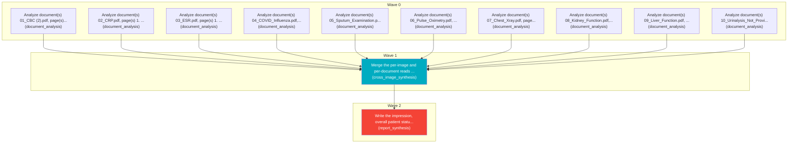

# Task Plan

**Job:** Interpret 0 image(s) and 10 document(s) (unknown modality) from study uploads-dd9acbef and report patient status. History: a persistent cough that brings up mucus, accompanied by chest tightness and fatigue

**Shape:** 12 nodes across 3 waves

| Node | Description | Capability | Depends on | Status | Time |
|---|---|---|---|---|---|
| `document0` | Analyze document(s) 01_CBC (2).pdf, page(s) 1. Classify each document and extract clinically relevant observations and exact reported values, preserving source refs. | document_analysis | - | done | 4.00s |
| `document1` | Analyze document(s) 02_CRP.pdf, page(s) 1. Classify each document and extract clinically relevant observations and exact reported values, preserving source refs. | document_analysis | - | done | 2.53s |
| `document2` | Analyze document(s) 03_ESR.pdf, page(s) 1. Classify each document and extract clinically relevant observations and exact reported values, preserving source refs. | document_analysis | - | done | 1.96s |
| `document3` | Analyze document(s) 04_COVID_Influenza.pdf, page(s) 1. Classify each document and extract clinically relevant observations and exact reported values, preserving source refs. | document_analysis | - | done | 2.46s |
| `document4` | Analyze document(s) 05_Sputum_Examination.pdf, page(s) 1. Classify each document and extract clinically relevant observations and exact reported values, preserving source refs. | document_analysis | - | done | 2.52s |
| `document5` | Analyze document(s) 06_Pulse_Oximetry.pdf, page(s) 1. Classify each document and extract clinically relevant observations and exact reported values, preserving source refs. | document_analysis | - | done | 1.97s |
| `document6` | Analyze document(s) 07_Chest_Xray.pdf, page(s) 1. Classify each document and extract clinically relevant observations and exact reported values, preserving source refs. | document_analysis | - | done | 2.54s |
| `document7` | Analyze document(s) 08_Kidney_Function.pdf, page(s) 1. Classify each document and extract clinically relevant observations and exact reported values, preserving source refs. | document_analysis | - | done | 17.92s |
| `document8` | Analyze document(s) 09_Liver_Function.pdf, page(s) 1. Classify each document and extract clinically relevant observations and exact reported values, preserving source refs. | document_analysis | - | done | 23.74s |
| `document9` | Analyze document(s) 10_Urinalysis_Not_Provided.pdf, page(s) 1. Classify each document and extract clinically relevant observations and exact reported values, preserving source refs. | document_analysis | - | done | 7.86s |
| `consolidate` | Merge the per-image and per-document reads into one coherent, de-duplicated findings list. Preserve exact document source references and reconcile disagreements without inventing facts. | cross_image_synthesis | `document0`, `document1`, `document2`, `document3`, `document4`, `document5`, `document6`, `document7`, `document8`, `document9` | done | 39.35s |
| `report` | Write the impression, overall patient status, triage level and recommended next steps for the referring clinician. | report_synthesis | `consolidate` | done | 48.09s |

## Execution waves

- **Wave 0** (10 in parallel): `document0`, `document1`, `document2`, `document3`, `document4`, `document5`, `document6`, `document7`, `document8`, `document9`
- **Wave 1** (1 in parallel): `consolidate`
- **Wave 2** (1 in parallel): `report`

## Graph

