# Task Plan

**Job:** Interpret 0 image(s) and 11 document(s) (unknown modality) from study uploads-417efe19 and report patient status. History: " feeling a dull ache, a heavy sensation, or mild fullness right under the  ribs on the upper right side of the stomach

**Shape:** 13 nodes across 3 waves

| Node | Description | Capability | Depends on | Status | Time |
|---|---|---|---|---|---|
| `document0` | Analyze document(s) 01_CBC.pdf, page(s) 1. Classify each document and extract clinically relevant observations and exact reported values, preserving source refs. | document_analysis | - | done | 2.55s |
| `document1` | Analyze document(s) 02_Liver_Function_Test (1).pdf, page(s) 1. Classify each document and extract clinically relevant observations and exact reported values, preserving source refs. | document_analysis | - | done | 2.60s |
| `document2` | Analyze document(s) 03_Glucose_Diabetes_Profile.pdf, page(s) 1. Classify each document and extract clinically relevant observations and exact reported values, preserving source refs. | document_analysis | - | done | 2.55s |
| `document3` | Analyze document(s) 04_Lipid_Profile.pdf, page(s) 1. Classify each document and extract clinically relevant observations and exact reported values, preserving source refs. | document_analysis | - | done | 2.55s |
| `document4` | Analyze document(s) 05_Kidney_Function_Electrolytes.pdf, page(s) 1. Classify each document and extract clinically relevant observations and exact reported values, preserving source refs. | document_analysis | - | done | 2.84s |
| `document5` | Analyze document(s) 06_Viral_Hepatitis_Screen.pdf, page(s) 1. Classify each document and extract clinically relevant observations and exact reported values, preserving source refs. | document_analysis | - | done | 1.97s |
| `document6` | Analyze document(s) 07_FIB4_Fibrosis_Assessment.pdf, page(s) 1. Classify each document and extract clinically relevant observations and exact reported values, preserving source refs. | document_analysis | - | done | 30.91s |
| `document7` | Analyze document(s) 08_Liver_Ultrasound.pdf, page(s) 1. Classify each document and extract clinically relevant observations and exact reported values, preserving source refs. | document_analysis | - | done | 3.19s |
| `document8` | Analyze document(s) 09_FibroScan_Liver_Elastography.pdf, page(s) 1. Classify each document and extract clinically relevant observations and exact reported values, preserving source refs. | document_analysis | - | done | 21.47s |
| `document9` | Analyze document(s) 10_CT_Abdomen_Report.pdf, page(s) 1. Classify each document and extract clinically relevant observations and exact reported values, preserving source refs. | document_analysis | - | done | 34.41s |
| `document10` | Analyze document(s) 11_Urinalysis_Not_Provided.pdf, page(s) 1. Classify each document and extract clinically relevant observations and exact reported values, preserving source refs. | document_analysis | - | done | 10.81s |
| `consolidate` | Merge the per-image and per-document reads into one coherent, de-duplicated findings list. Preserve exact document source references and reconcile disagreements without inventing facts. | cross_image_synthesis | `document0`, `document1`, `document2`, `document3`, `document4`, `document5`, `document6`, `document7`, `document8`, `document9`, `document10` | done | 56.15s |
| `report` | Write the impression, overall patient status, triage level and recommended next steps for the referring clinician. | report_synthesis | `consolidate` | done | 55.77s |

## Execution waves

- **Wave 0** (11 in parallel): `document0`, `document1`, `document2`, `document3`, `document4`, `document5`, `document6`, `document7`, `document8`, `document9`, `document10`
- **Wave 1** (1 in parallel): `consolidate`
- **Wave 2** (1 in parallel): `report`

## Graph

```mermaid
flowchart TD
    subgraph W0["Wave 0"]
        document0["Analyze document(s) 01_CBC.pdf, page(s) 1. ...<br/>(document_analysis)"]
        document1["Analyze document(s) 02_Liver_Function_Test ...<br/>(document_analysis)"]
        document2["Analyze document(s) 03_Glucose_Diabetes_Pro...<br/>(document_analysis)"]
        document3["Analyze document(s) 04_Lipid_Profile.pdf, p...<br/>(document_analysis)"]
        document4["Analyze document(s) 05_Kidney_Function_Elec...<br/>(document_analysis)"]
        document5["Analyze document(s) 06_Viral_Hepatitis_Scre...<br/>(document_analysis)"]
        document6["Analyze document(s) 07_FIB4_Fibrosis_Assess...<br/>(document_analysis)"]
        document7["Analyze document(s) 08_Liver_Ultrasound.pdf...<br/>(document_analysis)"]
        document8["Analyze document(s) 09_FibroScan_Liver_Elas...<br/>(document_analysis)"]
        document9["Analyze document(s) 10_CT_Abdomen_Report.pd...<br/>(document_analysis)"]
        document10["Analyze document(s) 11_Urinalysis_Not_Provi...<br/>(document_analysis)"]
    end
    subgraph W1["Wave 1"]
        consolidate["Merge the per-image and per-document reads ...<br/>(cross_image_synthesis)"]
    end
    subgraph W2["Wave 2"]
        report["Write the impression, overall patient statu...<br/>(report_synthesis)"]
    end
    document0 --> consolidate
    document1 --> consolidate
    document2 --> consolidate
    document3 --> consolidate
    document4 --> consolidate
    document5 --> consolidate
    document6 --> consolidate
    document7 --> consolidate
    document8 --> consolidate
    document9 --> consolidate
    document10 --> consolidate
    consolidate --> report

    classDef cross_image_synthesisStyle fill:#00ACC1,color:#fff
    classDef report_synthesisStyle fill:#F44336,color:#fff
    class consolidate cross_image_synthesisStyle
    class report report_synthesisStyle
```

