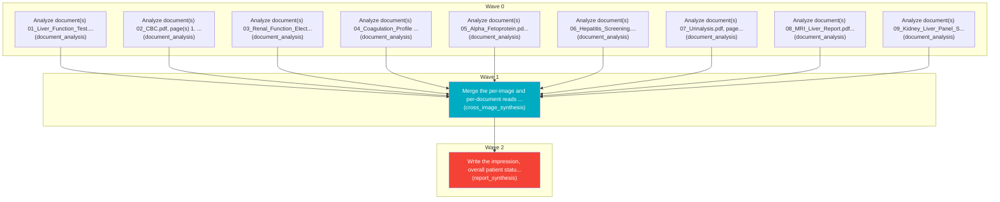

# Task Plan

**Job:** Interpret 0 image(s) and 9 document(s) (unknown modality) from study uploads-814423f7 and report patient status. History: feel unusually tired, have pain in the upper right side of their belly, and have noticed dark urine or yellow skin.

**Shape:** 11 nodes across 3 waves

| Node | Description | Capability | Depends on | Status | Time |
|---|---|---|---|---|---|
| `document0` | Analyze document(s) 01_Liver_Function_Test.pdf, page(s) 1. Classify each document and extract clinically relevant observations and exact reported values, preserving source refs. | document_analysis | - | done | 5.00s |
| `document1` | Analyze document(s) 02_CBC.pdf, page(s) 1. Classify each document and extract clinically relevant observations and exact reported values, preserving source refs. | document_analysis | - | done | 2.57s |
| `document2` | Analyze document(s) 03_Renal_Function_Electrolytes.pdf, page(s) 1. Classify each document and extract clinically relevant observations and exact reported values, preserving source refs. | document_analysis | - | done | 2.37s |
| `document3` | Analyze document(s) 04_Coagulation_Profile (2).pdf, page(s) 1. Classify each document and extract clinically relevant observations and exact reported values, preserving source refs. | document_analysis | - | done | 1.82s |
| `document4` | Analyze document(s) 05_Alpha_Fetoprotein.pdf, page(s) 1. Classify each document and extract clinically relevant observations and exact reported values, preserving source refs. | document_analysis | - | done | 1.67s |
| `document5` | Analyze document(s) 06_Hepatitis_Screening.pdf, page(s) 1. Classify each document and extract clinically relevant observations and exact reported values, preserving source refs. | document_analysis | - | done | 1.67s |
| `document6` | Analyze document(s) 07_Urinalysis.pdf, page(s) 1. Classify each document and extract clinically relevant observations and exact reported values, preserving source refs. | document_analysis | - | done | 2.47s |
| `document7` | Analyze document(s) 08_MRI_Liver_Report.pdf, page(s) 1. Classify each document and extract clinically relevant observations and exact reported values, preserving source refs. | document_analysis | - | done | 1.67s |
| `document8` | Analyze document(s) 09_Kidney_Liver_Panel_Summary.pdf, page(s) 1. Classify each document and extract clinically relevant observations and exact reported values, preserving source refs. | document_analysis | - | done | 16.16s |
| `consolidate` | Merge the per-image and per-document reads into one coherent, de-duplicated findings list. Preserve exact document source references and reconcile disagreements without inventing facts. | cross_image_synthesis | `document0`, `document1`, `document2`, `document3`, `document4`, `document5`, `document6`, `document7`, `document8` | done | 45.25s |
| `report` | Write the impression, overall patient status, triage level and recommended next steps for the referring clinician. | report_synthesis | `consolidate` | done | 4.60s |

## Execution waves

- **Wave 0** (9 in parallel): `document0`, `document1`, `document2`, `document3`, `document4`, `document5`, `document6`, `document7`, `document8`
- **Wave 1** (1 in parallel): `consolidate`
- **Wave 2** (1 in parallel): `report`

## Graph

