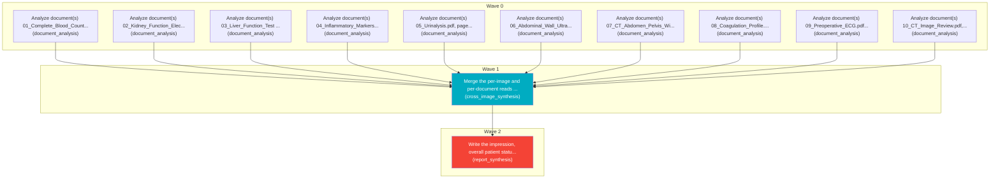

# Task Plan

**Job:** Interpret 0 image(s) and 10 document(s) (unknown modality) from study uploads-f471f8ec and report patient status. History: a soft lump in groin/lower belly. It pops out when  stand up or lift something heavy, but goes away when lie flat on  back

**Shape:** 12 nodes across 3 waves

| Node | Description | Capability | Depends on | Status | Time |
|---|---|---|---|---|---|
| `document0` | Analyze document(s) 01_Complete_Blood_Count_CBC (3).pdf, page(s) 1. Classify each document and extract clinically relevant observations and exact reported values, preserving source refs. | document_analysis | - | done | 2.85s |
| `document1` | Analyze document(s) 02_Kidney_Function_Electrolytes (1).pdf, page(s) 1. Classify each document and extract clinically relevant observations and exact reported values, preserving source refs. | document_analysis | - | done | 2.38s |
| `document2` | Analyze document(s) 03_Liver_Function_Test (1).pdf, page(s) 1. Classify each document and extract clinically relevant observations and exact reported values, preserving source refs. | document_analysis | - | done | 2.66s |
| `document3` | Analyze document(s) 04_Inflammatory_Markers.pdf, page(s) 1. Classify each document and extract clinically relevant observations and exact reported values, preserving source refs. | document_analysis | - | done | 2.14s |
| `document4` | Analyze document(s) 05_Urinalysis.pdf, page(s) 1. Classify each document and extract clinically relevant observations and exact reported values, preserving source refs. | document_analysis | - | done | 1.77s |
| `document5` | Analyze document(s) 06_Abdominal_Wall_Ultrasound.pdf, page(s) 1. Classify each document and extract clinically relevant observations and exact reported values, preserving source refs. | document_analysis | - | done | 1.77s |
| `document6` | Analyze document(s) 07_CT_Abdomen_Pelvis_With_Contrast.pdf, page(s) 1. Classify each document and extract clinically relevant observations and exact reported values, preserving source refs. | document_analysis | - | done | 2.92s |
| `document7` | Analyze document(s) 08_Coagulation_Profile.pdf, page(s) 1. Classify each document and extract clinically relevant observations and exact reported values, preserving source refs. | document_analysis | - | done | 32.96s |
| `document8` | Analyze document(s) 09_Preoperative_ECG.pdf, page(s) 1. Classify each document and extract clinically relevant observations and exact reported values, preserving source refs. | document_analysis | - | done | 12.35s |
| `document9` | Analyze document(s) 10_CT_Image_Review.pdf, page(s) 1. Classify each document and extract clinically relevant observations and exact reported values, preserving source refs. | document_analysis | - | done | 20.44s |
| `consolidate` | Merge the per-image and per-document reads into one coherent, de-duplicated findings list. Preserve exact document source references and reconcile disagreements without inventing facts. | cross_image_synthesis | `document0`, `document1`, `document2`, `document3`, `document4`, `document5`, `document6`, `document7`, `document8`, `document9` | done | 60.78s |
| `report` | Write the impression, overall patient status, triage level and recommended next steps for the referring clinician. | report_synthesis | `consolidate` | done | 55.75s |

## Execution waves

- **Wave 0** (10 in parallel): `document0`, `document1`, `document2`, `document3`, `document4`, `document5`, `document6`, `document7`, `document8`, `document9`
- **Wave 1** (1 in parallel): `consolidate`
- **Wave 2** (1 in parallel): `report`

## Graph

