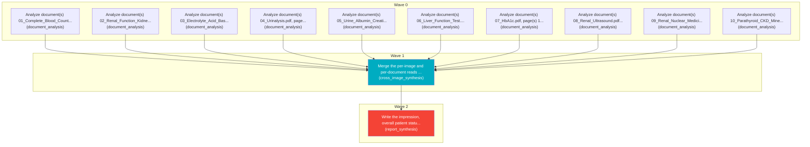

# Task Plan

**Job:** Interpret 0 image(s) and 10 document(s) (unknown modality) from study uploads-2cdc1248 and report patient status. History: feeling extremely exhausted, ankles and feet are swollen, trouble catching  breath

**Shape:** 12 nodes across 3 waves

| Node | Description | Capability | Depends on | Status | Time |
|---|---|---|---|---|---|
| `document0` | Analyze document(s) 01_Complete_Blood_Count_CBC (2).pdf, page(s) 1. Classify each document and extract clinically relevant observations and exact reported values, preserving source refs. | document_analysis | - | done | 2.40s |
| `document1` | Analyze document(s) 02_Renal_Function_Kidney_Panel.pdf, page(s) 1. Classify each document and extract clinically relevant observations and exact reported values, preserving source refs. | document_analysis | - | done | 2.84s |
| `document2` | Analyze document(s) 03_Electrolyte_Acid_Base_Report.pdf, page(s) 1. Classify each document and extract clinically relevant observations and exact reported values, preserving source refs. | document_analysis | - | done | 2.68s |
| `document3` | Analyze document(s) 04_Urinalysis.pdf, page(s) 1. Classify each document and extract clinically relevant observations and exact reported values, preserving source refs. | document_analysis | - | done | 2.41s |
| `document4` | Analyze document(s) 05_Urine_Albumin_Creatinine_Ratio.pdf, page(s) 1. Classify each document and extract clinically relevant observations and exact reported values, preserving source refs. | document_analysis | - | done | 1.83s |
| `document5` | Analyze document(s) 06_Liver_Function_Test.pdf, page(s) 1. Classify each document and extract clinically relevant observations and exact reported values, preserving source refs. | document_analysis | - | done | 2.56s |
| `document6` | Analyze document(s) 07_HbA1c.pdf, page(s) 1. Classify each document and extract clinically relevant observations and exact reported values, preserving source refs. | document_analysis | - | done | 2.08s |
| `document7` | Analyze document(s) 08_Renal_Ultrasound.pdf, page(s) 1. Classify each document and extract clinically relevant observations and exact reported values, preserving source refs. | document_analysis | - | done | 2.87s |
| `document8` | Analyze document(s) 09_Renal_Nuclear_Medicine_Scan.pdf, page(s) 1. Classify each document and extract clinically relevant observations and exact reported values, preserving source refs. | document_analysis | - | done | 24.23s |
| `document9` | Analyze document(s) 10_Parathyroid_CKD_Mineral_Profile.pdf, page(s) 1. Classify each document and extract clinically relevant observations and exact reported values, preserving source refs. | document_analysis | - | done | 14.17s |
| `consolidate` | Merge the per-image and per-document reads into one coherent, de-duplicated findings list. Preserve exact document source references and reconcile disagreements without inventing facts. | cross_image_synthesis | `document0`, `document1`, `document2`, `document3`, `document4`, `document5`, `document6`, `document7`, `document8`, `document9` | done | 49.86s |
| `report` | Write the impression, overall patient status, triage level and recommended next steps for the referring clinician. | report_synthesis | `consolidate` | done | 56.53s |

## Execution waves

- **Wave 0** (10 in parallel): `document0`, `document1`, `document2`, `document3`, `document4`, `document5`, `document6`, `document7`, `document8`, `document9`
- **Wave 1** (1 in parallel): `consolidate`
- **Wave 2** (1 in parallel): `report`

## Graph

