# Task Plan

**Job:** Interpret 0 image(s) and 11 document(s) (unknown modality) from study uploads-4d853d17 and report patient status. History: troubled breathing and bleeding through nose

**Shape:** 13 nodes across 3 waves

| Node | Description | Capability | Depends on | Status | Time |
|---|---|---|---|---|---|
| `document0` | Analyze document(s) 01_Complete_Blood_Count_CBC (1).pdf, page(s) 1. Classify each document and extract clinically relevant observations and exact reported values, preserving source refs. | document_analysis | - | done | 3.09s |
| `document1` | Analyze document(s) 02_Biochemistry_Report.pdf, page(s) 1. Classify each document and extract clinically relevant observations and exact reported values, preserving source refs. | document_analysis | - | done | 6.08s |
| `document2` | Analyze document(s) 03_Inflammatory_Markers.pdf, page(s) 1. Classify each document and extract clinically relevant observations and exact reported values, preserving source refs. | document_analysis | - | done | 1.78s |
| `document3` | Analyze document(s) 04_CT_Chest_With_Contrast.pdf, page(s) 1. Classify each document and extract clinically relevant observations and exact reported values, preserving source refs. | document_analysis | - | failed | 36.78s |
| `document4` | Analyze document(s) 05_Sputum_Microbiology.pdf, page(s) 1. Classify each document and extract clinically relevant observations and exact reported values, preserving source refs. | document_analysis | - | done | 18.21s |
| `document5` | Analyze document(s) 06_Bronchoscopy_EBUS_Report.pdf, page(s) 1. Classify each document and extract clinically relevant observations and exact reported values, preserving source refs. | document_analysis | - | done | 1.71s |
| `document6` | Analyze document(s) 07_Histopathology_Biopsy_Report.pdf, page(s) 1. Classify each document and extract clinically relevant observations and exact reported values, preserving source refs. | document_analysis | - | done | 2.39s |
| `document7` | Analyze document(s) 08_Molecular_Biomarker_Report.pdf, page(s) 1. Classify each document and extract clinically relevant observations and exact reported values, preserving source refs. | document_analysis | - | done | 37.32s |
| `document8` | Analyze document(s) 09_PET_CT_Report.pdf, page(s) 1. Classify each document and extract clinically relevant observations and exact reported values, preserving source refs. | document_analysis | - | done | 1.76s |
| `document9` | Analyze document(s) 10_MRI_Brain_With_Contrast.pdf, page(s) 1. Classify each document and extract clinically relevant observations and exact reported values, preserving source refs. | document_analysis | - | done | 25.90s |
| `document10` | Analyze document(s) 11_Chest_Xray_Image_Report.pdf, page(s) 1. Classify each document and extract clinically relevant observations and exact reported values, preserving source refs. | document_analysis | - | done | 44.31s |
| `consolidate` | Merge the per-image and per-document reads into one coherent, de-duplicated findings list. Preserve exact document source references and reconcile disagreements without inventing facts. | cross_image_synthesis | `document0`, `document1`, `document2`, `document3`, `document4`, `document5`, `document6`, `document7`, `document8`, `document9`, `document10` | done | 1.45s |
| `report` | Write the impression, overall patient status, triage level and recommended next steps for the referring clinician. | report_synthesis | `consolidate` | done | 53.60s |

## Execution waves

- **Wave 0** (11 in parallel): `document0`, `document1`, `document2`, `document3`, `document4`, `document5`, `document6`, `document7`, `document8`, `document9`, `document10`
- **Wave 1** (1 in parallel): `consolidate`
- **Wave 2** (1 in parallel): `report`

## Failures

- `document3` (document_analysis): [document_analysis] every document page failed -> 04_CT_Chest_With_Contrast.pdf#page=1: NameError: name '_fallback_from_laboratory_text' is not defined

## Graph

```mermaid
flowchart TD
    subgraph W0["Wave 0"]
        document0["Analyze document(s) 01_Complete_Blood_Count...<br/>(document_analysis)"]
        document1["Analyze document(s) 02_Biochemistry_Report....<br/>(document_analysis)"]
        document2["Analyze document(s) 03_Inflammatory_Markers...<br/>(document_analysis)"]
        document3["Analyze document(s) 04_CT_Chest_With_Contra...<br/>(document_analysis)"]
        document4["Analyze document(s) 05_Sputum_Microbiology....<br/>(document_analysis)"]
        document5["Analyze document(s) 06_Bronchoscopy_EBUS_Re...<br/>(document_analysis)"]
        document6["Analyze document(s) 07_Histopathology_Biops...<br/>(document_analysis)"]
        document7["Analyze document(s) 08_Molecular_Biomarker_...<br/>(document_analysis)"]
        document8["Analyze document(s) 09_PET_CT_Report.pdf, p...<br/>(document_analysis)"]
        document9["Analyze document(s) 10_MRI_Brain_With_Contr...<br/>(document_analysis)"]
        document10["Analyze document(s) 11_Chest_Xray_Image_Rep...<br/>(document_analysis)"]
    end
    subgraph W1["Wave 1"]
        consolidate["Merge the per-image and per-document reads ...<br/>(cross_image_synthesis)"]
    end
    subgraph W2["Wave 2"]
        report["Write the impression, overall patient statu...<br/>(report_synthesis)"]
    end
    document0 --> consolidate
    document1 --> consolidate
    document2 --> consolidate
    document3 --> consolidate
    document4 --> consolidate
    document5 --> consolidate
    document6 --> consolidate
    document7 --> consolidate
    document8 --> consolidate
    document9 --> consolidate
    document10 --> consolidate
    consolidate --> report

    classDef cross_image_synthesisStyle fill:#00ACC1,color:#fff
    classDef report_synthesisStyle fill:#F44336,color:#fff
    class consolidate cross_image_synthesisStyle
    class report report_synthesisStyle
    style document3 stroke:#B71C1C,stroke-width:3px,stroke-dasharray:4 2
```

