# Task Plan

**Job:** Interpret 0 image(s) and 13 document(s) (unknown modality) from study uploads-7478998d and report patient status. History: sudden  confusing physical changes in plain

**Shape:** 15 nodes across 3 waves

| Node | Description | Capability | Depends on | Status | Time |
|---|---|---|---|---|---|
| `document0` | Analyze document(s) 01_CBC (3).pdf, page(s) 1. Classify each document and extract clinically relevant observations and exact reported values, preserving source refs. | document_analysis | - | failed | 5.06s |
| `document1` | Analyze document(s) 02_Random_Blood_Glucose.pdf, page(s) 1. Classify each document and extract clinically relevant observations and exact reported values, preserving source refs. | document_analysis | - | failed | 6.61s |
| `document2` | Analyze document(s) 03_HbA1c.pdf, page(s) 1. Classify each document and extract clinically relevant observations and exact reported values, preserving source refs. | document_analysis | - | failed | 4.81s |
| `document3` | Analyze document(s) 04_Renal_Function_Electrolytes.pdf, page(s) 1. Classify each document and extract clinically relevant observations and exact reported values, preserving source refs. | document_analysis | - | failed | 4.81s |
| `document4` | Analyze document(s) 05_Coagulation_Profile.pdf, page(s) 1. Classify each document and extract clinically relevant observations and exact reported values, preserving source refs. | document_analysis | - | failed | 6.49s |
| `document5` | Analyze document(s) 06_Lipid_Profile.pdf, page(s) 1. Classify each document and extract clinically relevant observations and exact reported values, preserving source refs. | document_analysis | - | failed | 4.93s |
| `document6` | Analyze document(s) 07_CT_Brain_Without_Contrast.pdf, page(s) 1. Classify each document and extract clinically relevant observations and exact reported values, preserving source refs. | document_analysis | - | failed | 5.06s |
| `document7` | Analyze document(s) 08_MRI_Brain_DWI_ADC.pdf, page(s) 1. Classify each document and extract clinically relevant observations and exact reported values, preserving source refs. | document_analysis | - | failed | 4.80s |
| `document8` | Analyze document(s) 09_CT_Angiography_Head_Neck.pdf, page(s) 1. Classify each document and extract clinically relevant observations and exact reported values, preserving source refs. | document_analysis | - | failed | 4.07s |
| `document9` | Analyze document(s) 10_Carotid_Doppler.pdf, page(s) 1. Classify each document and extract clinically relevant observations and exact reported values, preserving source refs. | document_analysis | - | failed | 4.14s |
| `document10` | Analyze document(s) 11_ECG.pdf, page(s) 1. Classify each document and extract clinically relevant observations and exact reported values, preserving source refs. | document_analysis | - | failed | 3.95s |
| `document11` | Analyze document(s) 12_Echocardiogram.pdf, page(s) 1. Classify each document and extract clinically relevant observations and exact reported values, preserving source refs. | document_analysis | - | failed | 4.33s |
| `document12` | Analyze document(s) 13_Troponin_I.pdf, page(s) 1. Classify each document and extract clinically relevant observations and exact reported values, preserving source refs. | document_analysis | - | failed | 4.01s |
| `consolidate` | Merge the per-image and per-document reads into one coherent, de-duplicated findings list. Preserve exact document source references and reconcile disagreements without inventing facts. | cross_image_synthesis | `document0`, `document1`, `document2`, `document3`, `document4`, `document5`, `document6`, `document7`, `document8`, `document9`, `document10`, `document11`, `document12` | skipped | - |
| `report` | Write the impression, overall patient status, triage level and recommended next steps for the referring clinician. | report_synthesis | `consolidate` | skipped | - |

## Execution waves

- **Wave 0** (13 in parallel): `document0`, `document1`, `document2`, `document3`, `document4`, `document5`, `document6`, `document7`, `document8`, `document9`, `document10`, `document11`, `document12`
- **Wave 1** (1 in parallel): `consolidate`
- **Wave 2** (1 in parallel): `report`

## Failures

- `document0` (document_analysis): [document_analysis] every document page failed -> 01_CBC (3).pdf#page=1: NameError: name '_fallback_from_laboratory_text' is not defined
- `document1` (document_analysis): [document_analysis] every document page failed -> 02_Random_Blood_Glucose.pdf#page=1: NameError: name '_fallback_from_laboratory_text' is not defined
- `document2` (document_analysis): [document_analysis] every document page failed -> 03_HbA1c.pdf#page=1: NameError: name '_fallback_from_laboratory_text' is not defined
- `document3` (document_analysis): [document_analysis] every document page failed -> 04_Renal_Function_Electrolytes.pdf#page=1: NameError: name '_fallback_from_laboratory_text' is not defined
- `document4` (document_analysis): [document_analysis] every document page failed -> 05_Coagulation_Profile.pdf#page=1: NameError: name '_fallback_from_laboratory_text' is not defined
- `document5` (document_analysis): [document_analysis] every document page failed -> 06_Lipid_Profile.pdf#page=1: NameError: name '_fallback_from_laboratory_text' is not defined
- `document6` (document_analysis): [document_analysis] every document page failed -> 07_CT_Brain_Without_Contrast.pdf#page=1: NameError: name '_fallback_from_laboratory_text' is not defined
- `document7` (document_analysis): [document_analysis] every document page failed -> 08_MRI_Brain_DWI_ADC.pdf#page=1: NameError: name '_fallback_from_laboratory_text' is not defined
- `document8` (document_analysis): [document_analysis] every document page failed -> 09_CT_Angiography_Head_Neck.pdf#page=1: NameError: name '_fallback_from_laboratory_text' is not defined
- `document9` (document_analysis): [document_analysis] every document page failed -> 10_Carotid_Doppler.pdf#page=1: NameError: name '_fallback_from_laboratory_text' is not defined
- `document10` (document_analysis): [document_analysis] every document page failed -> 11_ECG.pdf#page=1: NameError: name '_fallback_from_laboratory_text' is not defined
- `document11` (document_analysis): [document_analysis] every document page failed -> 12_Echocardiogram.pdf#page=1: NameError: name '_fallback_from_laboratory_text' is not defined
- `document12` (document_analysis): [document_analysis] every document page failed -> 13_Troponin_I.pdf#page=1: NameError: name '_fallback_from_laboratory_text' is not defined

## Graph

```mermaid
flowchart TD
    subgraph W0["Wave 0"]
        document0["Analyze document(s) 01_CBC (3).pdf, page(s)...<br/>(document_analysis)"]
        document1["Analyze document(s) 02_Random_Blood_Glucose...<br/>(document_analysis)"]
        document2["Analyze document(s) 03_HbA1c.pdf, page(s) 1...<br/>(document_analysis)"]
        document3["Analyze document(s) 04_Renal_Function_Elect...<br/>(document_analysis)"]
        document4["Analyze document(s) 05_Coagulation_Profile....<br/>(document_analysis)"]
        document5["Analyze document(s) 06_Lipid_Profile.pdf, p...<br/>(document_analysis)"]
        document6["Analyze document(s) 07_CT_Brain_Without_Con...<br/>(document_analysis)"]
        document7["Analyze document(s) 08_MRI_Brain_DWI_ADC.pd...<br/>(document_analysis)"]
        document8["Analyze document(s) 09_CT_Angiography_Head_...<br/>(document_analysis)"]
        document9["Analyze document(s) 10_Carotid_Doppler.pdf,...<br/>(document_analysis)"]
        document10["Analyze document(s) 11_ECG.pdf, page(s) 1. ...<br/>(document_analysis)"]
        document11["Analyze document(s) 12_Echocardiogram.pdf, ...<br/>(document_analysis)"]
        document12["Analyze document(s) 13_Troponin_I.pdf, page...<br/>(document_analysis)"]
    end
    subgraph W1["Wave 1"]
        consolidate["Merge the per-image and per-document reads ...<br/>(cross_image_synthesis)"]
    end
    subgraph W2["Wave 2"]
        report["Write the impression, overall patient statu...<br/>(report_synthesis)"]
    end
    document0 --> consolidate
    document1 --> consolidate
    document2 --> consolidate
    document3 --> consolidate
    document4 --> consolidate
    document5 --> consolidate
    document6 --> consolidate
    document7 --> consolidate
    document8 --> consolidate
    document9 --> consolidate
    document10 --> consolidate
    document11 --> consolidate
    document12 --> consolidate
    consolidate --> report

    classDef cross_image_synthesisStyle fill:#00ACC1,color:#fff
    classDef report_synthesisStyle fill:#F44336,color:#fff
    class consolidate cross_image_synthesisStyle
    class report report_synthesisStyle
    style document0 stroke:#B71C1C,stroke-width:3px,stroke-dasharray:4 2
    style document1 stroke:#B71C1C,stroke-width:3px,stroke-dasharray:4 2
    style document2 stroke:#B71C1C,stroke-width:3px,stroke-dasharray:4 2
    style document3 stroke:#B71C1C,stroke-width:3px,stroke-dasharray:4 2
    style document4 stroke:#B71C1C,stroke-width:3px,stroke-dasharray:4 2
    style document5 stroke:#B71C1C,stroke-width:3px,stroke-dasharray:4 2
    style document6 stroke:#B71C1C,stroke-width:3px,stroke-dasharray:4 2
    style document7 stroke:#B71C1C,stroke-width:3px,stroke-dasharray:4 2
    style document8 stroke:#B71C1C,stroke-width:3px,stroke-dasharray:4 2
    style document9 stroke:#B71C1C,stroke-width:3px,stroke-dasharray:4 2
    style document10 stroke:#B71C1C,stroke-width:3px,stroke-dasharray:4 2
    style document11 stroke:#B71C1C,stroke-width:3px,stroke-dasharray:4 2
    style document12 stroke:#B71C1C,stroke-width:3px,stroke-dasharray:4 2
    style consolidate stroke:#9E9E9E,stroke-width:2px,stroke-dasharray:2 2
    style report stroke:#9E9E9E,stroke-width:2px,stroke-dasharray:2 2
```

