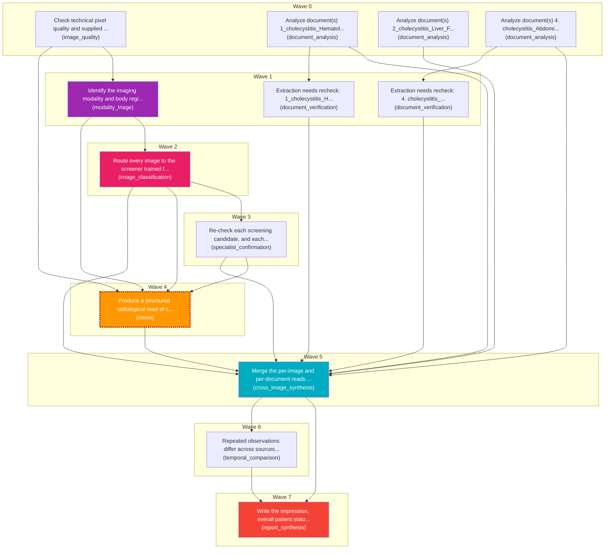

# Task Plan

**Job:** Interpret 1 image(s) and 3 document(s) (Unknown) from study uploads-3e78459d and report patient status. History: abdominal pain

**Shape:** 13 nodes across 8 waves

| Node | Description | Capability | Depends on | Status | Time |
|---|---|---|---|---|---|
| `quality` | Check technical pixel quality and supplied series/frame coverage | image_quality | - | done | - |
| `triage` | Identify the imaging modality and body region of every image, and flag any file that is not a medical image. | modality_triage | `quality` | done | 0.52s |
| `screen` | Route every image to the screener trained for its modality and region, and report candidate conditions with probabilities. | image_classification | `triage` | done | - |
| `confirm` | Re-check each screening candidate, and each condition named in the referring question, with a disease-specific specialist model. | specialist_confirmation | `screen` | done | - |
| `read0` | Produce a structured radiological read of cholecystitis.webp, describing modality, image quality, observations with severity, and a short impression. | vision | `quality`, `triage`, `screen`, `confirm` | failed | 2.96s |
| `document0` | Analyze document(s) 1_cholecystitis_Hematology_and_Inflammatory_Markers.pdf, page(s) 1. Classify each document and extract clinically relevant observations and exact reported values, preserving source refs. | document_analysis | - | done | 2.30s |
| `document1` | Analyze document(s) 2_cholecystitis_Liver_Function_and_Pancreatic_Enzymes.pdf, page(s) 1. Classify each document and extract clinically relevant observations and exact reported values, preserving source refs. | document_analysis | - | done | 5.79s |
| `document2` | Analyze document(s) 4. cholecystitis_Abdominal Ultrasound Imaging Report.pdf, page(s) 1, 2. Classify each document and extract clinically relevant observations and exact reported values, preserving source refs. | document_analysis | - | done | 4.74s |
| `consolidate` | Merge the per-image and per-document reads into one coherent, de-duplicated findings list. Preserve exact document source references and reconcile disagreements without inventing facts. | cross_image_synthesis | `read0`, `document0`, `document1`, `document2`, `screen`, `confirm`, `adapt1`, `adapt2` | done | - |
| `report` | Write the impression, overall patient status, triage level and recommended next steps for the referring clinician. | report_synthesis | `consolidate`, `adapt3` | done | 6.09s |
| `adapt1` | Extraction needs recheck: 1_cholecystitis_Hematology_and_Inflammatory_Markers.pdf#page=1 | document_verification | `document0` | done | 1.40s |
| `adapt2` | Extraction needs recheck: 4. cholecystitis_Abdominal Ultrasound Imaging Report.pdf#page=2 | document_verification | `document2` | done | 0.76s |
| `adapt3` | Repeated observations differ across sources; check dates, units and chronology | temporal_comparison | `consolidate` | done | - |

## Execution waves

- **Wave 0** (4 in parallel): `quality`, `document0`, `document1`, `document2`
- **Wave 1** (3 in parallel): `triage`, `adapt1`, `adapt2`
- **Wave 2** (1 in parallel): `screen`
- **Wave 3** (1 in parallel): `confirm`
- **Wave 4** (1 in parallel): `read0`
- **Wave 5** (1 in parallel): `consolidate`
- **Wave 6** (1 in parallel): `adapt3`
- **Wave 7** (1 in parallel): `report`

## Failures

- `read0` (vision): CapabilityError: [vision] every image read failed -> BackendError: no vision-language model was usable -> google/medgemma-4b-it: BadRequestError: (Request ID: Root=1-6ac4b4a0-44276915087f244333f00e69;896c78eb-76e4-47de-8c98-5300cb4a64e4)

Bad request:
{'message': "The requested model 'google/medgemma-4b-it' is not supported by any provider you have enabled.", 'type': 'invalid_request_error', 'param': 'model', 'code': 'model_not_supported'}; Qwen/Qwen2.5-VL-7B-Instruct: BadRequestError: (Request ID: Root=1-6ac4b4a1-6b2d0bd72513612d44537325;8fb9b56f-36fd-4f31-a8bb-3b566db89247)

Bad request:
{'message': "The requested model 'Qwen/Qwen2.5-VL-7B-Instruct' is not supported by any provider you have enabled.", 'type': 'invalid_request_error', 'param': 'model', 'code': 'model_not_supported'}

## Graph



## Selection and adaptation trace

```json
{
  "quality": {
    "requirements": {
      "skills": [
        "check_image_quality"
      ],
      "inputs": [
        "images"
      ],
      "outputs": [
        "image_quality"
      ],
      "tools": [],
      "context_tokens": 0,
      "max_memory_gb": null,
      "max_cost": null,
      "max_latency_s": null
    },
    "candidates": [
      {
        "candidate": "cross_image_synthesis",
        "eligible": false,
        "reasons": [
          "missing skills: ['check_image_quality']",
          "missing inputs: ['images']",
          "missing outputs: ['image_quality']"
        ],
        "score": 3.7498,
        "history": {
          "attempts": 1,
          "successes": 1,
          "latency_s": 0.0002,
          "last_success": true,
          "cooldown_until": 0
        }
      },
      {
        "candidate": "vision",
        "eligible": false,
        "reasons": [
          "missing skills: ['check_image_quality']",
          "missing outputs: ['image_quality']"
        ],
        "score": 1.2649,
        "history": {
          "attempts": 1,
          "successes": 0,
          "latency_s": 2.4388,
          "last_success": false,
          "cooldown_until": 1791275849.824029
        }
      },
      {
        "candidate": "document_analysis",
        "eligible": false,
        "reasons": [
          "missing skills: ['check_image_quality']",
          "missing inputs: ['images']",
          "missing outputs: ['image_quality']"
        ],
        "score": 2.4171,
        "history": {
          "attempts": 1,
          "successes": 1,
          "latency_s": 2.7922,
          "last_success": true,
          "cooldown_until": 0
        }
      },
      {
        "candidate": "image_classification",
        "eligible": false,
        "reasons": [
          "missing skills: ['check_image_quality']",
          "missing outputs: ['image_quality']"
        ],
        "score": 3.7499,
        "history": {
          "attempts": 1,
          "successes": 1,
          "latency_s": 0.0001,
          "last_success": true,
          "cooldown_until": 0
        }
      },
      {
        "candidate": "image_quality",
        "eligible": true,
        "reasons": [],
        "score": 5.7459,
        "history": {
          "attempts": 1,
          "successes": 1,
          "latency_s": 0.0041,
          "last_success": true,
          "cooldown_until": 0
        }
      },
      {
        "candidate": "modality_triage",
        "eligible": false,
        "reasons": [
          "missing skills: ['check_image_quality']",
          "missing outputs: ['image_quality']"
        ],
        "score": 3.1112,
        "history": {
          "attempts": 1,
          "successes": 1,
          "latency_s": 0.8942,
          "last_success": true,
          "cooldown_until": 0
        }
      },
      {
        "candidate": "report_synthesis",
        "eligible": false,
        "reasons": [
          "missing skills: ['check_image_quality']",
          "missing inputs: ['images']",
          "missing outputs: ['image_quality']"
        ],
        "score": 1.8897,
        "history": {
          "attempts": 1,
          "successes": 1,
          "latency_s": 5.4258,
          "last_success": true,
          "cooldown_until": 0
        }
      },
      {
        "candidate": "specialist_confirmation",
        "eligible": false,
        "reasons": [
          "missing skills: ['check_image_quality']",
          "missing outputs: ['image_quality']"
        ],
        "score": 3.7499,
        "history": {
          "attempts": 1,
          "successes": 1,
          "latency_s": 0.0001,
          "last_success": true,
          "cooldown_until": 0
        }
      },
      {
        "candidate": "summarization",
        "eligible": false,
        "reasons": [
          "missing skills: ['check_image_quality']",
          "missing inputs: ['images']",
          "missing outputs: ['image_quality']"
        ],
        "score": 2.6402,
        "history": {}
      },
      {
        "candidate": "document_verification",
        "eligible": false,
        "reasons": [
          "missing skills: ['check_image_quality']",
          "missing inputs: ['images']",
          "missing outputs: ['image_quality']"
        ],
        "score": 3.3476,
        "history": {
          "attempts": 2,
          "successes": 2,
          "latency_s": 0.9201,
          "last_success": true,
          "cooldown_until": 0
        }
      },
      {
        "candidate": "temporal_comparison",
        "eligible": false,
        "reasons": [
          "missing skills: ['check_image_quality']",
          "missing inputs: ['images']",
          "missing outputs: ['image_quality']"
        ],
        "score": 3.238,
        "history": {}
      },
      {
        "candidate": "evidence_verification",
        "eligible": false,
        "reasons": [
          "missing skills: ['check_image_quality']",
          "missing inputs: ['images']",
          "missing outputs: ['image_quality']"
        ],
        "score": 3.238,
        "history": {}
      },
      {
        "candidate": "web_search",
        "eligible": false,
        "reasons": [
          "missing skills: ['check_image_quality']",
          "missing inputs: ['images']",
          "missing outputs: ['image_quality']"
        ],
        "score": 2.6402,
        "history": {}
      }
    ],
    "attempts": [
      {
        "capability": "image_quality",
        "status": "accepted"
      }
    ]
  },
  "triage": {
    "requirements": {
      "skills": [
        "identify_modality"
      ],
      "inputs": [
        "images"
      ],
      "outputs": [
        "triage"
      ],
      "tools": [],
      "context_tokens": 0,
      "max_memory_gb": null,
      "max_cost": null,
      "max_latency_s": null
    },
    "candidates": [
      {
        "candidate": "cross_image_synthesis",
        "eligible": false,
        "reasons": [
          "missing skills: ['identify_modality']",
          "missing inputs: ['images']",
          "missing outputs: ['triage']"
        ],
        "score": 3.7498,
        "history": {
          "attempts": 1,
          "successes": 1,
          "latency_s": 0.0002,
          "last_success": true,
          "cooldown_until": 0
        }
      },
      {
        "candidate": "vision",
        "eligible": false,
        "reasons": [
          "missing skills: ['identify_modality']",
          "missing outputs: ['triage']"
        ],
        "score": 1.2649,
        "history": {
          "attempts": 1,
          "successes": 0,
          "latency_s": 2.4388,
          "last_success": false,
          "cooldown_until": 1791275849.824029
        }
      },
      {
        "candidate": "document_analysis",
        "eligible": false,
        "reasons": [
          "missing skills: ['identify_modality']",
          "missing inputs: ['images']",
          "missing outputs: ['triage']"
        ],
        "score": 2.4171,
        "history": {
          "attempts": 1,
          "successes": 1,
          "latency_s": 2.7922,
          "last_success": true,
          "cooldown_until": 0
        }
      },
      {
        "candidate": "image_classification",
        "eligible": false,
        "reasons": [
          "missing skills: ['identify_modality']",
          "missing outputs: ['triage']"
        ],
        "score": 3.7499,
        "history": {
          "attempts": 1,
          "successes": 1,
          "latency_s": 0.0001,
          "last_success": true,
          "cooldown_until": 0
        }
      },
      {
        "candidate": "image_quality",
        "eligible": false,
        "reasons": [
          "missing skills: ['identify_modality']",
          "missing outputs: ['triage']"
        ],
        "score": 3.9967,
        "history": {
          "attempts": 2,
          "successes": 2,
          "latency_s": 0.0033,
          "last_success": true,
          "cooldown_until": 0
        }
      },
      {
        "candidate": "modality_triage",
        "eligible": true,
        "reasons": [],
        "score": 5.1112,
        "history": {
          "attempts": 1,
          "successes": 1,
          "latency_s": 0.8942,
          "last_success": true,
          "cooldown_until": 0
        }
      },
      {
        "candidate": "report_synthesis",
        "eligible": false,
        "reasons": [
          "missing skills: ['identify_modality']",
          "missing inputs: ['images']",
          "missing outputs: ['triage']"
        ],
        "score": 1.8897,
        "history": {
          "attempts": 1,
          "successes": 1,
          "latency_s": 5.4258,
          "last_success": true,
          "cooldown_until": 0
        }
      },
      {
        "candidate": "specialist_confirmation",
        "eligible": false,
        "reasons": [
          "missing skills: ['identify_modality']",
          "missing outputs: ['triage']"
        ],
        "score": 3.7499,
        "history": {
          "attempts": 1,
          "successes": 1,
          "latency_s": 0.0001,
          "last_success": true,
          "cooldown_until": 0
        }
      },
      {
        "candidate": "summarization",
        "eligible": false,
        "reasons": [
          "missing skills: ['identify_modality']",
          "missing inputs: ['images']",
          "missing outputs: ['triage']"
        ],
        "score": 2.6402,
        "history": {}
      },
      {
        "candidate": "document_verification",
        "eligible": false,
        "reasons": [
          "missing skills: ['identify_modality']",
          "missing inputs: ['images']",
          "missing outputs: ['triage']"
        ],
        "score": 3.3476,
        "history": {
          "attempts": 2,
          "successes": 2,
          "latency_s": 0.9201,
          "last_success": true,
          "cooldown_until": 0
        }
      },
      {
        "candidate": "temporal_comparison",
        "eligible": false,
        "reasons": [
          "missing skills: ['identify_modality']",
          "missing inputs: ['images']",
          "missing outputs: ['triage']"
        ],
        "score": 3.238,
        "history": {}
      },
      {
        "candidate": "evidence_verification",
        "eligible": false,
        "reasons": [
          "missing skills: ['identify_modality']",
          "missing inputs: ['images']",
          "missing outputs: ['triage']"
        ],
        "score": 3.238,
        "history": {}
      },
      {
        "candidate": "web_search",
        "eligible": false,
        "reasons": [
          "missing skills: ['identify_modality']",
          "missing inputs: ['images']",
          "missing outputs: ['triage']"
        ],
        "score": 2.6402,
        "history": {}
      }
    ],
    "attempts": [
      {
        "capability": "modality_triage",
        "status": "accepted"
      }
    ]
  },
  "screen": {
    "requirements": {
      "skills": [
        "screen_images"
      ],
      "inputs": [
        "images",
        "triage"
      ],
      "outputs": [
        "screening"
      ],
      "tools": [],
      "context_tokens": 0,
      "max_memory_gb": null,
      "max_cost": null,
      "max_latency_s": null
    },
    "candidates": [
      {
        "candidate": "cross_image_synthesis",
        "eligible": false,
        "reasons": [
          "missing skills: ['screen_images']",
          "missing inputs: ['images', 'triage']",
          "missing outputs: ['screening']"
        ],
        "score": 3.7498,
        "history": {
          "attempts": 1,
          "successes": 1,
          "latency_s": 0.0002,
          "last_success": true,
          "cooldown_until": 0
        }
      },
      {
        "candidate": "vision",
        "eligible": false,
        "reasons": [
          "missing skills: ['screen_images']",
          "missing inputs: ['triage']",
          "missing outputs: ['screening']"
        ],
        "score": 1.2649,
        "history": {
          "attempts": 1,
          "successes": 0,
          "latency_s": 2.4388,
          "last_success": false,
          "cooldown_until": 1791275849.824029
        }
      },
      {
        "candidate": "document_analysis",
        "eligible": false,
        "reasons": [
          "missing skills: ['screen_images']",
          "missing inputs: ['images', 'triage']",
          "missing outputs: ['screening']"
        ],
        "score": 2.4171,
        "history": {
          "attempts": 1,
          "successes": 1,
          "latency_s": 2.7922,
          "last_success": true,
          "cooldown_until": 0
        }
      },
      {
        "candidate": "image_classification",
        "eligible": true,
        "reasons": [],
        "score": 5.7499,
        "history": {
          "attempts": 1,
          "successes": 1,
          "latency_s": 0.0001,
          "last_success": true,
          "cooldown_until": 0
        }
      },
      {
        "candidate": "image_quality",
        "eligible": false,
        "reasons": [
          "missing skills: ['screen_images']",
          "missing inputs: ['triage']",
          "missing outputs: ['screening']"
        ],
        "score": 3.9967,
        "history": {
          "attempts": 2,
          "successes": 2,
          "latency_s": 0.0033,
          "last_success": true,
          "cooldown_until": 0
        }
      },
      {
        "candidate": "modality_triage",
        "eligible": false,
        "reasons": [
          "missing skills: ['screen_images']",
          "missing inputs: ['triage']",
          "missing outputs: ['screening']"
        ],
        "score": 3.4122,
        "history": {
          "attempts": 2,
          "successes": 2,
          "latency_s": 0.8,
          "last_success": true,
          "cooldown_until": 0
        }
      },
      {
        "candidate": "report_synthesis",
        "eligible": false,
        "reasons": [
          "missing skills: ['screen_images']",
          "missing inputs: ['images', 'triage']",
          "missing outputs: ['screening']"
        ],
        "score": 1.8897,
        "history": {
          "attempts": 1,
          "successes": 1,
          "latency_s": 5.4258,
          "last_success": true,
          "cooldown_until": 0
        }
      },
      {
        "candidate": "specialist_confirmation",
        "eligible": false,
        "reasons": [
          "missing skills: ['screen_images']",
          "missing inputs: ['triage']",
          "missing outputs: ['screening']"
        ],
        "score": 3.7499,
        "history": {
          "attempts": 1,
          "successes": 1,
          "latency_s": 0.0001,
          "last_success": true,
          "cooldown_until": 0
        }
      },
      {
        "candidate": "summarization",
        "eligible": false,
        "reasons": [
          "missing skills: ['screen_images']",
          "missing inputs: ['images', 'triage']",
          "missing outputs: ['screening']"
        ],
        "score": 2.6402,
        "history": {}
      },
      {
        "candidate": "document_verification",
        "eligible": false,
        "reasons": [
          "missing skills: ['screen_images']",
          "missing inputs: ['images', 'triage']",
          "missing outputs: ['screening']"
        ],
        "score": 3.3476,
        "history": {
          "attempts": 2,
          "successes": 2,
          "latency_s": 0.9201,
          "last_success": true,
          "cooldown_until": 0
        }
      },
      {
        "candidate": "temporal_comparison",
        "eligible": false,
        "reasons": [
          "missing skills: ['screen_images']",
          "missing inputs: ['images', 'triage']",
          "missing outputs: ['screening']"
        ],
        "score": 3.238,
        "history": {}
      },
      {
        "candidate": "evidence_verification",
        "eligible": false,
        "reasons": [
          "missing skills: ['screen_images']",
          "missing inputs: ['images', 'triage']",
          "missing outputs: ['screening']"
        ],
        "score": 3.238,
        "history": {}
      },
      {
        "candidate": "web_search",
        "eligible": false,
        "reasons": [
          "missing skills: ['screen_images']",
          "missing inputs: ['images', 'triage']",
          "missing outputs: ['screening']"
        ],
        "score": 2.6402,
        "history": {}
      }
    ],
    "attempts": [
      {
        "capability": "image_classification",
        "status": "accepted"
      }
    ]
  },
  "confirm": {
    "requirements": {
      "skills": [
        "confirm_candidates"
      ],
      "inputs": [
        "images",
        "screening"
      ],
      "outputs": [
        "confirmation"
      ],
      "tools": [],
      "context_tokens": 0,
      "max_memory_gb": null,
      "max_cost": null,
      "max_latency_s": null
    },
    "candidates": [
      {
        "candidate": "cross_image_synthesis",
        "eligible": false,
        "reasons": [
          "missing skills: ['confirm_candidates']",
          "missing inputs: ['images', 'screening']",
          "missing outputs: ['confirmation']"
        ],
        "score": 3.7498,
        "history": {
          "attempts": 1,
          "successes": 1,
          "latency_s": 0.0002,
          "last_success": true,
          "cooldown_until": 0
        }
      },
      {
        "candidate": "vision",
        "eligible": false,
        "reasons": [
          "missing skills: ['confirm_candidates']",
          "missing inputs: ['screening']",
          "missing outputs: ['confirmation']"
        ],
        "score": 1.2649,
        "history": {
          "attempts": 1,
          "successes": 0,
          "latency_s": 2.4388,
          "last_success": false,
          "cooldown_until": 1791275849.824029
        }
      },
      {
        "candidate": "document_analysis",
        "eligible": false,
        "reasons": [
          "missing skills: ['confirm_candidates']",
          "missing inputs: ['images', 'screening']",
          "missing outputs: ['confirmation']"
        ],
        "score": 2.4171,
        "history": {
          "attempts": 1,
          "successes": 1,
          "latency_s": 2.7922,
          "last_success": true,
          "cooldown_until": 0
        }
      },
      {
        "candidate": "image_classification",
        "eligible": false,
        "reasons": [
          "missing skills: ['confirm_candidates']",
          "missing inputs: ['screening']",
          "missing outputs: ['confirmation']"
        ],
        "score": 3.9999,
        "history": {
          "attempts": 2,
          "successes": 2,
          "latency_s": 0.0001,
          "last_success": true,
          "cooldown_until": 0
        }
      },
      {
        "candidate": "image_quality",
        "eligible": false,
        "reasons": [
          "missing skills: ['confirm_candidates']",
          "missing inputs: ['screening']",
          "missing outputs: ['confirmation']"
        ],
        "score": 3.9967,
        "history": {
          "attempts": 2,
          "successes": 2,
          "latency_s": 0.0033,
          "last_success": true,
          "cooldown_until": 0
        }
      },
      {
        "candidate": "modality_triage",
        "eligible": false,
        "reasons": [
          "missing skills: ['confirm_candidates']",
          "missing inputs: ['screening']",
          "missing outputs: ['confirmation']"
        ],
        "score": 3.4122,
        "history": {
          "attempts": 2,
          "successes": 2,
          "latency_s": 0.8,
          "last_success": true,
          "cooldown_until": 0
        }
      },
      {
        "candidate": "report_synthesis",
        "eligible": false,
        "reasons": [
          "missing skills: ['confirm_candidates']",
          "missing inputs: ['images', 'screening']",
          "missing outputs: ['confirmation']"
        ],
        "score": 1.8897,
        "history": {
          "attempts": 1,
          "successes": 1,
          "latency_s": 5.4258,
          "last_success": true,
          "cooldown_until": 0
        }
      },
      {
        "candidate": "specialist_confirmation",
        "eligible": true,
        "reasons": [],
        "score": 5.7499,
        "history": {
          "attempts": 1,
          "successes": 1,
          "latency_s": 0.0001,
          "last_success": true,
          "cooldown_until": 0
        }
      },
      {
        "candidate": "summarization",
        "eligible": false,
        "reasons": [
          "missing skills: ['confirm_candidates']",
          "missing inputs: ['images', 'screening']",
          "missing outputs: ['confirmation']"
        ],
        "score": 2.6402,
        "history": {}
      },
      {
        "candidate": "document_verification",
        "eligible": false,
        "reasons": [
          "missing skills: ['confirm_candidates']",
          "missing inputs: ['images', 'screening']",
          "missing outputs: ['confirmation']"
        ],
        "score": 3.3476,
        "history": {
          "attempts": 2,
          "successes": 2,
          "latency_s": 0.9201,
          "last_success": true,
          "cooldown_until": 0
        }
      },
      {
        "candidate": "temporal_comparison",
        "eligible": false,
        "reasons": [
          "missing skills: ['confirm_candidates']",
          "missing inputs: ['images', 'screening']",
          "missing outputs: ['confirmation']"
        ],
        "score": 3.238,
        "history": {}
      },
      {
        "candidate": "evidence_verification",
        "eligible": false,
        "reasons": [
          "missing skills: ['confirm_candidates']",
          "missing inputs: ['images', 'screening']",
          "missing outputs: ['confirmation']"
        ],
        "score": 3.238,
        "history": {}
      },
      {
        "candidate": "web_search",
        "eligible": false,
        "reasons": [
          "missing skills: ['confirm_candidates']",
          "missing inputs: ['images', 'screening']",
          "missing outputs: ['confirmation']"
        ],
        "score": 2.6402,
        "history": {}
      }
    ],
    "attempts": [
      {
        "capability": "specialist_confirmation",
        "status": "accepted"
      }
    ]
  },
  "read0": {
    "requirements": {
      "skills": [
        "read_images"
      ],
      "inputs": [
        "images"
      ],
      "outputs": [
        "reads"
      ],
      "tools": [],
      "context_tokens": 0,
      "max_memory_gb": null,
      "max_cost": null,
      "max_latency_s": null
    },
    "candidates": [
      {
        "candidate": "cross_image_synthesis",
        "eligible": false,
        "reasons": [
          "missing skills: ['read_images']",
          "missing inputs: ['images']",
          "missing outputs: ['reads']"
        ],
        "score": 3.7498,
        "history": {
          "attempts": 1,
          "successes": 1,
          "latency_s": 0.0002,
          "last_success": true,
          "cooldown_until": 0
        }
      },
      {
        "candidate": "vision",
        "eligible": true,
        "reasons": [],
        "score": 3.2649,
        "history": {
          "attempts": 1,
          "successes": 0,
          "latency_s": 2.4388,
          "last_success": false,
          "cooldown_until": 1791275849.824029
        }
      },
      {
        "candidate": "document_analysis",
        "eligible": false,
        "reasons": [
          "missing skills: ['read_images']",
          "missing inputs: ['images']",
          "missing outputs: ['reads']"
        ],
        "score": 2.4171,
        "history": {
          "attempts": 1,
          "successes": 1,
          "latency_s": 2.7922,
          "last_success": true,
          "cooldown_until": 0
        }
      },
      {
        "candidate": "image_classification",
        "eligible": false,
        "reasons": [
          "missing skills: ['read_images']",
          "missing outputs: ['reads']"
        ],
        "score": 3.9999,
        "history": {
          "attempts": 2,
          "successes": 2,
          "latency_s": 0.0001,
          "last_success": true,
          "cooldown_until": 0
        }
      },
      {
        "candidate": "image_quality",
        "eligible": false,
        "reasons": [
          "missing skills: ['read_images']",
          "missing outputs: ['reads']"
        ],
        "score": 3.9967,
        "history": {
          "attempts": 2,
          "successes": 2,
          "latency_s": 0.0033,
          "last_success": true,
          "cooldown_until": 0
        }
      },
      {
        "candidate": "modality_triage",
        "eligible": false,
        "reasons": [
          "missing skills: ['read_images']",
          "missing outputs: ['reads']"
        ],
        "score": 3.4122,
        "history": {
          "attempts": 2,
          "successes": 2,
          "latency_s": 0.8,
          "last_success": true,
          "cooldown_until": 0
        }
      },
      {
        "candidate": "report_synthesis",
        "eligible": false,
        "reasons": [
          "missing skills: ['read_images']",
          "missing inputs: ['images']",
          "missing outputs: ['reads']"
        ],
        "score": 1.8897,
        "history": {
          "attempts": 1,
          "successes": 1,
          "latency_s": 5.4258,
          "last_success": true,
          "cooldown_until": 0
        }
      },
      {
        "candidate": "specialist_confirmation",
        "eligible": false,
        "reasons": [
          "missing skills: ['read_images']",
          "missing outputs: ['reads']"
        ],
        "score": 3.9999,
        "history": {
          "attempts": 2,
          "successes": 2,
          "latency_s": 0.0001,
          "last_success": true,
          "cooldown_until": 0
        }
      },
      {
        "candidate": "summarization",
        "eligible": false,
        "reasons": [
          "missing skills: ['read_images']",
          "missing inputs: ['images']",
          "missing outputs: ['reads']"
        ],
        "score": 2.6402,
        "history": {}
      },
      {
        "candidate": "document_verification",
        "eligible": false,
        "reasons": [
          "missing skills: ['read_images']",
          "missing inputs: ['images']",
          "missing outputs: ['reads']"
        ],
        "score": 3.3476,
        "history": {
          "attempts": 2,
          "successes": 2,
          "latency_s": 0.9201,
          "last_success": true,
          "cooldown_until": 0
        }
      },
      {
        "candidate": "temporal_comparison",
        "eligible": false,
        "reasons": [
          "missing skills: ['read_images']",
          "missing inputs: ['images']",
          "missing outputs: ['reads']"
        ],
        "score": 3.238,
        "history": {}
      },
      {
        "candidate": "evidence_verification",
        "eligible": false,
        "reasons": [
          "missing skills: ['read_images']",
          "missing inputs: ['images']",
          "missing outputs: ['reads']"
        ],
        "score": 3.238,
        "history": {}
      },
      {
        "candidate": "web_search",
        "eligible": false,
        "reasons": [
          "missing skills: ['read_images']",
          "missing inputs: ['images']",
          "missing outputs: ['reads']"
        ],
        "score": 2.6402,
        "history": {}
      }
    ],
    "attempts": [
      {
        "capability": "vision",
        "status": "rejected",
        "error": "CapabilityError: [vision] every image read failed -> BackendError: no vision-language model was usable -> google/medgemma-4b-it: BadRequestError: (Request ID: Root=1-6ac4b4a0-44276915087f244333f00e69;896c78eb-76e4-47de-8c98-5300cb4a64e4)\n\nBad request:\n{'message': \"The requested model 'google/medgemma-4b-it' is not supported by any provider you have enabled.\", 'type': 'invalid_request_error', 'param': 'model', 'code': 'model_not_supported'}; Qwen/Qwen2.5-VL-7B-Instruct: BadRequestError: (Request ID: Root=1-6ac4b4a1-6b2d0bd72513612d44537325;8fb9b56f-36fd-4f31-a8bb-3b566db89247)\n\nBad request:\n{'message': \"The requested model 'Qwen/Qwen2.5-VL-7B-Instruct' is not supported by any provider you have enabled.\", 'type': 'invalid_request_error', 'param': 'model', 'code': 'model_not_supported'}"
      }
    ]
  },
  "document0": {
    "requirements": {
      "skills": [
        "extract_documents"
      ],
      "inputs": [
        "documents"
      ],
      "outputs": [
        "document_reads",
        "findings"
      ],
      "tools": [],
      "context_tokens": 0,
      "max_memory_gb": null,
      "max_cost": null,
      "max_latency_s": null
    },
    "candidates": [
      {
        "candidate": "cross_image_synthesis",
        "eligible": false,
        "reasons": [
          "missing skills: ['extract_documents']",
          "missing inputs: ['documents']",
          "missing outputs: ['document_reads']"
        ],
        "score": 3.7498,
        "history": {
          "attempts": 1,
          "successes": 1,
          "latency_s": 0.0002,
          "last_success": true,
          "cooldown_until": 0
        }
      },
      {
        "candidate": "vision",
        "eligible": false,
        "reasons": [
          "missing skills: ['extract_documents']",
          "missing inputs: ['documents']",
          "missing outputs: ['document_reads', 'findings']"
        ],
        "score": 1.2649,
        "history": {
          "attempts": 1,
          "successes": 0,
          "latency_s": 2.4388,
          "last_success": false,
          "cooldown_until": 1791275849.824029
        }
      },
      {
        "candidate": "document_analysis",
        "eligible": true,
        "reasons": [],
        "score": 4.4171,
        "history": {
          "attempts": 1,
          "successes": 1,
          "latency_s": 2.7922,
          "last_success": true,
          "cooldown_until": 0
        }
      },
      {
        "candidate": "image_classification",
        "eligible": false,
        "reasons": [
          "missing skills: ['extract_documents']",
          "missing inputs: ['documents']",
          "missing outputs: ['document_reads', 'findings']"
        ],
        "score": 3.7499,
        "history": {
          "attempts": 1,
          "successes": 1,
          "latency_s": 0.0001,
          "last_success": true,
          "cooldown_until": 0
        }
      },
      {
        "candidate": "image_quality",
        "eligible": false,
        "reasons": [
          "missing skills: ['extract_documents']",
          "missing inputs: ['documents']",
          "missing outputs: ['document_reads', 'findings']"
        ],
        "score": 3.9967,
        "history": {
          "attempts": 2,
          "successes": 2,
          "latency_s": 0.0033,
          "last_success": true,
          "cooldown_until": 0
        }
      },
      {
        "candidate": "modality_triage",
        "eligible": false,
        "reasons": [
          "missing skills: ['extract_documents']",
          "missing inputs: ['documents']",
          "missing outputs: ['document_reads', 'findings']"
        ],
        "score": 3.1112,
        "history": {
          "attempts": 1,
          "successes": 1,
          "latency_s": 0.8942,
          "last_success": true,
          "cooldown_until": 0
        }
      },
      {
        "candidate": "report_synthesis",
        "eligible": false,
        "reasons": [
          "missing skills: ['extract_documents']",
          "missing inputs: ['documents']",
          "missing outputs: ['document_reads', 'findings']"
        ],
        "score": 1.8897,
        "history": {
          "attempts": 1,
          "successes": 1,
          "latency_s": 5.4258,
          "last_success": true,
          "cooldown_until": 0
        }
      },
      {
        "candidate": "specialist_confirmation",
        "eligible": false,
        "reasons": [
          "missing skills: ['extract_documents']",
          "missing inputs: ['documents']",
          "missing outputs: ['document_reads', 'findings']"
        ],
        "score": 3.7499,
        "history": {
          "attempts": 1,
          "successes": 1,
          "latency_s": 0.0001,
          "last_success": true,
          "cooldown_until": 0
        }
      },
      {
        "candidate": "summarization",
        "eligible": false,
        "reasons": [
          "missing skills: ['extract_documents']",
          "missing inputs: ['documents']",
          "missing outputs: ['document_reads', 'findings']"
        ],
        "score": 2.6402,
        "history": {}
      },
      {
        "candidate": "document_verification",
        "eligible": false,
        "reasons": [
          "missing skills: ['extract_documents']",
          "missing outputs: ['document_reads', 'findings']"
        ],
        "score": 3.3476,
        "history": {
          "attempts": 2,
          "successes": 2,
          "latency_s": 0.9201,
          "last_success": true,
          "cooldown_until": 0
        }
      },
      {
        "candidate": "temporal_comparison",
        "eligible": false,
        "reasons": [
          "missing skills: ['extract_documents']",
          "missing inputs: ['documents']",
          "missing outputs: ['document_reads', 'findings']"
        ],
        "score": 3.238,
        "history": {}
      },
      {
        "candidate": "evidence_verification",
        "eligible": false,
        "reasons": [
          "missing skills: ['extract_documents']",
          "missing inputs: ['documents']",
          "missing outputs: ['document_reads', 'findings']"
        ],
        "score": 3.238,
        "history": {}
      },
      {
        "candidate": "web_search",
        "eligible": false,
        "reasons": [
          "missing skills: ['extract_documents']",
          "missing inputs: ['documents']",
          "missing outputs: ['document_reads', 'findings']"
        ],
        "score": 2.6402,
        "history": {}
      }
    ],
    "attempts": [
      {
        "capability": "document_analysis",
        "status": "accepted"
      }
    ]
  },
  "document1": {
    "requirements": {
      "skills": [
        "extract_documents"
      ],
      "inputs": [
        "documents"
      ],
      "outputs": [
        "document_reads",
        "findings"
      ],
      "tools": [],
      "context_tokens": 0,
      "max_memory_gb": null,
      "max_cost": null,
      "max_latency_s": null
    },
    "candidates": [
      {
        "candidate": "cross_image_synthesis",
        "eligible": false,
        "reasons": [
          "missing skills: ['extract_documents']",
          "missing inputs: ['documents']",
          "missing outputs: ['document_reads']"
        ],
        "score": 3.7498,
        "history": {
          "attempts": 1,
          "successes": 1,
          "latency_s": 0.0002,
          "last_success": true,
          "cooldown_until": 0
        }
      },
      {
        "candidate": "vision",
        "eligible": false,
        "reasons": [
          "missing skills: ['extract_documents']",
          "missing inputs: ['documents']",
          "missing outputs: ['document_reads', 'findings']"
        ],
        "score": 1.2649,
        "history": {
          "attempts": 1,
          "successes": 0,
          "latency_s": 2.4388,
          "last_success": false,
          "cooldown_until": 1791275849.824029
        }
      },
      {
        "candidate": "document_analysis",
        "eligible": true,
        "reasons": [],
        "score": 4.4171,
        "history": {
          "attempts": 1,
          "successes": 1,
          "latency_s": 2.7922,
          "last_success": true,
          "cooldown_until": 0
        }
      },
      {
        "candidate": "image_classification",
        "eligible": false,
        "reasons": [
          "missing skills: ['extract_documents']",
          "missing inputs: ['documents']",
          "missing outputs: ['document_reads', 'findings']"
        ],
        "score": 3.7499,
        "history": {
          "attempts": 1,
          "successes": 1,
          "latency_s": 0.0001,
          "last_success": true,
          "cooldown_until": 0
        }
      },
      {
        "candidate": "image_quality",
        "eligible": false,
        "reasons": [
          "missing skills: ['extract_documents']",
          "missing inputs: ['documents']",
          "missing outputs: ['document_reads', 'findings']"
        ],
        "score": 3.9967,
        "history": {
          "attempts": 2,
          "successes": 2,
          "latency_s": 0.0033,
          "last_success": true,
          "cooldown_until": 0
        }
      },
      {
        "candidate": "modality_triage",
        "eligible": false,
        "reasons": [
          "missing skills: ['extract_documents']",
          "missing inputs: ['documents']",
          "missing outputs: ['document_reads', 'findings']"
        ],
        "score": 3.1112,
        "history": {
          "attempts": 1,
          "successes": 1,
          "latency_s": 0.8942,
          "last_success": true,
          "cooldown_until": 0
        }
      },
      {
        "candidate": "report_synthesis",
        "eligible": false,
        "reasons": [
          "missing skills: ['extract_documents']",
          "missing inputs: ['documents']",
          "missing outputs: ['document_reads', 'findings']"
        ],
        "score": 1.8897,
        "history": {
          "attempts": 1,
          "successes": 1,
          "latency_s": 5.4258,
          "last_success": true,
          "cooldown_until": 0
        }
      },
      {
        "candidate": "specialist_confirmation",
        "eligible": false,
        "reasons": [
          "missing skills: ['extract_documents']",
          "missing inputs: ['documents']",
          "missing outputs: ['document_reads', 'findings']"
        ],
        "score": 3.7499,
        "history": {
          "attempts": 1,
          "successes": 1,
          "latency_s": 0.0001,
          "last_success": true,
          "cooldown_until": 0
        }
      },
      {
        "candidate": "summarization",
        "eligible": false,
        "reasons": [
          "missing skills: ['extract_documents']",
          "missing inputs: ['documents']",
          "missing outputs: ['document_reads', 'findings']"
        ],
        "score": 2.6402,
        "history": {}
      },
      {
        "candidate": "document_verification",
        "eligible": false,
        "reasons": [
          "missing skills: ['extract_documents']",
          "missing outputs: ['document_reads', 'findings']"
        ],
        "score": 3.3476,
        "history": {
          "attempts": 2,
          "successes": 2,
          "latency_s": 0.9201,
          "last_success": true,
          "cooldown_until": 0
        }
      },
      {
        "candidate": "temporal_comparison",
        "eligible": false,
        "reasons": [
          "missing skills: ['extract_documents']",
          "missing inputs: ['documents']",
          "missing outputs: ['document_reads', 'findings']"
        ],
        "score": 3.238,
        "history": {}
      },
      {
        "candidate": "evidence_verification",
        "eligible": false,
        "reasons": [
          "missing skills: ['extract_documents']",
          "missing inputs: ['documents']",
          "missing outputs: ['document_reads', 'findings']"
        ],
        "score": 3.238,
        "history": {}
      },
      {
        "candidate": "web_search",
        "eligible": false,
        "reasons": [
          "missing skills: ['extract_documents']",
          "missing inputs: ['documents']",
          "missing outputs: ['document_reads', 'findings']"
        ],
        "score": 2.6402,
        "history": {}
      }
    ],
    "attempts": [
      {
        "capability": "document_analysis",
        "status": "accepted"
      }
    ]
  },
  "document2": {
    "requirements": {
      "skills": [
        "extract_documents"
      ],
      "inputs": [
        "documents"
      ],
      "outputs": [
        "document_reads",
        "findings"
      ],
      "tools": [],
      "context_tokens": 0,
      "max_memory_gb": null,
      "max_cost": null,
      "max_latency_s": null
    },
    "candidates": [
      {
        "candidate": "cross_image_synthesis",
        "eligible": false,
        "reasons": [
          "missing skills: ['extract_documents']",
          "missing inputs: ['documents']",
          "missing outputs: ['document_reads']"
        ],
        "score": 3.7498,
        "history": {
          "attempts": 1,
          "successes": 1,
          "latency_s": 0.0002,
          "last_success": true,
          "cooldown_until": 0
        }
      },
      {
        "candidate": "vision",
        "eligible": false,
        "reasons": [
          "missing skills: ['extract_documents']",
          "missing inputs: ['documents']",
          "missing outputs: ['document_reads', 'findings']"
        ],
        "score": 1.2649,
        "history": {
          "attempts": 1,
          "successes": 0,
          "latency_s": 2.4388,
          "last_success": false,
          "cooldown_until": 1791275849.824029
        }
      },
      {
        "candidate": "document_analysis",
        "eligible": true,
        "reasons": [],
        "score": 4.4171,
        "history": {
          "attempts": 1,
          "successes": 1,
          "latency_s": 2.7922,
          "last_success": true,
          "cooldown_until": 0
        }
      },
      {
        "candidate": "image_classification",
        "eligible": false,
        "reasons": [
          "missing skills: ['extract_documents']",
          "missing inputs: ['documents']",
          "missing outputs: ['document_reads', 'findings']"
        ],
        "score": 3.7499,
        "history": {
          "attempts": 1,
          "successes": 1,
          "latency_s": 0.0001,
          "last_success": true,
          "cooldown_until": 0
        }
      },
      {
        "candidate": "image_quality",
        "eligible": false,
        "reasons": [
          "missing skills: ['extract_documents']",
          "missing inputs: ['documents']",
          "missing outputs: ['document_reads', 'findings']"
        ],
        "score": 3.9967,
        "history": {
          "attempts": 2,
          "successes": 2,
          "latency_s": 0.0033,
          "last_success": true,
          "cooldown_until": 0
        }
      },
      {
        "candidate": "modality_triage",
        "eligible": false,
        "reasons": [
          "missing skills: ['extract_documents']",
          "missing inputs: ['documents']",
          "missing outputs: ['document_reads', 'findings']"
        ],
        "score": 3.1112,
        "history": {
          "attempts": 1,
          "successes": 1,
          "latency_s": 0.8942,
          "last_success": true,
          "cooldown_until": 0
        }
      },
      {
        "candidate": "report_synthesis",
        "eligible": false,
        "reasons": [
          "missing skills: ['extract_documents']",
          "missing inputs: ['documents']",
          "missing outputs: ['document_reads', 'findings']"
        ],
        "score": 1.8897,
        "history": {
          "attempts": 1,
          "successes": 1,
          "latency_s": 5.4258,
          "last_success": true,
          "cooldown_until": 0
        }
      },
      {
        "candidate": "specialist_confirmation",
        "eligible": false,
        "reasons": [
          "missing skills: ['extract_documents']",
          "missing inputs: ['documents']",
          "missing outputs: ['document_reads', 'findings']"
        ],
        "score": 3.7499,
        "history": {
          "attempts": 1,
          "successes": 1,
          "latency_s": 0.0001,
          "last_success": true,
          "cooldown_until": 0
        }
      },
      {
        "candidate": "summarization",
        "eligible": false,
        "reasons": [
          "missing skills: ['extract_documents']",
          "missing inputs: ['documents']",
          "missing outputs: ['document_reads', 'findings']"
        ],
        "score": 2.6402,
        "history": {}
      },
      {
        "candidate": "document_verification",
        "eligible": false,
        "reasons": [
          "missing skills: ['extract_documents']",
          "missing outputs: ['document_reads', 'findings']"
        ],
        "score": 3.3476,
        "history": {
          "attempts": 2,
          "successes": 2,
          "latency_s": 0.9201,
          "last_success": true,
          "cooldown_until": 0
        }
      },
      {
        "candidate": "temporal_comparison",
        "eligible": false,
        "reasons": [
          "missing skills: ['extract_documents']",
          "missing inputs: ['documents']",
          "missing outputs: ['document_reads', 'findings']"
        ],
        "score": 3.238,
        "history": {}
      },
      {
        "candidate": "evidence_verification",
        "eligible": false,
        "reasons": [
          "missing skills: ['extract_documents']",
          "missing inputs: ['documents']",
          "missing outputs: ['document_reads', 'findings']"
        ],
        "score": 3.238,
        "history": {}
      },
      {
        "candidate": "web_search",
        "eligible": false,
        "reasons": [
          "missing skills: ['extract_documents']",
          "missing inputs: ['documents']",
          "missing outputs: ['document_reads', 'findings']"
        ],
        "score": 2.6402,
        "history": {}
      }
    ],
    "attempts": [
      {
        "capability": "document_analysis",
        "status": "accepted"
      }
    ]
  },
  "consolidate": {
    "requirements": {
      "skills": [
        "reconcile_observations"
      ],
      "inputs": [
        "text"
      ],
      "outputs": [
        "findings"
      ],
      "tools": [],
      "context_tokens": 0,
      "max_memory_gb": null,
      "max_cost": null,
      "max_latency_s": null
    },
    "candidates": [
      {
        "candidate": "cross_image_synthesis",
        "eligible": true,
        "reasons": [],
        "score": 5.7498,
        "history": {
          "attempts": 1,
          "successes": 1,
          "latency_s": 0.0002,
          "last_success": true,
          "cooldown_until": 0
        }
      },
      {
        "candidate": "vision",
        "eligible": false,
        "reasons": [
          "missing skills: ['reconcile_observations']",
          "missing inputs: ['text']",
          "missing outputs: ['findings']"
        ],
        "score": 0.728,
        "history": {
          "attempts": 2,
          "successes": 0,
          "latency_s": 2.568,
          "last_success": false,
          "cooldown_until": 1791276201.68614
        }
      },
      {
        "candidate": "document_analysis",
        "eligible": false,
        "reasons": [
          "missing skills: ['reconcile_observations']",
          "missing inputs: ['text']"
        ],
        "score": 2.7095,
        "history": {
          "attempts": 4,
          "successes": 4,
          "latency_s": 3.8368,
          "last_success": true,
          "cooldown_until": 0
        }
      },
      {
        "candidate": "image_classification",
        "eligible": false,
        "reasons": [
          "missing skills: ['reconcile_observations']",
          "missing inputs: ['text']",
          "missing outputs: ['findings']"
        ],
        "score": 3.9999,
        "history": {
          "attempts": 2,
          "successes": 2,
          "latency_s": 0.0001,
          "last_success": true,
          "cooldown_until": 0
        }
      },
      {
        "candidate": "image_quality",
        "eligible": false,
        "reasons": [
          "missing skills: ['reconcile_observations']",
          "missing inputs: ['text']",
          "missing outputs: ['findings']"
        ],
        "score": 3.9967,
        "history": {
          "attempts": 2,
          "successes": 2,
          "latency_s": 0.0033,
          "last_success": true,
          "cooldown_until": 0
        }
      },
      {
        "candidate": "modality_triage",
        "eligible": false,
        "reasons": [
          "missing skills: ['reconcile_observations']",
          "missing inputs: ['text']",
          "missing outputs: ['findings']"
        ],
        "score": 3.4122,
        "history": {
          "attempts": 2,
          "successes": 2,
          "latency_s": 0.8,
          "last_success": true,
          "cooldown_until": 0
        }
      },
      {
        "candidate": "report_synthesis",
        "eligible": false,
        "reasons": [
          "missing skills: ['reconcile_observations']",
          "missing outputs: ['findings']"
        ],
        "score": 1.8897,
        "history": {
          "attempts": 1,
          "successes": 1,
          "latency_s": 5.4258,
          "last_success": true,
          "cooldown_until": 0
        }
      },
      {
        "candidate": "specialist_confirmation",
        "eligible": false,
        "reasons": [
          "missing skills: ['reconcile_observations']",
          "missing inputs: ['text']",
          "missing outputs: ['findings']"
        ],
        "score": 3.9999,
        "history": {
          "attempts": 2,
          "successes": 2,
          "latency_s": 0.0001,
          "last_success": true,
          "cooldown_until": 0
        }
      },
      {
        "candidate": "summarization",
        "eligible": false,
        "reasons": [
          "missing skills: ['reconcile_observations']",
          "missing outputs: ['findings']"
        ],
        "score": 2.6402,
        "history": {}
      },
      {
        "candidate": "document_verification",
        "eligible": false,
        "reasons": [
          "missing skills: ['reconcile_observations']",
          "missing outputs: ['findings']"
        ],
        "score": 3.6085,
        "history": {
          "attempts": 4,
          "successes": 4,
          "latency_s": 0.9683,
          "last_success": true,
          "cooldown_until": 0
        }
      },
      {
        "candidate": "temporal_comparison",
        "eligible": false,
        "reasons": [
          "missing skills: ['reconcile_observations']",
          "missing outputs: ['findings']"
        ],
        "score": 3.238,
        "history": {}
      },
      {
        "candidate": "evidence_verification",
        "eligible": false,
        "reasons": [
          "missing skills: ['reconcile_observations']",
          "missing outputs: ['findings']"
        ],
        "score": 3.238,
        "history": {}
      },
      {
        "candidate": "web_search",
        "eligible": false,
        "reasons": [
          "missing skills: ['reconcile_observations']",
          "missing outputs: ['findings']"
        ],
        "score": 2.6402,
        "history": {}
      }
    ],
    "attempts": [
      {
        "capability": "cross_image_synthesis",
        "status": "accepted"
      }
    ]
  },
  "report": {
    "requirements": {
      "skills": [
        "clinical_reasoning"
      ],
      "inputs": [
        "text",
        "findings"
      ],
      "outputs": [
        "clinical_assessment",
        "status"
      ],
      "tools": [],
      "context_tokens": 0,
      "max_memory_gb": null,
      "max_cost": null,
      "max_latency_s": null
    },
    "candidates": [
      {
        "candidate": "cross_image_synthesis",
        "eligible": false,
        "reasons": [
          "missing skills: ['clinical_reasoning']",
          "missing inputs: ['findings']",
          "missing outputs: ['clinical_assessment', 'status']"
        ],
        "score": 3.9996,
        "history": {
          "attempts": 2,
          "successes": 2,
          "latency_s": 0.0004,
          "last_success": true,
          "cooldown_until": 0
        }
      },
      {
        "candidate": "vision",
        "eligible": false,
        "reasons": [
          "missing skills: ['clinical_reasoning']",
          "missing inputs: ['findings', 'text']",
          "missing outputs: ['clinical_assessment', 'status']"
        ],
        "score": 0.728,
        "history": {
          "attempts": 2,
          "successes": 0,
          "latency_s": 2.568,
          "last_success": false,
          "cooldown_until": 1791276201.68614
        }
      },
      {
        "candidate": "document_analysis",
        "eligible": false,
        "reasons": [
          "missing skills: ['clinical_reasoning']",
          "missing inputs: ['findings', 'text']",
          "missing outputs: ['clinical_assessment', 'status']"
        ],
        "score": 2.7095,
        "history": {
          "attempts": 4,
          "successes": 4,
          "latency_s": 3.8368,
          "last_success": true,
          "cooldown_until": 0
        }
      },
      {
        "candidate": "image_classification",
        "eligible": false,
        "reasons": [
          "missing skills: ['clinical_reasoning']",
          "missing inputs: ['findings', 'text']",
          "missing outputs: ['clinical_assessment', 'status']"
        ],
        "score": 3.9999,
        "history": {
          "attempts": 2,
          "successes": 2,
          "latency_s": 0.0001,
          "last_success": true,
          "cooldown_until": 0
        }
      },
      {
        "candidate": "image_quality",
        "eligible": false,
        "reasons": [
          "missing skills: ['clinical_reasoning']",
          "missing inputs: ['findings', 'text']",
          "missing outputs: ['clinical_assessment', 'status']"
        ],
        "score": 3.9967,
        "history": {
          "attempts": 2,
          "successes": 2,
          "latency_s": 0.0033,
          "last_success": true,
          "cooldown_until": 0
        }
      },
      {
        "candidate": "modality_triage",
        "eligible": false,
        "reasons": [
          "missing skills: ['clinical_reasoning']",
          "missing inputs: ['findings', 'text']",
          "missing outputs: ['clinical_assessment', 'status']"
        ],
        "score": 3.4122,
        "history": {
          "attempts": 2,
          "successes": 2,
          "latency_s": 0.8,
          "last_success": true,
          "cooldown_until": 0
        }
      },
      {
        "candidate": "report_synthesis",
        "eligible": true,
        "reasons": [],
        "score": 3.8897,
        "history": {
          "attempts": 1,
          "successes": 1,
          "latency_s": 5.4258,
          "last_success": true,
          "cooldown_until": 0
        }
      },
      {
        "candidate": "specialist_confirmation",
        "eligible": false,
        "reasons": [
          "missing skills: ['clinical_reasoning']",
          "missing inputs: ['findings', 'text']",
          "missing outputs: ['clinical_assessment', 'status']"
        ],
        "score": 3.9999,
        "history": {
          "attempts": 2,
          "successes": 2,
          "latency_s": 0.0001,
          "last_success": true,
          "cooldown_until": 0
        }
      },
      {
        "candidate": "summarization",
        "eligible": false,
        "reasons": [
          "missing skills: ['clinical_reasoning']",
          "missing inputs: ['findings']",
          "missing outputs: ['clinical_assessment', 'status']"
        ],
        "score": 2.6402,
        "history": {}
      },
      {
        "candidate": "document_verification",
        "eligible": false,
        "reasons": [
          "missing skills: ['clinical_reasoning']",
          "missing inputs: ['findings']",
          "missing outputs: ['clinical_assessment', 'status']"
        ],
        "score": 3.6085,
        "history": {
          "attempts": 4,
          "successes": 4,
          "latency_s": 0.9683,
          "last_success": true,
          "cooldown_until": 0
        }
      },
      {
        "candidate": "temporal_comparison",
        "eligible": false,
        "reasons": [
          "missing skills: ['clinical_reasoning']",
          "missing outputs: ['clinical_assessment', 'status']"
        ],
        "score": 3.7491,
        "history": {
          "attempts": 1,
          "successes": 1,
          "latency_s": 0.0009,
          "last_success": true,
          "cooldown_until": 0
        }
      },
      {
        "candidate": "evidence_verification",
        "eligible": false,
        "reasons": [
          "missing skills: ['clinical_reasoning']",
          "missing outputs: ['clinical_assessment', 'status']"
        ],
        "score": 3.238,
        "history": {}
      },
      {
        "candidate": "web_search",
        "eligible": false,
        "reasons": [
          "missing skills: ['clinical_reasoning']",
          "missing inputs: ['findings']",
          "missing outputs: ['clinical_assessment', 'status']"
        ],
        "score": 2.6402,
        "history": {}
      }
    ],
    "attempts": [
      {
        "capability": "report_synthesis",
        "status": "accepted"
      }
    ]
  },
  "adapt1": {
    "requirements": {
      "skills": [
        "verify_documents"
      ],
      "inputs": [],
      "outputs": [
        "verification"
      ],
      "tools": [],
      "context_tokens": 0,
      "max_memory_gb": null,
      "max_cost": null,
      "max_latency_s": null
    },
    "candidates": [
      {
        "candidate": "cross_image_synthesis",
        "eligible": false,
        "reasons": [
          "missing skills: ['verify_documents']",
          "missing outputs: ['verification']"
        ],
        "score": 3.7498,
        "history": {
          "attempts": 1,
          "successes": 1,
          "latency_s": 0.0002,
          "last_success": true,
          "cooldown_until": 0
        }
      },
      {
        "candidate": "vision",
        "eligible": false,
        "reasons": [
          "missing skills: ['verify_documents']",
          "missing outputs: ['verification']"
        ],
        "score": 1.2649,
        "history": {
          "attempts": 1,
          "successes": 0,
          "latency_s": 2.4388,
          "last_success": false,
          "cooldown_until": 1791275849.824029
        }
      },
      {
        "candidate": "document_analysis",
        "eligible": false,
        "reasons": [
          "missing skills: ['verify_documents']",
          "missing outputs: ['verification']"
        ],
        "score": 2.7005,
        "history": {
          "attempts": 2,
          "successes": 2,
          "latency_s": 2.6675,
          "last_success": true,
          "cooldown_until": 0
        }
      },
      {
        "candidate": "image_classification",
        "eligible": false,
        "reasons": [
          "missing skills: ['verify_documents']",
          "missing outputs: ['verification']"
        ],
        "score": 3.9999,
        "history": {
          "attempts": 2,
          "successes": 2,
          "latency_s": 0.0001,
          "last_success": true,
          "cooldown_until": 0
        }
      },
      {
        "candidate": "image_quality",
        "eligible": false,
        "reasons": [
          "missing skills: ['verify_documents']",
          "missing outputs: ['verification']"
        ],
        "score": 3.9967,
        "history": {
          "attempts": 2,
          "successes": 2,
          "latency_s": 0.0033,
          "last_success": true,
          "cooldown_until": 0
        }
      },
      {
        "candidate": "modality_triage",
        "eligible": false,
        "reasons": [
          "missing skills: ['verify_documents']",
          "missing outputs: ['verification']"
        ],
        "score": 3.4122,
        "history": {
          "attempts": 2,
          "successes": 2,
          "latency_s": 0.8,
          "last_success": true,
          "cooldown_until": 0
        }
      },
      {
        "candidate": "report_synthesis",
        "eligible": false,
        "reasons": [
          "missing skills: ['verify_documents']",
          "missing outputs: ['verification']"
        ],
        "score": 1.8897,
        "history": {
          "attempts": 1,
          "successes": 1,
          "latency_s": 5.4258,
          "last_success": true,
          "cooldown_until": 0
        }
      },
      {
        "candidate": "specialist_confirmation",
        "eligible": false,
        "reasons": [
          "missing skills: ['verify_documents']",
          "missing outputs: ['verification']"
        ],
        "score": 3.9999,
        "history": {
          "attempts": 2,
          "successes": 2,
          "latency_s": 0.0001,
          "last_success": true,
          "cooldown_until": 0
        }
      },
      {
        "candidate": "summarization",
        "eligible": false,
        "reasons": [
          "missing skills: ['verify_documents']",
          "missing outputs: ['verification']"
        ],
        "score": 2.6402,
        "history": {}
      },
      {
        "candidate": "document_verification",
        "eligible": true,
        "reasons": [],
        "score": 5.3476,
        "history": {
          "attempts": 2,
          "successes": 2,
          "latency_s": 0.9201,
          "last_success": true,
          "cooldown_until": 0
        }
      },
      {
        "candidate": "temporal_comparison",
        "eligible": false,
        "reasons": [
          "missing skills: ['verify_documents']"
        ],
        "score": 3.238,
        "history": {}
      },
      {
        "candidate": "evidence_verification",
        "eligible": false,
        "reasons": [
          "missing skills: ['verify_documents']"
        ],
        "score": 3.238,
        "history": {}
      },
      {
        "candidate": "web_search",
        "eligible": false,
        "reasons": [
          "missing skills: ['verify_documents']",
          "missing outputs: ['verification']"
        ],
        "score": 2.6402,
        "history": {}
      }
    ],
    "attempts": [
      {
        "capability": "document_verification",
        "status": "accepted"
      }
    ]
  },
  "adapt2": {
    "requirements": {
      "skills": [
        "verify_documents"
      ],
      "inputs": [],
      "outputs": [
        "verification"
      ],
      "tools": [],
      "context_tokens": 0,
      "max_memory_gb": null,
      "max_cost": null,
      "max_latency_s": null
    },
    "candidates": [
      {
        "candidate": "cross_image_synthesis",
        "eligible": false,
        "reasons": [
          "missing skills: ['verify_documents']",
          "missing outputs: ['verification']"
        ],
        "score": 3.7498,
        "history": {
          "attempts": 1,
          "successes": 1,
          "latency_s": 0.0002,
          "last_success": true,
          "cooldown_until": 0
        }
      },
      {
        "candidate": "vision",
        "eligible": false,
        "reasons": [
          "missing skills: ['verify_documents']",
          "missing outputs: ['verification']"
        ],
        "score": 0.728,
        "history": {
          "attempts": 2,
          "successes": 0,
          "latency_s": 2.568,
          "last_success": false,
          "cooldown_until": 1791276201.68614
        }
      },
      {
        "candidate": "document_analysis",
        "eligible": false,
        "reasons": [
          "missing skills: ['verify_documents']",
          "missing outputs: ['verification']"
        ],
        "score": 2.735,
        "history": {
          "attempts": 3,
          "successes": 3,
          "latency_s": 3.1857,
          "last_success": true,
          "cooldown_until": 0
        }
      },
      {
        "candidate": "image_classification",
        "eligible": false,
        "reasons": [
          "missing skills: ['verify_documents']",
          "missing outputs: ['verification']"
        ],
        "score": 3.9999,
        "history": {
          "attempts": 2,
          "successes": 2,
          "latency_s": 0.0001,
          "last_success": true,
          "cooldown_until": 0
        }
      },
      {
        "candidate": "image_quality",
        "eligible": false,
        "reasons": [
          "missing skills: ['verify_documents']",
          "missing outputs: ['verification']"
        ],
        "score": 3.9967,
        "history": {
          "attempts": 2,
          "successes": 2,
          "latency_s": 0.0033,
          "last_success": true,
          "cooldown_until": 0
        }
      },
      {
        "candidate": "modality_triage",
        "eligible": false,
        "reasons": [
          "missing skills: ['verify_documents']",
          "missing outputs: ['verification']"
        ],
        "score": 3.4122,
        "history": {
          "attempts": 2,
          "successes": 2,
          "latency_s": 0.8,
          "last_success": true,
          "cooldown_until": 0
        }
      },
      {
        "candidate": "report_synthesis",
        "eligible": false,
        "reasons": [
          "missing skills: ['verify_documents']",
          "missing outputs: ['verification']"
        ],
        "score": 1.8897,
        "history": {
          "attempts": 1,
          "successes": 1,
          "latency_s": 5.4258,
          "last_success": true,
          "cooldown_until": 0
        }
      },
      {
        "candidate": "specialist_confirmation",
        "eligible": false,
        "reasons": [
          "missing skills: ['verify_documents']",
          "missing outputs: ['verification']"
        ],
        "score": 3.9999,
        "history": {
          "attempts": 2,
          "successes": 2,
          "latency_s": 0.0001,
          "last_success": true,
          "cooldown_until": 0
        }
      },
      {
        "candidate": "summarization",
        "eligible": false,
        "reasons": [
          "missing skills: ['verify_documents']",
          "missing outputs: ['verification']"
        ],
        "score": 2.6402,
        "history": {}
      },
      {
        "candidate": "document_verification",
        "eligible": true,
        "reasons": [],
        "score": 5.4547,
        "history": {
          "attempts": 3,
          "successes": 3,
          "latency_s": 1.038,
          "last_success": true,
          "cooldown_until": 0
        }
      },
      {
        "candidate": "temporal_comparison",
        "eligible": false,
        "reasons": [
          "missing skills: ['verify_documents']"
        ],
        "score": 3.238,
        "history": {}
      },
      {
        "candidate": "evidence_verification",
        "eligible": false,
        "reasons": [
          "missing skills: ['verify_documents']"
        ],
        "score": 3.238,
        "history": {}
      },
      {
        "candidate": "web_search",
        "eligible": false,
        "reasons": [
          "missing skills: ['verify_documents']",
          "missing outputs: ['verification']"
        ],
        "score": 2.6402,
        "history": {}
      }
    ],
    "attempts": [
      {
        "capability": "document_verification",
        "status": "accepted"
      }
    ]
  },
  "adapt3": {
    "requirements": {
      "skills": [
        "compare_temporal_evidence"
      ],
      "inputs": [],
      "outputs": [
        "verification"
      ],
      "tools": [],
      "context_tokens": 0,
      "max_memory_gb": null,
      "max_cost": null,
      "max_latency_s": null
    },
    "candidates": [
      {
        "candidate": "cross_image_synthesis",
        "eligible": false,
        "reasons": [
          "missing skills: ['compare_temporal_evidence']",
          "missing outputs: ['verification']"
        ],
        "score": 3.9996,
        "history": {
          "attempts": 2,
          "successes": 2,
          "latency_s": 0.0004,
          "last_success": true,
          "cooldown_until": 0
        }
      },
      {
        "candidate": "vision",
        "eligible": false,
        "reasons": [
          "missing skills: ['compare_temporal_evidence']",
          "missing outputs: ['verification']"
        ],
        "score": 0.728,
        "history": {
          "attempts": 2,
          "successes": 0,
          "latency_s": 2.568,
          "last_success": false,
          "cooldown_until": 1791276201.68614
        }
      },
      {
        "candidate": "document_analysis",
        "eligible": false,
        "reasons": [
          "missing skills: ['compare_temporal_evidence']",
          "missing outputs: ['verification']"
        ],
        "score": 2.7095,
        "history": {
          "attempts": 4,
          "successes": 4,
          "latency_s": 3.8368,
          "last_success": true,
          "cooldown_until": 0
        }
      },
      {
        "candidate": "image_classification",
        "eligible": false,
        "reasons": [
          "missing skills: ['compare_temporal_evidence']",
          "missing outputs: ['verification']"
        ],
        "score": 3.9999,
        "history": {
          "attempts": 2,
          "successes": 2,
          "latency_s": 0.0001,
          "last_success": true,
          "cooldown_until": 0
        }
      },
      {
        "candidate": "image_quality",
        "eligible": false,
        "reasons": [
          "missing skills: ['compare_temporal_evidence']",
          "missing outputs: ['verification']"
        ],
        "score": 3.9967,
        "history": {
          "attempts": 2,
          "successes": 2,
          "latency_s": 0.0033,
          "last_success": true,
          "cooldown_until": 0
        }
      },
      {
        "candidate": "modality_triage",
        "eligible": false,
        "reasons": [
          "missing skills: ['compare_temporal_evidence']",
          "missing outputs: ['verification']"
        ],
        "score": 3.4122,
        "history": {
          "attempts": 2,
          "successes": 2,
          "latency_s": 0.8,
          "last_success": true,
          "cooldown_until": 0
        }
      },
      {
        "candidate": "report_synthesis",
        "eligible": false,
        "reasons": [
          "missing skills: ['compare_temporal_evidence']",
          "missing outputs: ['verification']"
        ],
        "score": 1.8897,
        "history": {
          "attempts": 1,
          "successes": 1,
          "latency_s": 5.4258,
          "last_success": true,
          "cooldown_until": 0
        }
      },
      {
        "candidate": "specialist_confirmation",
        "eligible": false,
        "reasons": [
          "missing skills: ['compare_temporal_evidence']",
          "missing outputs: ['verification']"
        ],
        "score": 3.9999,
        "history": {
          "attempts": 2,
          "successes": 2,
          "latency_s": 0.0001,
          "last_success": true,
          "cooldown_until": 0
        }
      },
      {
        "candidate": "summarization",
        "eligible": false,
        "reasons": [
          "missing skills: ['compare_temporal_evidence']",
          "missing outputs: ['verification']"
        ],
        "score": 2.6402,
        "history": {}
      },
      {
        "candidate": "document_verification",
        "eligible": false,
        "reasons": [
          "missing skills: ['compare_temporal_evidence']"
        ],
        "score": 3.6085,
        "history": {
          "attempts": 4,
          "successes": 4,
          "latency_s": 0.9683,
          "last_success": true,
          "cooldown_until": 0
        }
      },
      {
        "candidate": "temporal_comparison",
        "eligible": true,
        "reasons": [],
        "score": 5.238,
        "history": {}
      },
      {
        "candidate": "evidence_verification",
        "eligible": false,
        "reasons": [
          "missing skills: ['compare_temporal_evidence']"
        ],
        "score": 3.238,
        "history": {}
      },
      {
        "candidate": "web_search",
        "eligible": false,
        "reasons": [
          "missing skills: ['compare_temporal_evidence']",
          "missing outputs: ['verification']"
        ],
        "score": 2.6402,
        "history": {}
      }
    ],
    "attempts": [
      {
        "capability": "temporal_comparison",
        "status": "accepted"
      }
    ]
  }
}
```

## Task understanding

```json
{
  "intent": "Interpret 1 image(s) and 3 document(s) (Unknown) from study uploads-3e78459d and report patient status. History: abdominal pain",
  "evidence": [
    {
      "source_id": "cholecystitis.webp",
      "kind": "direct_image",
      "available": true,
      "limitations": []
    },
    {
      "source_id": "1_cholecystitis_Hematology_and_Inflammatory_Markers.pdf#page=1",
      "kind": "document_page",
      "available": true,
      "limitations": []
    },
    {
      "source_id": "2_cholecystitis_Liver_Function_and_Pancreatic_Enzymes.pdf#page=1",
      "kind": "document_page",
      "available": true,
      "limitations": []
    },
    {
      "source_id": "4. cholecystitis_Abdominal Ultrasound Imaging Report.pdf#page=1",
      "kind": "document_page",
      "available": true,
      "limitations": []
    },
    {
      "source_id": "4. cholecystitis_Abdominal Ultrasound Imaging Report.pdf#page=2",
      "kind": "document_page",
      "available": true,
      "limitations": []
    }
  ],
  "missing_evidence": [],
  "required_skills": [
    "check_image_quality",
    "clinical_reasoning",
    "confirm_candidates",
    "extract_documents",
    "identify_modality",
    "read_images",
    "reconcile_observations",
    "screen_images"
  ],
  "acceptance_criteria": [
    {
      "id": "source_coverage",
      "requirement": "Read every assigned image and document page",
      "output_keys": [],
      "source_ids": [
        "cholecystitis.webp",
        "1_cholecystitis_Hematology_and_Inflammatory_Markers.pdf#page=1",
        "2_cholecystitis_Liver_Function_and_Pancreatic_Enzymes.pdf#page=1",
        "4. cholecystitis_Abdominal Ultrasound Imaging Report.pdf#page=1",
        "4. cholecystitis_Abdominal Ultrasound Imaging Report.pdf#page=2"
      ],
      "coverage_keys": [
        "reads",
        "document_reads"
      ]
    },
    {
      "id": "assessment",
      "requirement": "Produce a structured source-linked clinical assessment",
      "output_keys": [
        "clinical_assessment",
        "status"
      ],
      "source_ids": [],
      "coverage_keys": []
    }
  ],
  "budget": {
    "max_replans": 4,
    "max_added_nodes": 8,
    "max_attempts_per_node": 2,
    "max_elapsed_s": null,
    "max_cost": null,
    "max_memory_gb": null
  }
}
```

## Original plan and runtime revisions

```json
{
  "original_plan": [
    {
      "id": "quality",
      "description": "Check technical pixel quality and supplied series/frame coverage",
      "capability": "image_quality",
      "depends_on": [],
      "optional_dependencies": [],
      "allow_partial": false,
      "partial_requires": [],
      "input": null,
      "output": null,
      "status": "pending",
      "performed_by": null,
      "error": null,
      "duration_s": null,
      "artifacts": {
        "image_ids": [
          "cholecystitis.webp"
        ]
      }
    },
    {
      "id": "triage",
      "description": "Identify the imaging modality and body region of every image, and flag any file that is not a medical image.",
      "capability": "modality_triage",
      "depends_on": [
        "quality"
      ],
      "optional_dependencies": [],
      "allow_partial": false,
      "partial_requires": [],
      "input": null,
      "output": null,
      "status": "pending",
      "performed_by": null,
      "error": null,
      "duration_s": null,
      "artifacts": {
        "image_ids": [
          "cholecystitis.webp"
        ]
      }
    },
    {
      "id": "screen",
      "description": "Route every image to the screener trained for its modality and region, and report candidate conditions with probabilities.",
      "capability": "image_classification",
      "depends_on": [
        "triage"
      ],
      "optional_dependencies": [],
      "allow_partial": false,
      "partial_requires": [],
      "input": null,
      "output": null,
      "status": "pending",
      "performed_by": null,
      "error": null,
      "duration_s": null,
      "artifacts": {
        "image_ids": [
          "cholecystitis.webp"
        ]
      }
    },
    {
      "id": "confirm",
      "description": "Re-check each screening candidate, and each condition named in the referring question, with a disease-specific specialist model.",
      "capability": "specialist_confirmation",
      "depends_on": [
        "screen"
      ],
      "optional_dependencies": [],
      "allow_partial": false,
      "partial_requires": [],
      "input": null,
      "output": null,
      "status": "pending",
      "performed_by": null,
      "error": null,
      "duration_s": null,
      "artifacts": {
        "image_ids": [
          "cholecystitis.webp"
        ]
      }
    },
    {
      "id": "read0",
      "description": "Produce a structured radiological read of cholecystitis.webp, describing modality, image quality, observations with severity, and a short impression.",
      "capability": "vision",
      "depends_on": [
        "quality",
        "triage",
        "screen",
        "confirm"
      ],
      "optional_dependencies": [],
      "allow_partial": true,
      "partial_requires": [],
      "input": null,
      "output": null,
      "status": "pending",
      "performed_by": null,
      "error": null,
      "duration_s": null,
      "artifacts": {
        "image_ids": [
          "cholecystitis.webp"
        ]
      }
    },
    {
      "id": "document0",
      "description": "Analyze document(s) 1_cholecystitis_Hematology_and_Inflammatory_Markers.pdf, page(s) 1. Classify each document and extract clinically relevant observations and exact reported values, preserving source refs.",
      "capability": "document_analysis",
      "depends_on": [],
      "optional_dependencies": [],
      "allow_partial": false,
      "partial_requires": [],
      "input": null,
      "output": null,
      "status": "pending",
      "performed_by": null,
      "error": null,
      "duration_s": null,
      "artifacts": {
        "document_ids": [
          "1_cholecystitis_Hematology_and_Inflammatory_Markers.pdf"
        ],
        "document_page_numbers": [
          1
        ]
      }
    },
    {
      "id": "document1",
      "description": "Analyze document(s) 2_cholecystitis_Liver_Function_and_Pancreatic_Enzymes.pdf, page(s) 1. Classify each document and extract clinically relevant observations and exact reported values, preserving source refs.",
      "capability": "document_analysis",
      "depends_on": [],
      "optional_dependencies": [],
      "allow_partial": false,
      "partial_requires": [],
      "input": null,
      "output": null,
      "status": "pending",
      "performed_by": null,
      "error": null,
      "duration_s": null,
      "artifacts": {
        "document_ids": [
          "2_cholecystitis_Liver_Function_and_Pancreatic_Enzymes.pdf"
        ],
        "document_page_numbers": [
          1
        ]
      }
    },
    {
      "id": "document2",
      "description": "Analyze document(s) 4. cholecystitis_Abdominal Ultrasound Imaging Report.pdf, page(s) 1, 2. Classify each document and extract clinically relevant observations and exact reported values, preserving source refs.",
      "capability": "document_analysis",
      "depends_on": [],
      "optional_dependencies": [],
      "allow_partial": false,
      "partial_requires": [],
      "input": null,
      "output": null,
      "status": "pending",
      "performed_by": null,
      "error": null,
      "duration_s": null,
      "artifacts": {
        "document_ids": [
          "4. cholecystitis_Abdominal Ultrasound Imaging Report.pdf"
        ],
        "document_page_numbers": [
          1,
          2
        ]
      }
    },
    {
      "id": "consolidate",
      "description": "Merge the per-image and per-document reads into one coherent, de-duplicated findings list. Preserve exact document source references and reconcile disagreements without inventing facts.",
      "capability": "cross_image_synthesis",
      "depends_on": [
        "read0",
        "document0",
        "document1",
        "document2",
        "screen",
        "confirm"
      ],
      "optional_dependencies": [],
      "allow_partial": true,
      "partial_requires": [
        "read0",
        "document0",
        "document1",
        "document2"
      ],
      "input": null,
      "output": null,
      "status": "pending",
      "performed_by": null,
      "error": null,
      "duration_s": null,
      "artifacts": {}
    },
    {
      "id": "report",
      "description": "Write the impression, overall patient status, triage level and recommended next steps for the referring clinician.",
      "capability": "report_synthesis",
      "depends_on": [
        "consolidate"
      ],
      "optional_dependencies": [],
      "allow_partial": true,
      "partial_requires": [],
      "input": null,
      "output": null,
      "status": "pending",
      "performed_by": null,
      "error": null,
      "duration_s": null,
      "artifacts": {}
    }
  ],
  "revisions": [
    {
      "source_node": "document0",
      "kind": "verification",
      "status": "applied",
      "reason": "Extraction needs recheck: 1_cholecystitis_Hematology_and_Inflammatory_Markers.pdf#page=1",
      "elapsed_s": 2.303,
      "added_node": "adapt1",
      "capability": "document_verification",
      "requirements": {
        "skills": [
          "verify_documents"
        ],
        "inputs": [],
        "outputs": [
          "verification"
        ],
        "tools": [],
        "context_tokens": 0,
        "max_memory_gb": null,
        "max_cost": null,
        "max_latency_s": null
      },
      "rewired_consumers": [
        "consolidate"
      ],
      "revised_plan": [
        {
          "id": "quality",
          "capability": "image_quality",
          "depends_on": []
        },
        {
          "id": "triage",
          "capability": "modality_triage",
          "depends_on": [
            "quality"
          ]
        },
        {
          "id": "screen",
          "capability": "image_classification",
          "depends_on": [
            "triage"
          ]
        },
        {
          "id": "confirm",
          "capability": "specialist_confirmation",
          "depends_on": [
            "screen"
          ]
        },
        {
          "id": "read0",
          "capability": "vision",
          "depends_on": [
            "quality",
            "triage",
            "screen",
            "confirm"
          ]
        },
        {
          "id": "document0",
          "capability": "document_analysis",
          "depends_on": []
        },
        {
          "id": "document1",
          "capability": "document_analysis",
          "depends_on": []
        },
        {
          "id": "document2",
          "capability": "document_analysis",
          "depends_on": []
        },
        {
          "id": "consolidate",
          "capability": "cross_image_synthesis",
          "depends_on": [
            "read0",
            "document0",
            "document1",
            "document2",
            "screen",
            "confirm",
            "adapt1"
          ]
        },
        {
          "id": "report",
          "capability": "report_synthesis",
          "depends_on": [
            "consolidate"
          ]
        },
        {
          "id": "adapt1",
          "capability": "document_verification",
          "depends_on": [
            "document0"
          ]
        }
      ]
    },
    {
      "source_node": "document2",
      "kind": "verification",
      "status": "applied",
      "reason": "Extraction needs recheck: 4. cholecystitis_Abdominal Ultrasound Imaging Report.pdf#page=2",
      "elapsed_s": 4.757,
      "added_node": "adapt2",
      "capability": "document_verification",
      "requirements": {
        "skills": [
          "verify_documents"
        ],
        "inputs": [],
        "outputs": [
          "verification"
        ],
        "tools": [],
        "context_tokens": 0,
        "max_memory_gb": null,
        "max_cost": null,
        "max_latency_s": null
      },
      "rewired_consumers": [
        "consolidate"
      ],
      "revised_plan": [
        {
          "id": "quality",
          "capability": "image_quality",
          "depends_on": []
        },
        {
          "id": "triage",
          "capability": "modality_triage",
          "depends_on": [
            "quality"
          ]
        },
        {
          "id": "screen",
          "capability": "image_classification",
          "depends_on": [
            "triage"
          ]
        },
        {
          "id": "confirm",
          "capability": "specialist_confirmation",
          "depends_on": [
            "screen"
          ]
        },
        {
          "id": "read0",
          "capability": "vision",
          "depends_on": [
            "quality",
            "triage",
            "screen",
            "confirm"
          ]
        },
        {
          "id": "document0",
          "capability": "document_analysis",
          "depends_on": []
        },
        {
          "id": "document1",
          "capability": "document_analysis",
          "depends_on": []
        },
        {
          "id": "document2",
          "capability": "document_analysis",
          "depends_on": []
        },
        {
          "id": "consolidate",
          "capability": "cross_image_synthesis",
          "depends_on": [
            "read0",
            "document0",
            "document1",
            "document2",
            "screen",
            "confirm",
            "adapt1",
            "adapt2"
          ]
        },
        {
          "id": "report",
          "capability": "report_synthesis",
          "depends_on": [
            "consolidate"
          ]
        },
        {
          "id": "adapt1",
          "capability": "document_verification",
          "depends_on": [
            "document0"
          ]
        },
        {
          "id": "adapt2",
          "capability": "document_verification",
          "depends_on": [
            "document2"
          ]
        }
      ]
    },
    {
      "source_node": "consolidate",
      "kind": "verification",
      "status": "applied",
      "reason": "Repeated observations differ across sources; check dates, units and chronology",
      "elapsed_s": 5.808,
      "added_node": "adapt3",
      "capability": "temporal_comparison",
      "requirements": {
        "skills": [
          "compare_temporal_evidence"
        ],
        "inputs": [],
        "outputs": [
          "verification"
        ],
        "tools": [],
        "context_tokens": 0,
        "max_memory_gb": null,
        "max_cost": null,
        "max_latency_s": null
      },
      "rewired_consumers": [
        "report"
      ],
      "revised_plan": [
        {
          "id": "quality",
          "capability": "image_quality",
          "depends_on": []
        },
        {
          "id": "triage",
          "capability": "modality_triage",
          "depends_on": [
            "quality"
          ]
        },
        {
          "id": "screen",
          "capability": "image_classification",
          "depends_on": [
            "triage"
          ]
        },
        {
          "id": "confirm",
          "capability": "specialist_confirmation",
          "depends_on": [
            "screen"
          ]
        },
        {
          "id": "read0",
          "capability": "vision",
          "depends_on": [
            "quality",
            "triage",
            "screen",
            "confirm"
          ]
        },
        {
          "id": "document0",
          "capability": "document_analysis",
          "depends_on": []
        },
        {
          "id": "document1",
          "capability": "document_analysis",
          "depends_on": []
        },
        {
          "id": "document2",
          "capability": "document_analysis",
          "depends_on": []
        },
        {
          "id": "consolidate",
          "capability": "cross_image_synthesis",
          "depends_on": [
            "read0",
            "document0",
            "document1",
            "document2",
            "screen",
            "confirm",
            "adapt1",
            "adapt2"
          ]
        },
        {
          "id": "report",
          "capability": "report_synthesis",
          "depends_on": [
            "consolidate",
            "adapt3"
          ]
        },
        {
          "id": "adapt1",
          "capability": "document_verification",
          "depends_on": [
            "document0"
          ]
        },
        {
          "id": "adapt2",
          "capability": "document_verification",
          "depends_on": [
            "document2"
          ]
        },
        {
          "id": "adapt3",
          "capability": "temporal_comparison",
          "depends_on": [
            "consolidate"
          ]
        }
      ]
    }
  ],
  "acceptance": [
    {
      "id": "source_coverage",
      "requirement": "Read every assigned image and document page",
      "status": "unmet",
      "missing_outputs": [],
      "missing_sources": [
        "cholecystitis.webp"
      ],
      "scope": "structural coverage only; clinician verification still required"
    },
    {
      "id": "assessment",
      "requirement": "Produce a structured source-linked clinical assessment",
      "status": "met",
      "missing_outputs": [],
      "missing_sources": [],
      "scope": "structural coverage only; clinician verification still required"
    }
  ]
}
```
